# Syntaxe et livraison Mermaid

Partez de l'exemple correspondant ci-dessous. Ses valeurs et dates sont
illustratives ; remplacez-les par les faits fournis ou les résultats réels des
outils. Gardez des libellés courts, dans la langue de l'utilisateur, accents
compris. Séparez les identifiants stables des libellés affichés et utilisez la
syntaxe propre au type choisi.

### Logigramme (flowchart)

Utilisez `TD` de haut en bas ou `LR` de gauche à droite. Les rectangles sont des
activités, les losanges des décisions, et les libellés d'arêtes décrivent les
branches. Mettez les libellés affichés entre guillemets ; utilisez des
identifiants courts dans les flèches. Évitez l'identifiant réservé `end` en
minuscules. Un bloc `subgraph` regroupe des nœuds liés et se ferme par `end`.

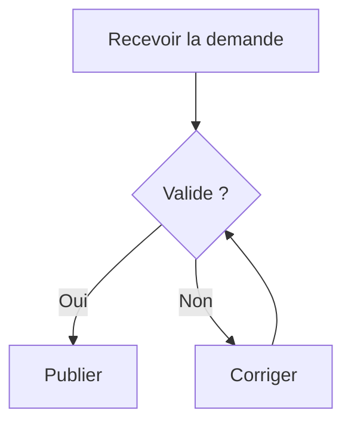

### Diagramme de séquence

Déclarez les participants et utilisez `as` pour les noms affichés. `->>` envoie un
message et `-->>` représente une réponse. Les alternatives utilisent
`alt` / `else` / `end` ; la répétition utilise `loop` / `end`.

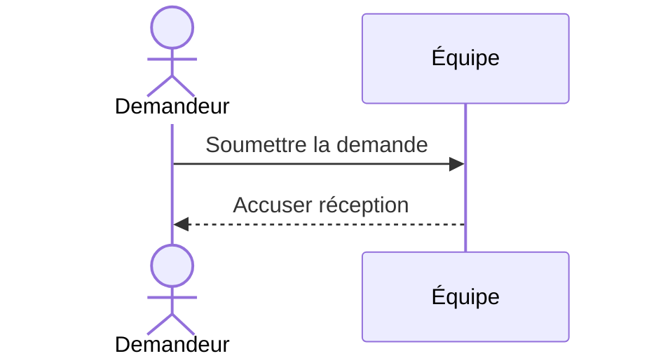

### Diagramme d'états

Utilisez `[*]` pour un début ou une fin et `: événement` sur les transitions. Un
état peut avoir un libellé affiché distinct de son identifiant.

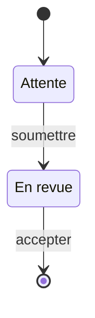

### Diagramme de classes

Placez attributs et méthodes entre accolades ; `+` est public et `-` privé.
Utilisez `<|--` pour l'héritage, `*--` pour la composition, `o--` pour
l'agrégation, `-->` pour l'association ou `..>` pour la dépendance, lorsque la
source établit ce sens.

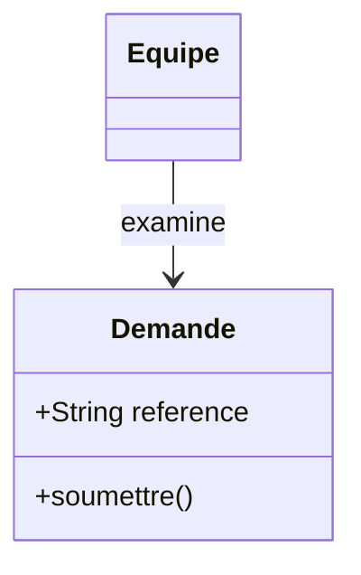

### Diagramme entité-association

Les extrémités de cardinalité utilisent `||` pour exactement un, `o|` / `|o` pour
zéro ou un, `o{` / `}o` pour zéro ou plusieurs et `|{` / `}|` pour un ou
plusieurs. `--` indique une relation identifiante et `..` une relation non
identifiante. Les attributs s'écrivent `type nom`, avec les marqueurs
facultatifs `PK`, `FK` ou `UK`.

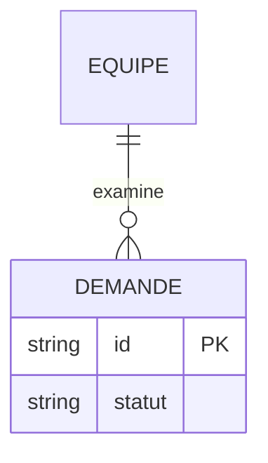

### Carte mentale (mindmap)

L'indentation définit la filiation. Gardez une seule racine et une indentation
cohérente entre éléments de même niveau. Préférez un logigramme quand les liens
transversaux comptent plus que la hiérarchie.

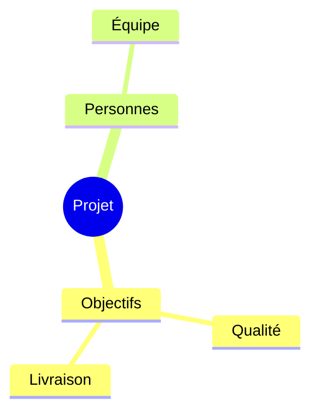

### Frise chronologique (timeline)

Écrivez `période : événement` dans l'ordre chronologique. Les périodes sont des
libellés, pas des durées ; `section Nom` peut regrouper les événements suivants.

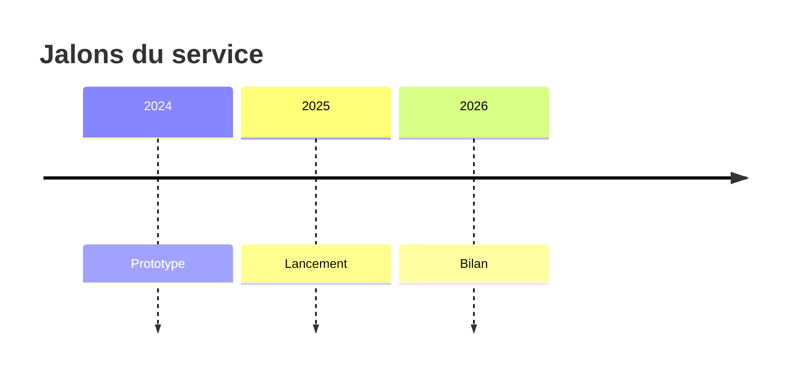

### Diagramme de Gantt

Déclarez `dateFormat`. Les tâches s'écrivent `libellé :id, début, durée` ;
`after id` exprime une dépendance. Utilisez des dates connues ou présentez
clairement un planning proposé.

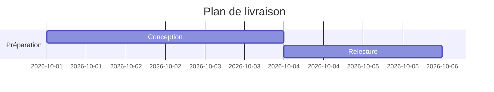

### Camembert (pie)

Utilisez `"Libellé" : valeur` pour quelques parts positives d'un même total
vérifié. Omettez les parts nulles et expliquez les exclusions. Les barres sont
plus claires pour des comparaisons précises.

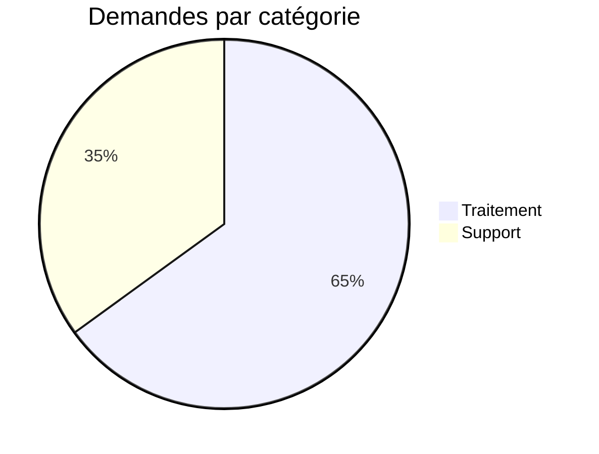

### Graphique XY en barres ou en courbe

Alignez chaque série sur ses catégories ; utilisez `line [...]` pour une
évolution ordonnée ou `bar [...]` pour des comparaisons. Indiquez les unités et
faites partir les barres de zéro. Une courbe n'est pas un nuage de points.
Laissez les trous visibles ; utilisez un tableau si ces formes ne peuvent pas
représenter fidèlement les données.

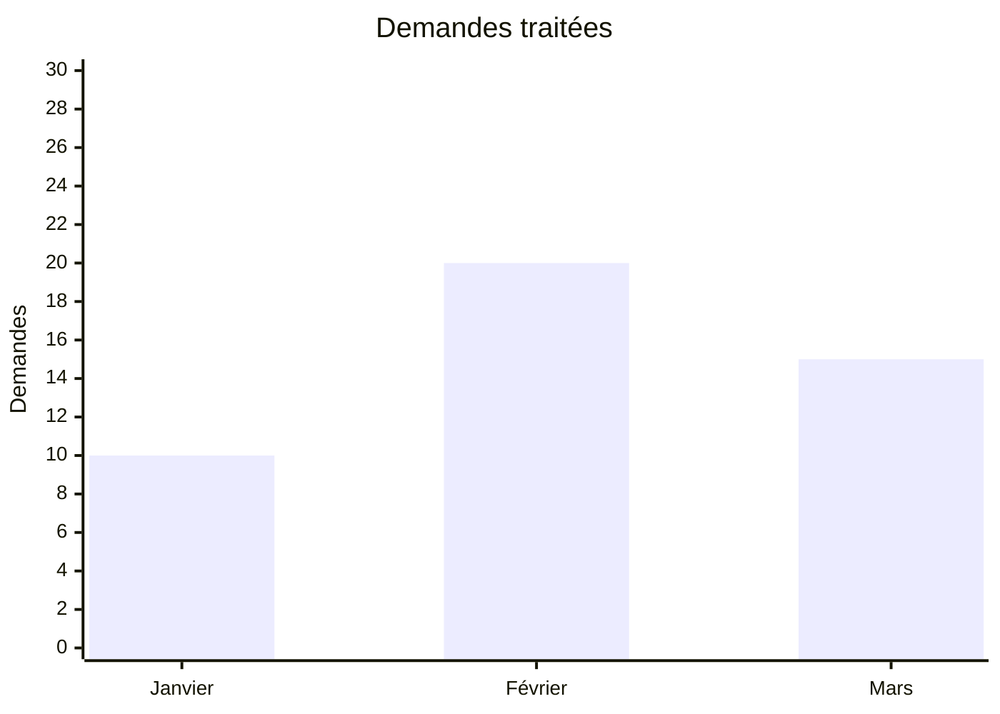

### Parcours utilisateur (journey)

Les tâches s'écrivent `Tâche: score: acteur1, acteur2`, avec des scores de 1 à 5.
Les scores doivent venir de la source ; utilisez un logigramme sans score quand
ils ne sont pas disponibles.

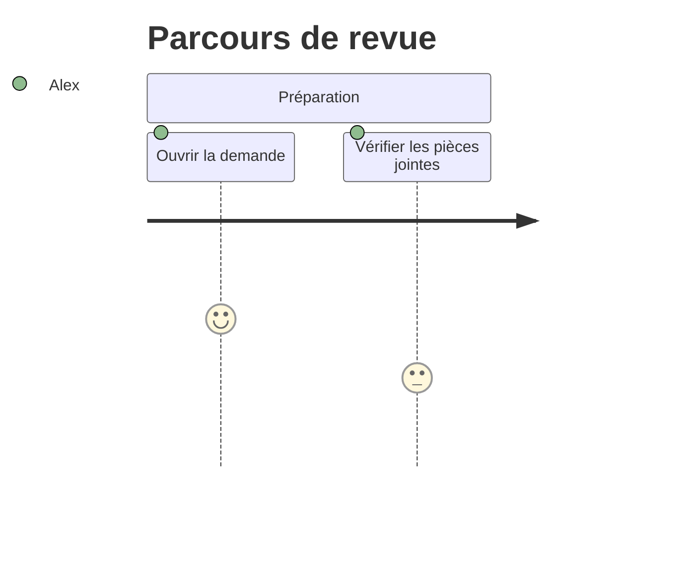

### Graphe Git

`branch` crée une branche et s'y place, `checkout` passe sur une branche
existante et `merge` fusionne une autre branche dans la branche courante.
Respectez la filiation réelle, ou présentez le graphe comme un flux hypothétique.

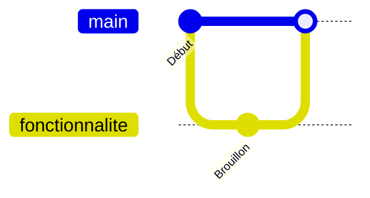

## Vérifier et livrer

- Gardez une instruction par ligne, fermez guillemets et blocs, et vérifiez
  chaque arête, cardinalité, date et valeur par rapport à sa source. Découpez
  les graphes trop denses en plusieurs vues.
- Utilisez du texte et les formes intégrées, avec le thème par défaut du chat.
  Les diagrammes doivent fonctionner sans images distantes, packs d'icônes,
  scripts, HTML ni extensions supplémentaires.
- Renvoyez directement dans le chat un bloc délimité `mermaid` complet,
  commençant par la déclaration du diagramme. Les cartes mentales utilisent
  aussi un bloc `mermaid`. Une visionneuse d'artefact HTML n'affiche pas le
  source Mermaid.
- Introduisez le résultat par une légende sur son sujet et expliquez les
  hypothèses importantes. N'évoquez le moteur de rendu que si l'utilisateur le
  demande.
- Les exemples suivent la base Mermaid 11.16.1 du chat. Repartez de ces formes
  pour corriger une syntaxe importée ou avancée. Lancez un analyseur ou un moteur
  de rendu local s'il est disponible et ne mentionnez que les vérifications
  réellement effectuées ; sinon, inspectez le source et simplifiez la syntaxe
  incertaine, ou proposez un tableau.
