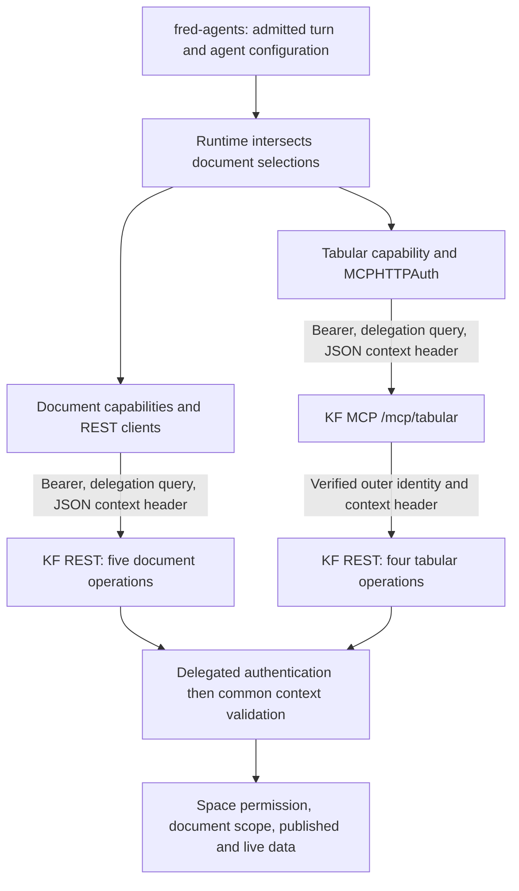

# Developer Guide – Knowledge Flow Backend

This guide explains how to understand, extend, and contribute to the Knowledge Flow microservice.

---

## API Structure: REST and MCP

Weaver's `main.py` mounts the capability backend under the configurable
`app.base_url`, defaulting to `/knowledge-flow/v2`. This is the Knowledge Flow
API contract version, independent of Fred 5.x, SDK package versions and the MCP
protocol version. Agent pods configure the matching `ai.knowledge_flow_url`.

The mounted operations are:

| Method | Path relative to the configured prefix | operationId |
| --- | --- | --- |
| POST | `/documents/search` | `search_documents` |
| GET | `/documents/{document_uid}/chunks` | `get_document_chunks` |
| GET | `/documents/{document_uid}/markdown` | `get_document_markdown` |
| POST | `/documents/{document_uid}/summarize` | `summarize_document` |
| POST | `/documents/{document_uid}/extract` | `extract_document` |
| GET | `/tabular/documents` | `list_tabular_documents` |
| GET | `/tabular/documents/schemas` | `describe_tabular_documents` |
| POST | `/tabular/query` | `query_tabular_documents` |
| POST | `/tabular/search` | `search_tabular_values` |

`document_uid` is a path parameter for document reads. Swagger UI and OpenAPI
are available at `<app.base_url>/docs` and `<app.base_url>/openapi.json` when enabled.
All nine operations require the document context described below.

The generated [API reference](API_REFERENCE.md) covers their schemas, defaults,
limits and error responses. [SDK-free integration examples](INTEGRATION.md)
show the REST wire contract. Both are code-derived technical documentation,
not evidence of functional validation. Regenerate with
`make -C docs/architecture knowledge-flow-reference` from the repository root.

`mount_fastapi_tools` in `mcp_mount.py` uses FastMCP to project the four REST
operations tagged `Tabular` at `<app.base_url>/mcp/tabular`. Their explicit
operationIds are the MCP tool names. No separate tabular business service is
introduced by this projection. The catalog keeps capability ID
`mcp-knowledge-flow-mcp-tabular` and resolves its relative `mcp/tabular` path
against the configured Knowledge Flow URL.

These declarations describe the mounted code contract, not end-to-end Weaver
validation. The document drive and ingestion admission belong to Control Plane.

## Document context contract

After the existing delegated authentication, all nine operations receive exactly
one `DocumentAccessContext` in `x-fred-document-context`. Its value is a JSON
object, serialized once directly into the HTTP header, without URL encoding or
base64. OpenAPI declares the header as required, with `content: application/json`
and a reference to `#/components/schemas/DocumentAccessContext`; its nested
`DocumentScope` and `DocumentSelection` schemas are included.

```json
{"space_id":"00000000-0000-0000-0000-000000000001","document_scope":{"selections":[{"folder_ids":["00000000-0000-0000-0000-000000000002"],"document_ids":[]}]}}
```

The runtime takes the space from the admitted turn, intersects the configured
agent scope with the turn selection, and constructs the header outside model
arguments. Document identifiers supplied to a tool and `dataset_uids` only narrow
that context. KF still checks the represented person's space permission and the
placement, publication and lifecycle of the requested documents. No per-tool
Control Plane authority resolution is introduced.



MCP hides the header from tool schemas, removes any inner supplied value, and
forwards only the outer request's value after the existing delegation check.
Only the four tabular operations are projected into MCP. REST callers need no
Fred Python dependency; an already authorized delegated caller can use:

```sh
curl --get "$KF_BASE_URL/documents/$DOCUMENT_UID/markdown" \
  --data-urlencode "person=$PERSON_ID" \
  --data-urlencode "run=$RUN_ID" \
  --data-urlencode "agent=$AGENT_ID" \
  --header "Authorization: Bearer $WORKLOAD_ACCESS_TOKEN" \
  --header 'x-fred-document-context: {"space_id":"00000000-0000-0000-0000-000000000001","document_scope":{"selections":[]}}'
```

`KF_BASE_URL` includes the configured prefix, normally `/knowledge-flow/v2`.
The workload token must satisfy existing delegation policy; this example grants
no new identity or authorization exception. REST clients send `person`, `run`
and `agent` in the existing query envelope for GET and POST, leaving business
JSON bodies strict. Neither the body nor query supplies document context.

### Missing, invalid and explicitly empty values

These context errors apply after delegated authentication:

| Input | Result |
| --- | --- |
| No `x-fred-document-context`, even with old context fields in query/body | 403, `document_context_required` |
| Empty header, malformed JSON, `null`, invalid UUID, missing required field or extra context field | 400, `invalid_document_context` |
| Valid context and `space_id` or `document_scope` in a business POST body | 422, forbidden extra field |
| Explicit `document_scope: {}` or `{"selections":[]}` | No additional selection filter; space, publication and lifecycle checks still apply |
| Explicit `document_scope: {"selections":[{}]}` | No documents selected; never falls back to the corpus |
| Requested `dataset_uids` outside the authorized selection | Existing tabular 403; no partial authorization of the requested list |

An empty scope (zero selection clauses) and an empty selection (one clause with
no folder or document) have different meanings. A missing context is neither.
Searching all authorized documents, even in a million-document corpus, transmits
the space UUID and an explicit unfiltered scope; it does not enumerate the corpus.
A folder selection carries folder UUIDs, not every contained document UUID.

### Request isolation and transport size

The shared REST connection pool carries no mutable document context. Each call
creates its own header dictionary; KF parses a fresh frozen context, containing
frozen scopes and tuple selections. Document controllers pass it as a local
argument; the tabular dependency builds a service for that request. Runtime
services are built per pod request, and admitted turns and verified MCP grants
use task-local `ContextVar` storage. MCP forwarding edits the individual outgoing
request, never shared client headers. Credential retries retain that request's
context. This describes code inspection, not an executed concurrency validation.

There is no Fred-specific header length cap or truncation. Header size grows
with explicit selection clauses and identifiers, not corpus size. A compact
context with one selection of 1,000 document UUIDs and no folder UUIDs occupies
39,120 ASCII bytes. The installed h11 implementation defaults to a 16 KiB bound
on incomplete request-line/header events: fragmented headers of that size can
be rejected before KF's context validation. Uvicorn's automatic protocol uses
httptools when installed (as in the current environment and the standard runtime
dependencies), otherwise h11. No deployment-independent limit is established
here for httptools or intervening proxies, and no live transport-size test was
run. Large explicit selections therefore need verification against the actual
HTTP server and proxy configuration; this lot adds no cap, compression, context
storage or reference mechanism.

## Processor Architecture

### Input Processors

Input processors extract structured content and metadata from uploaded files.

| Type     | Location            | Output        |
| -------- | ------------------- | ------------- |
| Markdown | `input_processors/` | Markdown text |
| Tabular  | `input_processors/` | Table rows    |

Each input processor specializes in a file type (PDF, DOCX, CSV, etc.).

### Output Processors

Output processors transform parsed content into embeddings or structured records.

| Type          | Location                                     | Output                           |
| ------------- | -------------------------------------------- | -------------------------------- |
| Vectorization | `output_processors/vectorization_processor/` | Embeddings + metadata            |
| Tabular       | `output_processors/tabular_processor/`       | Dataset-scoped Parquet artifacts |

---

## Vectorization Pipeline

```txt
  [ FILE PATH + METADATA ]
          │
          ▼
  DocumentLoaderInterface
          │
          ▼
   TextSplitterInterface
          │
          ▼
  EmbeddingModelInterface
          │
          ▼
   VectorStoreInterface
          │
          ▼
   BaseMetadataStore
```

Each interface is pluggable. You can switch OpenSearch → Pinecone, or Azure → HuggingFace by updating config and
implementing the interface.

---

## Tabular Pipeline

Knowledge Flow supports one tabular storage runtime for SQL querying:

| Runtime                 | What is stored                    | Main config                                 | Status      |
| ----------------------- | --------------------------------- | ------------------------------------------- | ----------- |
| Dataset-centric runtime | One Parquet artifact per document | `content_storage` + `storage.tabular_store` | Recommended |

### Recommended pipeline: dataset-centric runtime

The recommended tabular runtime is document-scoped rather than database-scoped.

```txt
  [ CSV INPUT ]
        │
        ▼
  CsvTabularProcessor
  - delimiter/encoding inspection
        │
        ▼
  TabularProcessor
  - DuckDB read_csv_auto(...)
  - COPY ... TO PARQUET
        │
        ▼
  Parquet artifact in content_storage
  + schema/row_count from Parquet metadata
        │
        ▼
  metadata.extensions["tabular_v1"]
        │
        ▼
  /tabular/datasets + /tabular/query
        │
        ▼
  DuckDB session with authorized views only
```

Important runtime rules for the recommended mode:

- Each document produces its own Parquet artifact under `storage.tabular_store.artifacts_prefix`.
- The main CSV-to-Parquet path is DuckDB-native and avoids loading the full dataset into a pandas DataFrame.
- Column names are normalized before export so the mounted dataset exposes stable SQL-safe names.
- ReBAC is enforced at document level before a dataset is exposed or mounted.
- Team/personal/library scope is applied before query aliases are shown to the caller.
- Read-only query validation accepts only `SELECT`/`WITH` statements and only against authorized mounted datasets.
- Remote MinIO/S3-compatible reads use backend-internal presigned URLs plus DuckDB `httpfs`.

### Legacy pipeline: SQL-backed tabular stores

The historical SQL-backed runtime has been removed.

- Keep the legacy design note only as migration context.
- Prefer the dataset-centric runtime for any endpoint, agent flow, or deployment.

---

## Knowledge Flow – Project Layout (Modularized)

This project uses a modular architecture that separates domain features from core infrastructure. Below is the directory
structure with roles and guidelines for extension.

---

### 🔩 Root Layout

```
knowledge_flow_backend/
├── main.py                       # FastAPI + MCP entrypoint
├── application_context.py        # Shared runtime context (DI / singleton-style config)
├── config/                       # YAML and Python-based configuration modules
├── common/                       # Shared types, utilities, exceptions
├── features/                     # DOMAIN LOGIC — Controllers, Services, Structures
├── core/                         # INFRASTRUCTURE — Stores, Processors, Pipelines
└── services/ (optional)          # Cross-cutting service logic if needed
```

---

### `features/` – Domain-Centric Components

Each folder inside `features/` implements a full vertical slice:

```
features/
├── tabular/
│   ├── controller.py             # Dataset-centric tabular REST/MCP endpoints
│   ├── service.py                # ReBAC-aware dataset resolution + DuckDB query runtime
│   └── structures.py             # Pydantic models for dataset/query requests and responses
├── vector_search/
│   ├── controller.py
│   ├── service.py
│   └── structures.py
└── metadata/
    ├── controller.py
    ├── service.py
    └── structures.py
```

📌 **Where to add a new API?**

- Create a folder in `features/`
- Add controller, service, and structures as needed

---

### `core/` – Infrastructure + Processing

```
core/
├── stores/
│   ├── base_metadata_store.py
│   ├── base_content_store.py
│   ├── vector_store/
│   │   ├── opensearch_vector_store.py
│   │   └── in_memory_vector_store.py
│   └── metadata_store/
│       ├── local_metadata_store.py
│       └── opensearch_metadata_store.py
│
├── processors/
│   ├── input/
│   │   ├── csv/
│   │   │   └── csv_tabular_processor.py
│   │   ├── docx/
│   │   ├── pdf/
│   │   └── ...
│   └── output/
│       ├── vectorization/
│       │   └── vectorization_processor.py
│       ├── tabular_normalization/
│       └── ...
│
└── pipelines/
    ├── vectorization_pipeline.py
    ├── tabular_pipeline.py
    └── ...
```

📌 **Where to add new file support?**

- Add an `input/your_type/` folder inside `core/processors`

📌 **Where to add embedding or normalization logic?**

- Use `core/pipelines/` and optionally create helpers in `output/`

---

### `common/` – Shared Types and Helpers

```
common/
├── structures.py                 # Shared Pydantic models
└── utils.py                      # Generic helpers
```

---

### `config/` – Pluggable Settings

Contains config classes (e.g., OpenAI, Ollama, GCS, MinIO):

```
config/
├── embedding_openai_settings.py
├── opensearch_settings.py
└── ...
```

---

### Developer Guidance

| Task                       | Location                                   |
| -------------------------- | ------------------------------------------ |
| Add a new REST API         | `features/your_feature/`                   |
| Add support for a new file | `core/processors/input/your_type/`         |
| Add a new vector store     | `core/stores/vector_store/`                |
| Change embedding backend   | `core/pipelines/vectorization_pipeline.py` |
| Customize ingestion flow   | `services/ingestion_service.py`            |
| Add business exceptions    | into your feature                          |

---

## ✅ Dev loop

```bash
make dev         # Setup .venv
make run         # Start FastAPI server
make test        # Run pytest
```

---

## 🧪 Testing

Use standard `pytest`. Tests live in `tests/`.

Run all:

```bash
pytest
```

Run specific:

```bash
pytest tests/test_vector_search_service.py
```

---

## 📚 Docs and Swagger

Docs available at: [http://localhost:8111/knowledge-flow/v2/docs](http://localhost:8111/knowledge-flow/v2/docs)

---

## 🤝 Contributions

Please follow the coding guidelines in `CODING_GUIDELINES.md` and submit PRs or issues via GitHub.

## Testing

```bash
make test
```

Use standard `pytest`. Tests live in `tests/`, and you can run individual files with:

```bash
pytest tests/test_ingestion.py
```

---

## Custom Configuration

- See [`config/configuration.yaml`](../config/configuration.yaml)
- Set environment variables in `.env` (based on `.env.template`)
- Configure AI backend in the `ai:` block (OpenAI, Azure, Ollama)

---
