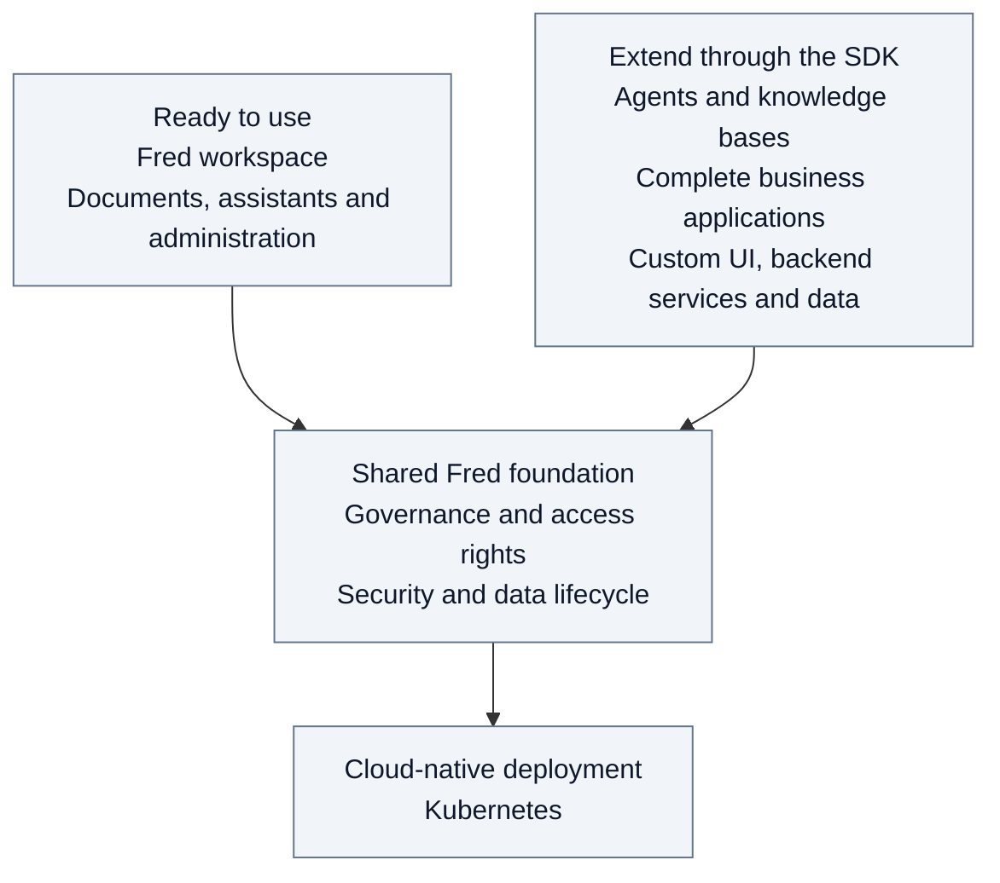

# 0. Introduction

Fred is an open-source platform that lets organizations use their knowledge
with AI while retaining control over data and its use. It brings together data
lifecycle management, access security and usage governance.

Fred provides a ready-to-use workspace for documents, AI assistants and
administration. Its SDK lets teams extend the platform with agents, knowledge
bases and complete business applications, including their own UI, backend
services and data, with or without agents. The platform and its extensions
follow a cloud-native deployment model based on Kubernetes.

## Spaces and access

Resources are organized into organization, team, project or personal **spaces**.
An **admin** manages business activity; an **owner** has a limited institutional
mandate. Access to content is a separate responsibility. The [security chapter](03-security.md)
explains these boundaries; the [roles annex](A11-roles.md) distinguishes agreed
responsibilities from current permissions.

## Agents, capabilities and models

| Concept | Meaning |
| --- | --- |
| **Agent instance** | An assistant configured in a working space. |
| **Capability** | A function available to an agent, such as document search. |
| **Model** | An AI service used for inference. |

## Reading this dossier

- [System overview](01-system-overview.md): components, responsibilities and interactions.
- [Journeys](02-journeys.md): access, document ingestion and conversations in practice.
- [Security](03-security.md): identity, permissions and isolation boundaries.
- [SDK documentation](../../libs/fred-sdk/README.md): authoring agents and Knowledge Bases.

The journeys use the fictional organizations Acme and Globex; their people,
spaces and role grants are defined in the [example conventions](02-journeys.md#example-people-and-spaces).
