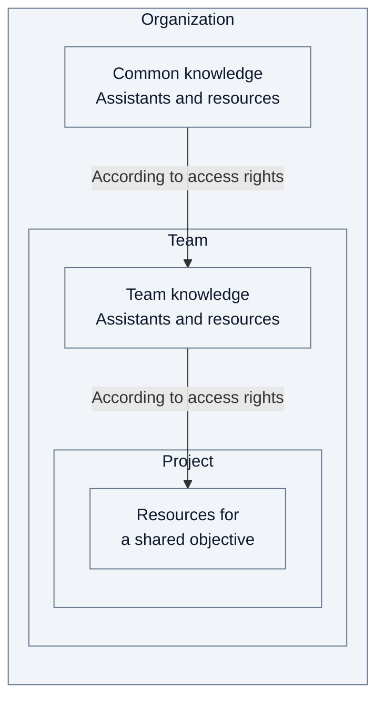

# 0. Introduction

Fred is an open-source platform for working with knowledge and AI assistants.
In the UI, people work in an **organization**, join **teams** and collaborate on
**projects**, with documents and assistants available according to their rights.

## Organizations, teams and projects

Each project belongs to a team; each team belongs to an organization.
Behind these familiar places is one simple concept: a **space** brings together
resources, configured assistants and access rights. The same model serves all
three levels and personal spaces, so Fred and its extensions use a consistent
boundary for their data and permissions.

**Sharing a space does not share conversations.** Roles apply where they are
granted; they do not automatically extend to another space. Access to shared
resources does not open another person's conversations.

In a collective space, the **Owner / Responsable** governs business uses.
**Editors** contribute, **analysts** read and evaluate, and **members** read and
use authorized assistants. Technical **Admins** have separate, limited duties.
Management alone grants no content access; people can hold several roles.
[Spaces](04-organizations.md) and [security](03-security.md) explain the boundaries.

## Use Fred or extend it

Fred supplies a workspace for documents, assistants and administration. Developers
can also supply their own Agent Pods and applications through its SDK. An Agent
Pod hosts agents and their tools; Fred provides a native pod. The
[system overview](01-system-overview.md) explains their responsibilities, and
[journey 2.3](02.3-agent-administration.md) follows an assistant from configuration
to a useful result in a space.
