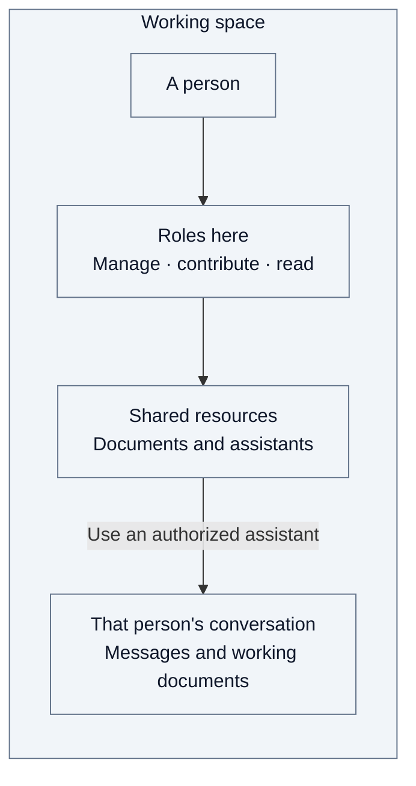

# 0. Introduction

Fred is an open-source platform for working with knowledge and AI assistants.
Its central concept is the **space**: a work perimeter that brings together
resources, configured assistants and people's access rights.

## Start with the space

**Shared space does not mean shared conversations.** Access to a space's resources
does not open another person's conversations. Roles apply to the space where they
are granted; they do not automatically extend to other spaces.

In a collective space, the **Owner / Responsable** governs business uses. **Editors** contribute,
**analysts** read and evaluate, and **members** read and use authorized assistants.
Technical **Admins** have separate, limited duties. Management alone grants no
content access; people can hold several roles.

Collective spaces form an organization → team → project hierarchy. A personal
space is individual. These distinctions matter where a rule depends on the level;
otherwise the journeys simply speak of a space. [Spaces](04-organizations.md)
and [security](03-security.md) explain the boundaries.

## Use Fred or extend it

Fred supplies a workspace for documents, assistants and administration. Developers
can also supply their own Agent Pods and applications through its SDK. An Agent
Pod hosts agents and their tools; Fred provides a native pod. The
[system overview](01-system-overview.md) explains their responsibilities, and
[journey 2.3](02.3-agent-administration.md) follows an assistant from configuration
to a useful result in a space.
