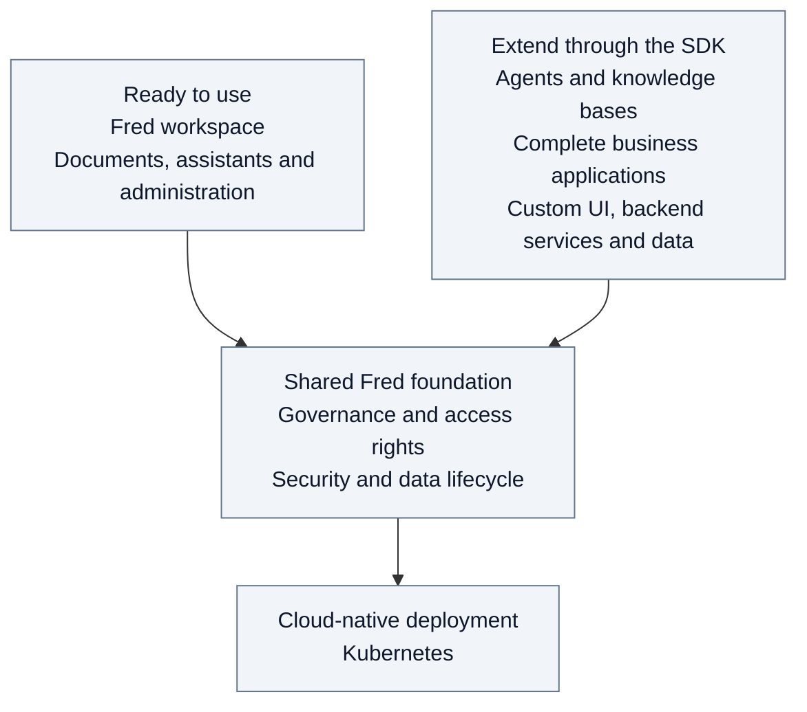
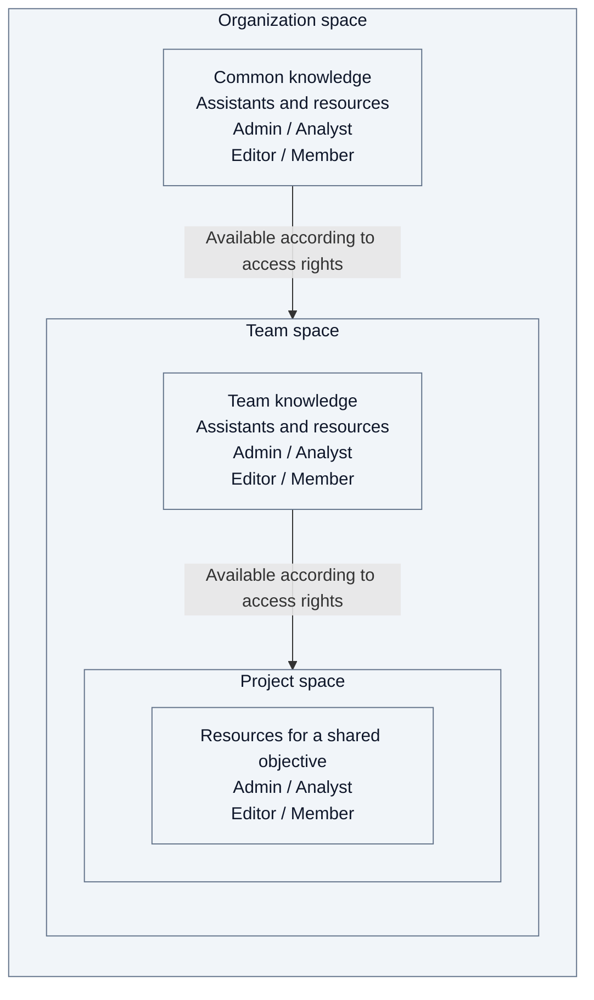

# 0. Introduction

Fred is an open-source platform that lets organizations use their knowledge
with AI while retaining control over data and its use. It brings together data
lifecycle management, access security and usage governance.

Fred provides a ready-to-use workspace for documents, AI assistants and
administration. Its [SDK](../../libs/fred-sdk/README.md) lets teams extend the platform with agents, knowledge
bases and complete business applications, including their own UI, backend
services and data, with or without agents. The platform and its extensions
follow a cloud-native deployment model based on Kubernetes.

## A shared foundation for collaboration

This shared foundation organizes collaboration into three levels: **organization,
team and project**. Each provides a **space** for shared knowledge, assistants and
business resources. This structure supports both Fred's native workspace and
applications built on its foundation.

The organization holds common resources. Teams organize their own work; projects
focus collaboration within a team. Subject to [access rights](03-security.md),
a team can use organization resources, and a project can use resources from both
its team and organization.

The same [four roles](A11-roles.md#reference-roles) apply at every level:
**admins** manage the workspace and its community, **analysts** evaluate agents
and their use, **editors** contribute content, and **members** consult it.
Management and content access remain separate permissions; a person can combine
roles.

Each project belongs to a team; each team belongs to an organization. The nested
spaces show where collaboration happens; the arrows show how shared resources
support it.

The [system overview](01-system-overview.md) explains how Fred's components deliver
this foundation. The [journeys](02-journeys.md), with their
[example people and spaces](02-journeys.md#example-people-and-spaces), show it in use.
