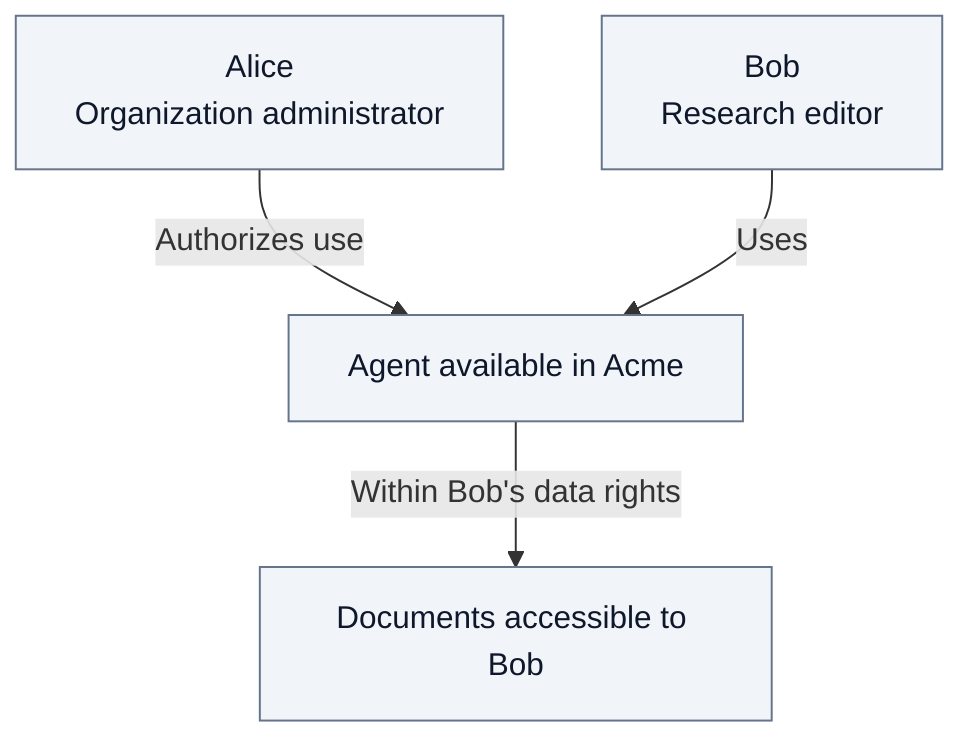
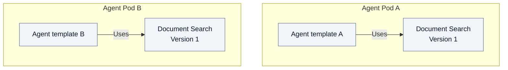

# 0. Introduction

Fred lets an organization offer AI assistants over its knowledge while keeping
control of who can use them and which data they may access. Its document drive
organizes shared work into teams and projects, alongside private personal spaces.

## People, roles and rights

Signing in establishes identity. A **role**, granted in a particular **space**,
determines what that person may do. Administration and content access are separate:
managing an organization does not automatically allow reading its documents.

**Who authorizes what?** The organization permits agent use; the person's rights
limit accessible data. This is a functional view.

Bob's Research role in Acme grants no access to Globex's Support documents. Personal spaces
inherit no content rights from the organization. Explicit role combinations and
inheritance are explained in the [security chapter](03-security.md).

## Agents, capabilities and models

An **Agent Pod** is a logical runtime that supplies executable agent templates.
Several deployment replicas can serve the same pod identity. A configured **instance**
of a template belongs to a working space. A **capability** is a function embedded
in that pod, such as Document Search. A **model** supplies inference; it can be
hosted outside the pod. Control Plane maintains the model catalog and each
organization's permitted choices; the Agent Pod calls the selected model.

**Where does a capability belong?** Each offering belongs to exactly one Agent
Pod, with its own version and configuration. This diagram shows logical ownership;
both pods reuse the same Python library.

Shared code supports **independent delivery**: each team can adopt a library
release without waiting for other pods. Model sources and organization model
permissions are managed separately from these pod-owned capabilities.

An organization authorizes agents, restricts usable models and inspects each pod's
capabilities. Capabilities have no separate user-permission matrix. Data access
and approved external connections retain their own controls: enabling an agent
neither grants document access nor approves a new destination for data.

The [first-chat journey](02.3-agent-administration.md) follows Alice authorizing
models for Acme and Bob choosing one for his assistant. It distinguishes a model
being discovered, permitted and selected.

## Conventions used throughout this dossier

The following fictional people and spaces keep examples consistent. Acme contains
Research; Globex contains Support. Each person belongs to only one organization.
Names identify the examples; permissions come from explicit role grants.

The platform account **`owner`** is created through the registration form and
activates platform ownership with the bootstrap token. It governs organizations
and appoints their owners and administrators, without automatic content access.
**Dana** is the infrastructure operator in the model-service examples: she
configures approved connections and credentials. This operational responsibility
does not introduce another demo account or grant business content rights.

| Function | Acme | Globex | Direct role at that scope |
| --- | --- | --- | --- |
| Organization owner | **Oscar** (`oscar`) | **Olivia** (`olivia`) | `organization_owner` on the organization |
| Organization administrator | **Alice** (`alice`) | **Grace** (`grace`) | `admin` on the organization |
| Team | **Research** | **Support** | - |
| Team administrator | **Carl** (`carl`) | **Marc** (`marc`) | `admin` on the team |
| Team analyst | **Elena** (`elena`) | **Nadia** (`nadia`) | `analyst` on the team |
| Team member | **Carol** (`carol`) | **Phil** (`phil`) | `member` on the team |
| Team editor | **Bob** (`bob`) | **Zoe** (`zoe`) | `editor` on the team |

Each of the four team personas also holds `member` directly on their organization,
the prerequisite for a team role. This parent role grants organization-level read
access but does not descend into teams. Owners and organization administrators
hold only their listed governance role; none of these twelve people holds a
platform role. Carl can administer Research without reading its documents; Bob
can read and contribute; Carol and Elena can read. Member stays local, whereas
analyst also reaches descendant projects when a scenario introduces one.

The demo bundle supplies these twelve organization accounts and two teams. The
platform account is bootstrapped separately. Additional projects, role combinations
and personal-space eligibility are stated explicitly in the relevant examples;
the basic demo does not create projects or grant personal-space eligibility.
