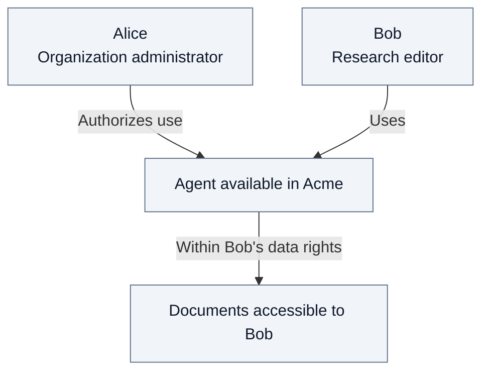
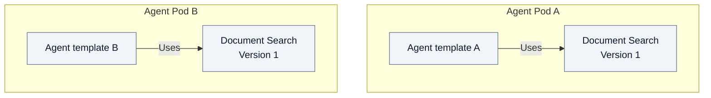

# 0. Introduction

Fred lets an organization offer AI assistants over its knowledge while keeping
control of who can use them and which data they may access. Its document drive
organizes shared work into teams and projects, alongside private personal spaces.

## People, roles and rights

Signing in establishes identity. A **role**, granted in a particular **space**,
determines what that person may do. Administration and content access are separate:
managing an organization does not automatically allow reading its documents.

**Who authorizes what?** The organization permits agent use; the person's rights
limit accessible data. This is a functional view.

Bob's Research role grants no access to Support documents. Personal spaces
inherit no content rights from the organization. Explicit role combinations and
inheritance are explained in the [security chapter](03-security.md).

## Agents, capabilities and models

An **Agent Pod** is a logical runtime that supplies executable agent templates.
Several deployment replicas can serve the same pod identity. A configured **instance**
of a template belongs to a working space. A **capability** is a function embedded
in that pod, such as Document Search. A **model** supplies inference; it can be
hosted outside the pod. Control Plane maintains the model catalog and each
organization's permitted choices; the Agent Pod calls the selected model.

**Where does a capability belong?** Each offering belongs to exactly one Agent
Pod, with its own version and configuration. This diagram shows logical ownership;
both pods reuse the same Python library.

Shared code supports **independent delivery**: each team can adopt a library
release without waiting for other pods. Model sources and organization model
permissions are managed separately from these pod-owned capabilities.

An organization authorizes agents, restricts usable models and inspects each pod's
capabilities. Capabilities have no separate user-permission matrix. Data access
and approved external connections retain their own controls: enabling an agent
neither grants document access nor approves a new destination for data.

The [first-chat journey](02.3-agent-administration.md) follows Alice authorizing
models for Acme and Bob choosing one for his assistant. It distinguishes a model
being discovered, permitted and selected.

## Conventions used throughout this dossier

The following fictional people and spaces keep examples consistent. Names are
labels for the reader, never credentials or permission rules.

| Name | Role in the examples |
| --- | --- |
| **Acme** | The example organization, containing the Research and Support teams. |
| **Dana** | Platform operator; configures approved model services and their credentials, without acquiring business content rights. |
| **Alice** | Acme's organization administrator; no content role unless stated. |
| **Bob** | An editor in Research; he contributes documents and configures agent instances when authorized. |
| **Carol** | A member of Support; she reads its content and has no Research role. |

Alice's administrator role is distinct from organization ownership. A platform
owner creates organizations and appoints their owners and administrators; that
role also grants no automatic document access. Examples introduce additional
roles or personal-space eligibility explicitly. Repository fixtures may use other
names; technical annexes identify them without changing these conventions.
