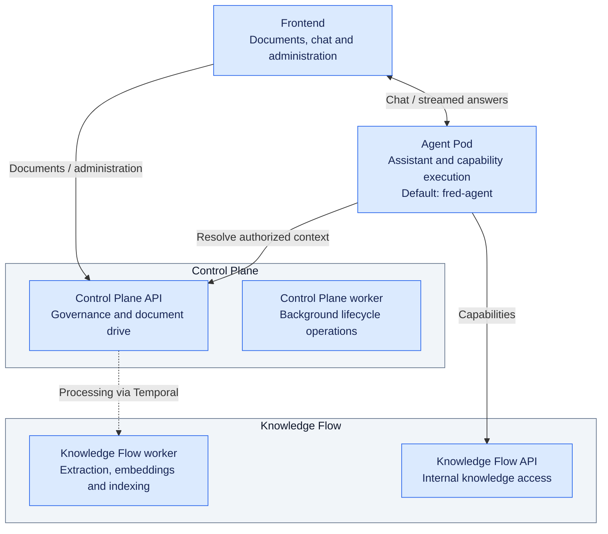
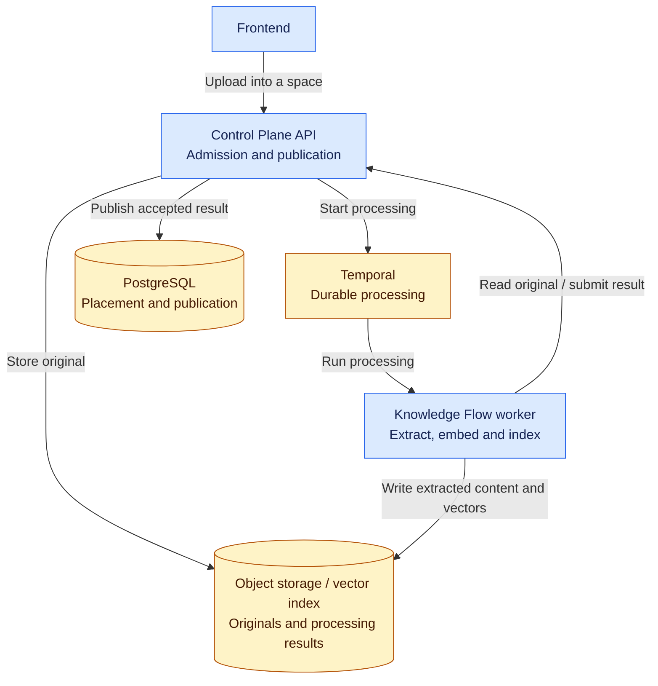
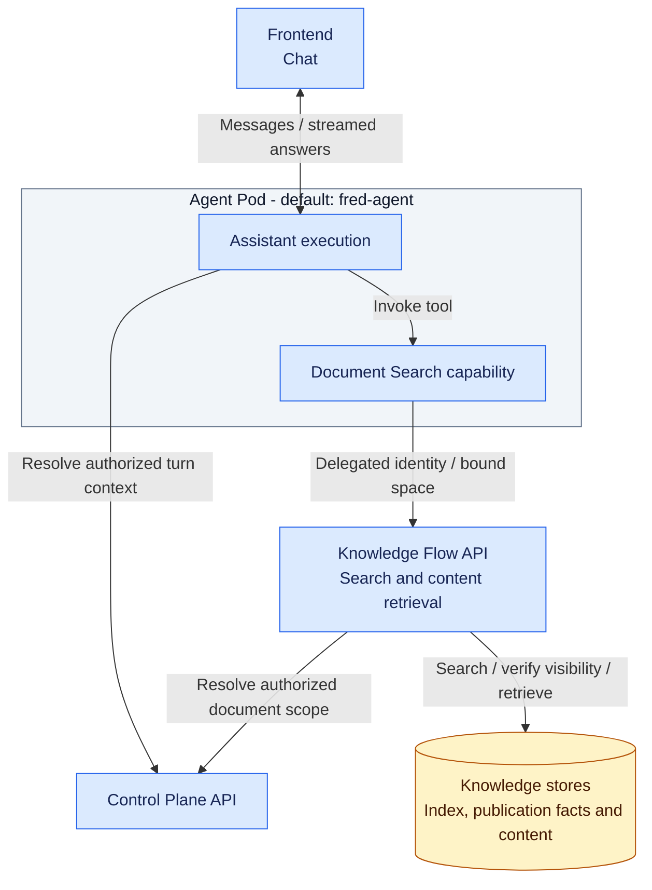
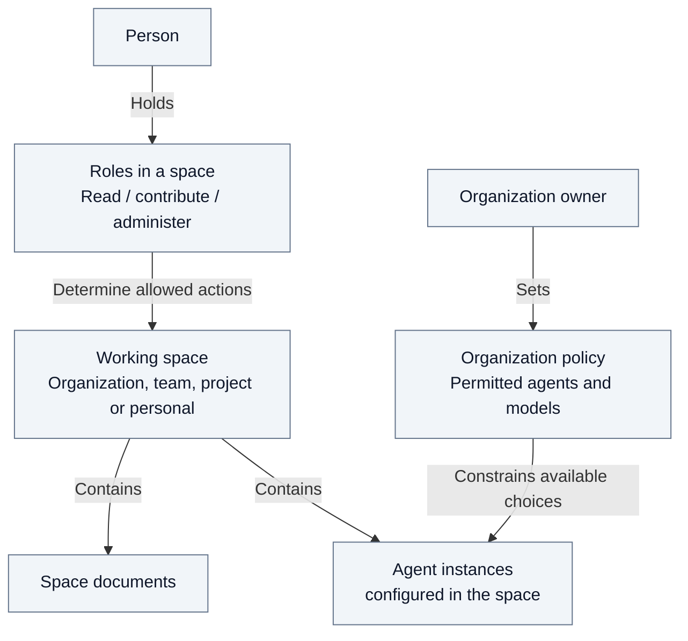
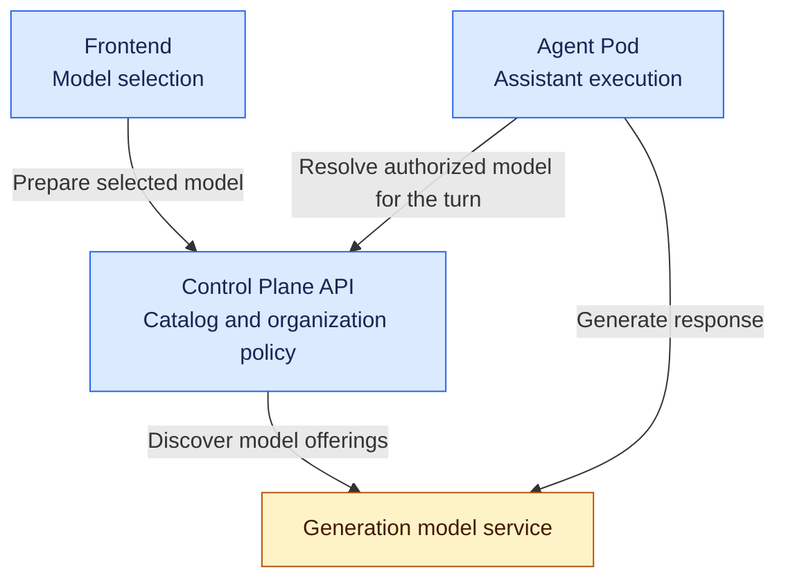
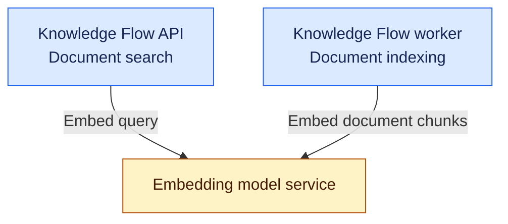

# 1. System overview

The following views describe Fred's core platform, which supports both its
ready-to-use workspace and SDK extensions, through document ingestion, agent
access, governance and model use.

## 1.1. Six components and their responsibilities

The frontend provides the workspace for documents, conversations and
administration. It calls Control Plane API for resource management and Agent Pods
directly for chat. An Agent Pod is a runtime that hosts agents and their
capabilities. Fred supplies `fred-agent` as its default Agent Pod.

Control Plane API governs spaces, access and document operations; its worker
handles lifecycle cleanup, including space deletion. Knowledge Flow worker
extracts and indexes document content, while Knowledge Flow API serves that
knowledge to agent capabilities through internal endpoints.

**Legend:** 🟦 Fred · 🟨 COTS · 🟪 Extensions · ⬜ Concepts

These are six logical responsibilities. Control Plane API and its worker
currently share a process. The dotted arrow represents asynchronous processing
coordinated through Temporal, the workflow engine.

## 1.2. Ingestion: the path from a document to knowledge

A document enters Fred through Control Plane API, within a space where the user
may contribute. Control Plane stores the original and starts processing through
Temporal. Knowledge Flow worker extracts content, computes embeddings (numerical
representations used for semantic search) and writes the processing results.

Control Plane controls publication: producing an artifact does not by itself
make it available. Document placement, lifecycle and publication state determine
which results can be exposed. The
[document journey](02.2-document-journey.md#concurrent-imports-and-publication)
explains the coordination of concurrent imports and publication; the
[open performance question](A10-open-issues.md#oi-1-document-write-concurrency)
records the evidence needed to assess its cost under load.

## 1.3. Agents: accessing knowledge during a conversation

The Agent Pod resolves the user's authorized execution context with Control
Plane for each turn. When the assistant needs documents, it invokes a capability
that calls Knowledge Flow API on the user's behalf, using their delegated
identity and the space bound to that turn.

Knowledge Flow API checks the user's access to the requested space, searches
the index and verifies document visibility before returning content. The
capability stays with the agent; knowledge retrieval and storage access stay
with Knowledge Flow.

## 1.4. Governance: administering resources by space

The organization owner sets business choices, including permitted agents, models
and the capabilities each Agent Pod offers. Each person's
space roles determine what they may
manage, contribute to or read. The owner's separate institutional mandate and
the precise role boundaries are defined in the [roles annex](A11-roles.md).

An assistant must satisfy both controls: the organization's usage policy and
the person's access rights in the working space. The [security chapter](03-security.md)
defines inheritance and isolation rules.

## 1.5. Models: authorization, selection and invocation

**Assistant model: selection and execution**

Control Plane maintains the model catalog and the organization's permitted
choices. The user selects an available model; the Agent Pod resolves the
authorized choice for the turn, calls the model service and streams the answer
directly to the frontend.

**Knowledge embeddings: indexing and search**

Knowledge Flow also uses models: its worker embeds document chunks during
indexing, and its API embeds queries during search. This embedding configuration
is separate from the generation model selected for a conversation.

