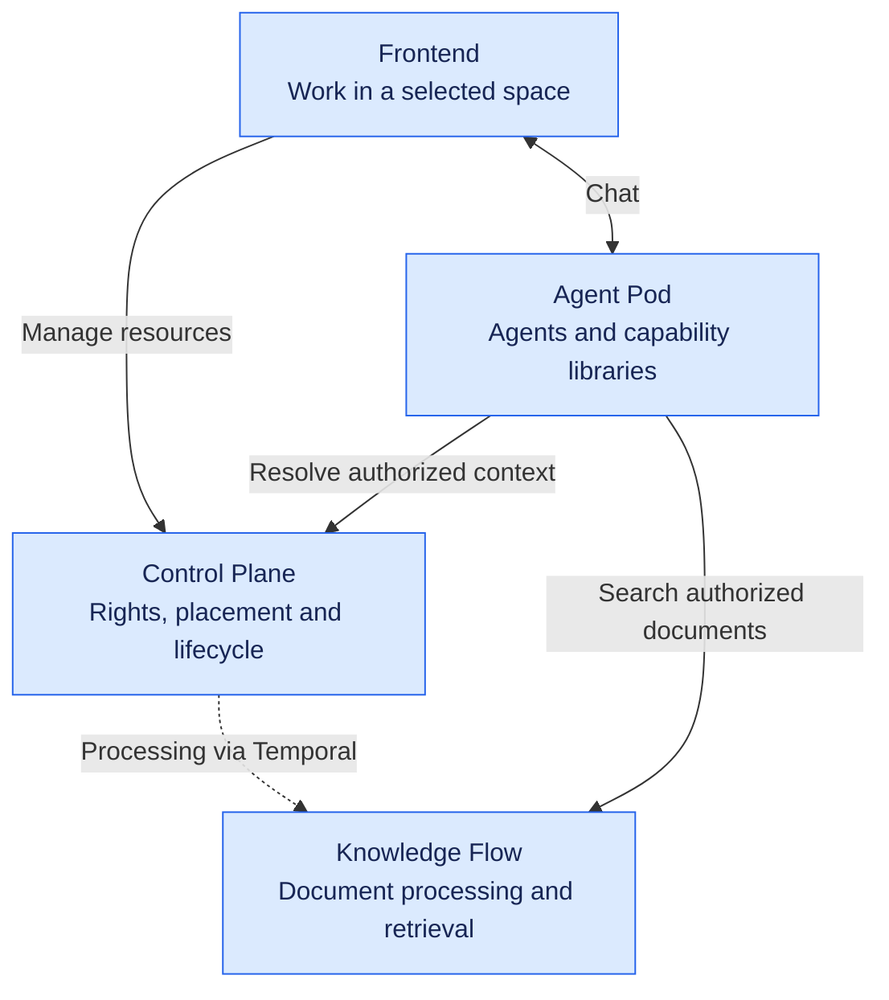
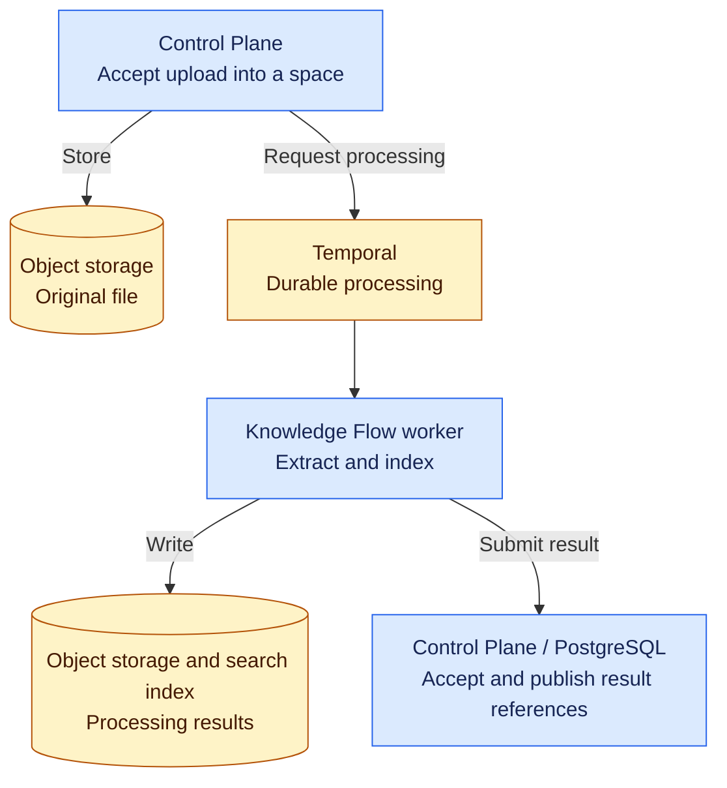
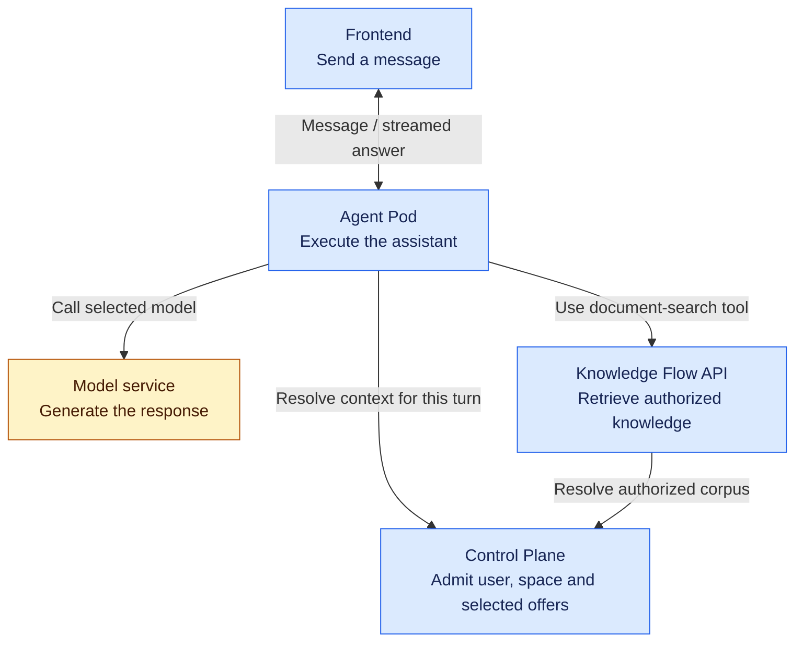
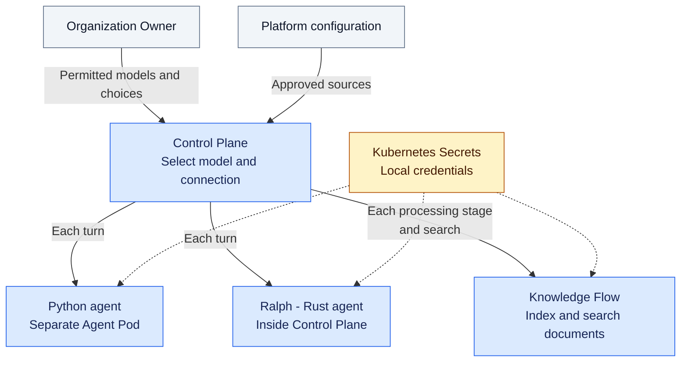
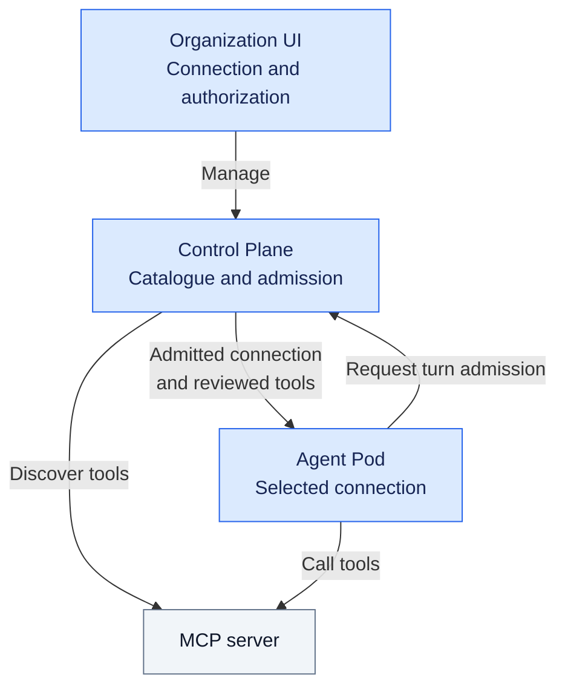

# 1. System overview

The [space](00-introduction.md#organizations-teams-and-projects) is a work perimeter, not a
separate deployment. Fred's components carry its identity and the user's authority
through each operation. They serve many spaces without merging their access rights.
The [resource map](06-resources.md) compares ownership, storage and lifecycle boundaries.

**Legend:** 🟦 Fred · 🟨 COTS · 🟪 Extensions · ⬜ Concepts

## 1.1. Components serving the space

Control Plane owns placement, access decisions and model governance. Agent Pods execute assistants;
Fred supplies `fred-agent`, and developers can provide other pods. Capability
libraries belong to their pod. Knowledge Flow processes documents and serves
knowledge through its API. Each backend also has background work: grouping it
here with its owner does not imply a single process or replica.

## 1.2. Importing a document

File bytes live in object storage; PostgreSQL records their placement and
publication. Knowledge Flow reads the authorized original through Control Plane.
Producing a file does not publish it: Control Plane accepts the result before
exposing it. The [document journey](02.2-document-journey.md) explains the user
experience; the [storage annex](A9-documents.md) details coordination and cleanup.

## 1.3. Answering in a conversation

The pod obtains an authorized context for each turn. Selecting an assistant or
model in the browser does not grant execution. Document search uses the person's
authority within the conversation's space and permitted ancestor resources;
it does not give the model unrestricted access. The answer streams from the pod
to the frontend. Knowledge Flow embeds the question with the corpus model of the
space's organization, not with the conversation's generation model.

Organization-level policy limits which models, pod offers and MCP connections
may be used; local capability restrictions can narrow it. Roles in the working
space determine what the person may do. [Security](03-security.md) explains these two controls;
[journey 2.3](02.3-agent-administration.md) shows how people use them.

## 1.4. Model decisions and credentials

Control Plane decides every remote model call Fred makes for an organization, from
one organization policy that the Owner administers in **Models**. For agents, it
selects the chat model at admission of each turn, using the working space's
organization policy, the assistant's recommendation and the user's choice. For the
organization's documents, the policy names the embedding model, an optional
image-description model, and the default chat model that document tools such as
summary and extraction use. Team and project execution do not introduce separate
model policies, and no component chooses a remote model in its own configuration.

Models packaged with a workload are a different boundary: the search reranker, OCR
and audio transcription run inside Knowledge Flow, send no document to a provider,
and are configured with the deployment, not by the organization policy.

Each consumer verifies the admitted decision against its local credential binding
before calling the provider. The decision carries a credential reference, never its
value. Browser preparation exposes neither that connection nor a secret. Startup
supplies credentials; it does not fix a model for the process's lifetime.

An organization's documents form one corpus in its own vector index, embedded with
one model. The first indexing locks that choice, since an index cannot mix embedding
spaces; changing it would require reindexing every document, which Fred does not
offer yet. Documents are not processed before an embedding model is chosen, and an
unusable corpus model stops processing and search instead of being replaced. The
[model reference](A13-models.md) connects these boundaries to the SQL schema,
configuration types and runtime contracts, including the narrower transport that
Ralph and Knowledge Flow support.

## 1.5. From an MCP connection to an agent's tools

An external MCP (Model Context Protocol) connection gives an assistant access to
a tool server. It belongs to a space. Its current management scope is the
organization, through **Features > MCP**. Control Plane retains the connection and
reviewed inventory; it exposes an offer through the existing capability catalogue.
A compatible Agent Pod executes the selected tools.

The endpoint and any required credentials must work from the executing pod as
well as from Control Plane. A credential reference is not a secret value or an
authorization. The [administration journey](02.3-agent-administration.md#models-and-mcp)
separates discovery, validation and use; the
[technical boundary](A13-models.md#mcp-connection-boundary) traces the runtime contract.

Knowledge Flow Tabular is an internal Fred capability. Its ordinary organization
and space authorization is sufficient; it has no administrable MCP connection.
Control Plane supplies the trusted destination at admission, and the Agent Pod
uses the shared MCP transport with the person's delegation and document scope.
There is no separate availability check or activation: a service outage is an
execution failure, not a change to the capability policy.
