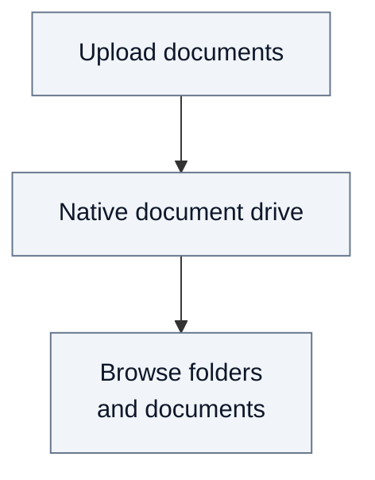
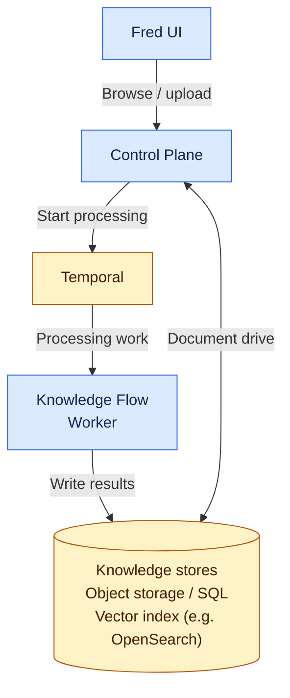

# 1. System overview

## 1.1. Functional overview: the native document drive

Users upload documents to their space and browse its folders and files.
Their roles determine which content they can read and where they can contribute.

## 1.2. Technical view: knowledge ingestion and storage

**Legend:** 🟦 Fred · 🟨 COTS · 🟪 Extensions · ⬜ Concepts

**Control Plane** serves the document drive and receives ingestion requests.
It starts processing through Temporal; **Knowledge Flow** is the worker that
executes the pipelines and produces the stored results.

