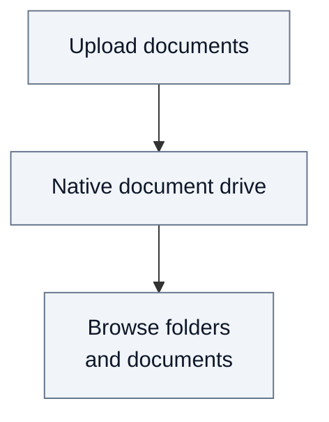
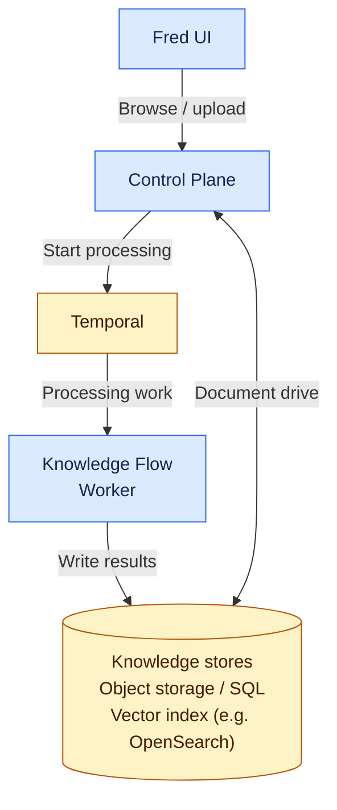
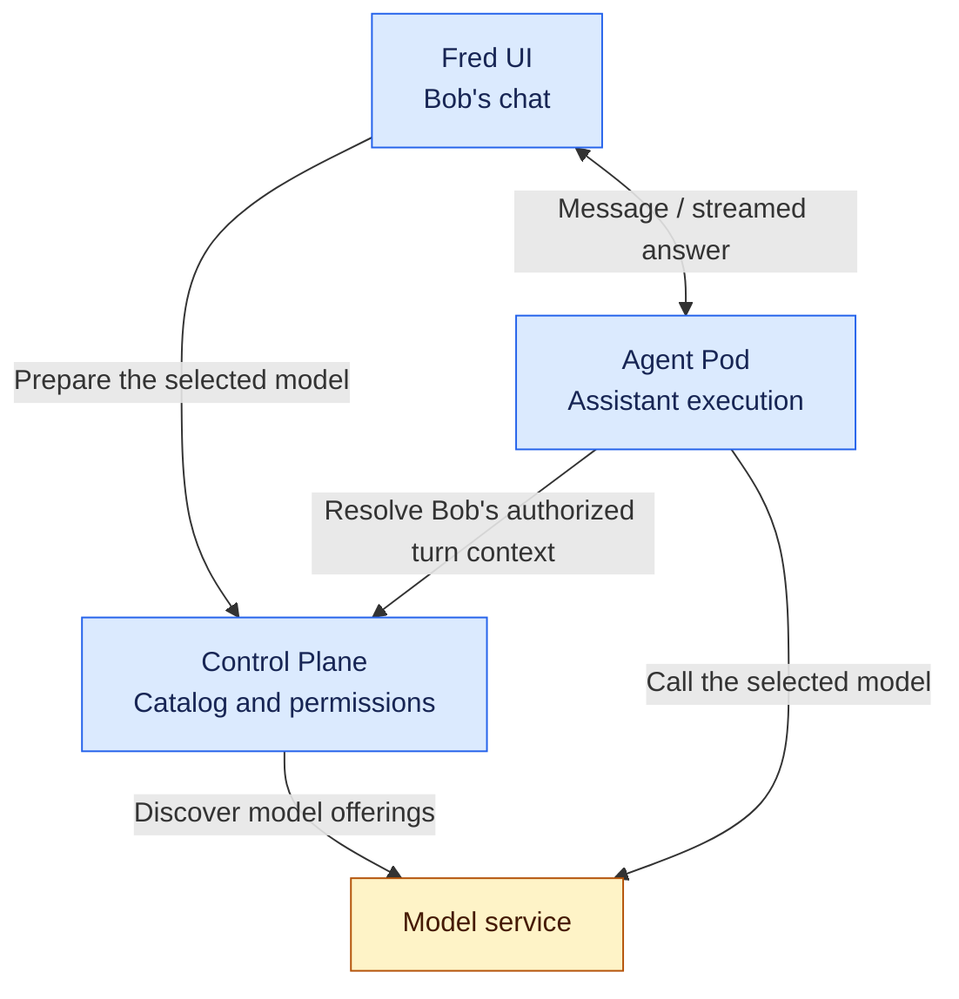
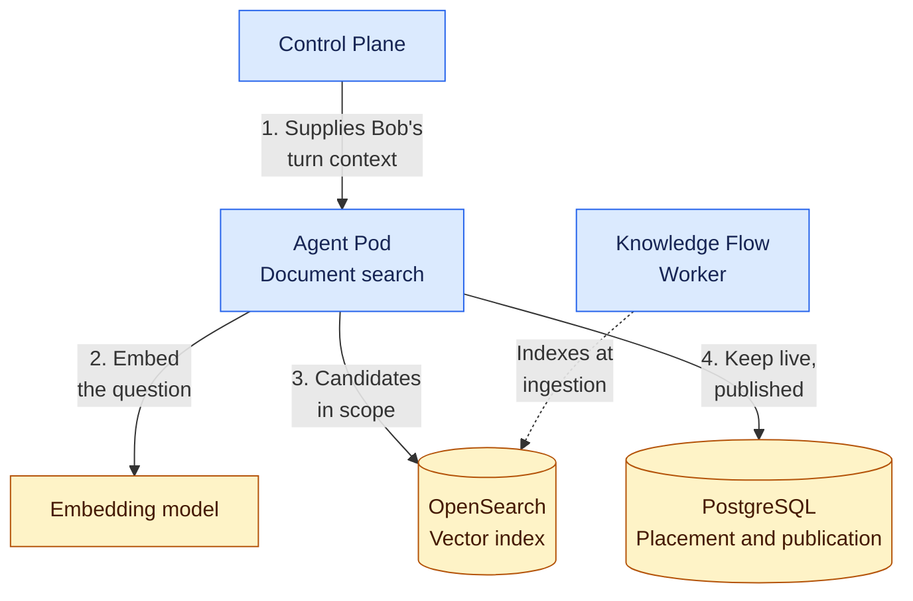

# 1. System overview

Fred separates governance from execution. Control Plane manages spaces, access
and model choices. Knowledge Flow processes documents; Agent Pod runs assistants.
The following views separate document ingestion from a conversation.

## 1.1. Functional overview: the native document drive

Users upload documents to their space and browse its folders and files.
Their roles determine which content they can read and where they can contribute.

## 1.2. Technical view: knowledge ingestion and storage

**Legend:** 🟦 Fred · 🟨 COTS · 🟪 Extensions · ⬜ Concepts

**Control Plane** serves the document drive and receives ingestion requests.
It starts processing through Temporal; **Knowledge Flow** is the worker that
executes the pipelines and produces the stored results.

## 1.3. Coordinating document writes

Control Plane decides when an original or a processing result becomes available.
PostgreSQL holds its placement, lifecycle and publication state; OpenFGA holds
permissions. Their changes do not share a single transaction. Control Plane
coordinates authorization checks and publication with an organization-wide
PostgreSQL lock and version guards in OpenFGA. The lock prevents participating
mutations from interleaving between their checks and their commit; the guards
also reject stale remote writes. Together with database constraints, this
preserves current authority, lifecycle rules and shared quota reservations.

The organization lock is held for reservation and publication, including their
authorization calls, not for file transfer, extraction or embedding computation.
These sections run one at a time across the organization's teams and across all
Control Plane replicas. Document reads and standalone permission checks do not
take this write lock. Sections are intended to be short; their actual duration
and accumulated waiting depend on load and dependency latency.

The [document journey](02.2-document-journey.md#concurrent-imports-and-publication)
illustrates the guarantee. [Open Issues](A10-open-issues.md#oi-1-document-write-concurrency)
records the retained design and the evidence needed to assess its performance.

## 1.4. Model governance and agent execution

**Who checks Bob's choice, and who calls the model?** Control Plane owns the
catalog, Acme's permissions and the chat's preparation check. Agent Pod executes
the assistant using the context supplied by Control Plane.

Control Plane does not relay the model response. The pod still resolves the final
selection and enforces it at execution, using the organization's policy rather
than a separate pod-owned model catalog. An early preparation result is not an
execution grant. See the [Acme journey](02.3-agent-administration.md) for the user
view and [admission details](A2-manager-contracts.md#chat-model-preparation-and-turn-admission)
for the technical boundary.

## 1.5. Document search during a conversation

**Which components answer the assistant's document search?** Agent Pod performs
it within the turn. Knowledge Flow only builds the index at ingestion; it is not
called during a conversation.

The space comes from the turn context resolved by Control Plane, never from the
model's tool arguments. The scope is that space and its parents. The index only
proposes candidates; PostgreSQL decides. A passage reaches the model only if its
document is in scope, not deleted, retrievable, and part of the published
processing result. The pod reads these stores with its infrastructure
credentials; they authenticate the pod, not Bob's rights.
