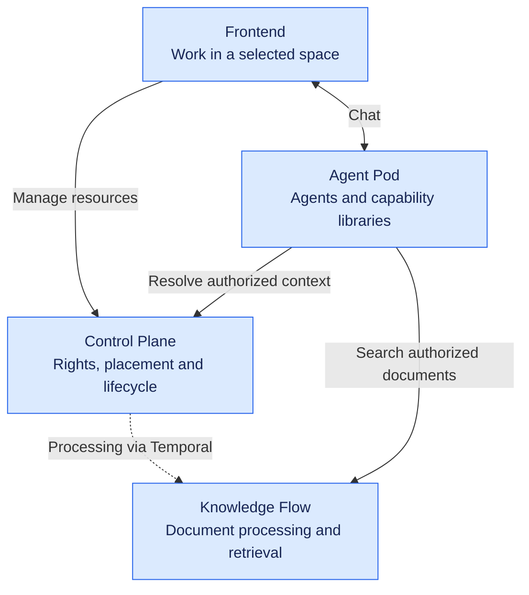
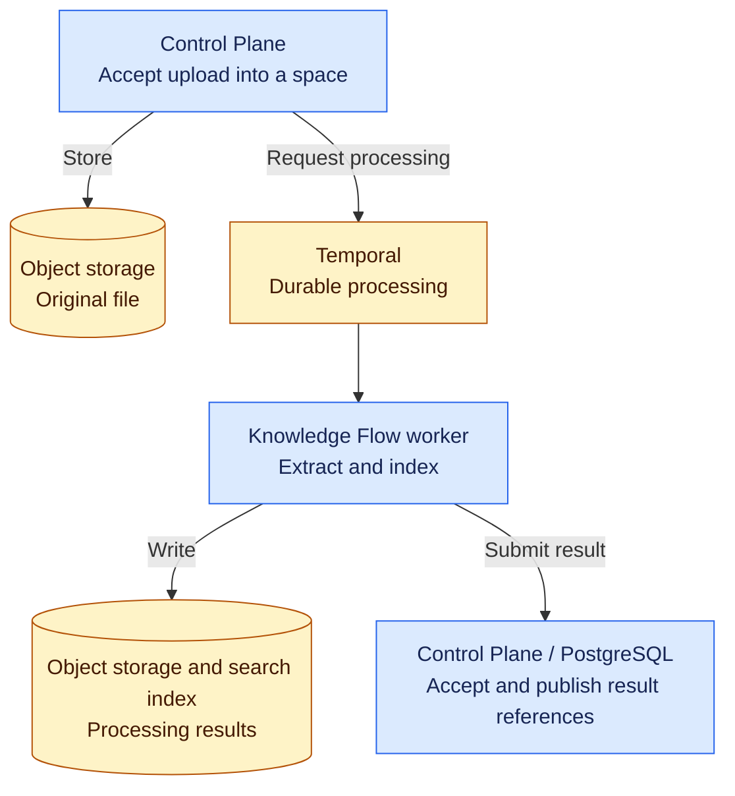
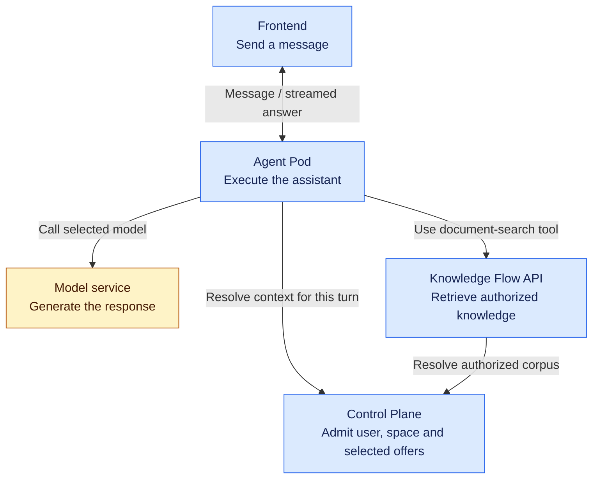

# 1. System overview

The [space](00-introduction.md#organizations-teams-and-projects) is a work perimeter, not a
separate deployment. Fred's components carry its identity and the user's authority
through each operation. They serve many spaces without merging their access rights.

**Legend:** 🟦 Fred · 🟨 COTS · 🟪 Extensions · ⬜ Concepts

## 1.1. Components serving the space

Control Plane owns placement and access decisions. Agent Pods execute assistants;
Fred supplies `fred-agent`, and developers can provide other pods. Capability
libraries belong to their pod. Knowledge Flow processes documents and serves
knowledge through its API. Each backend also has background work: grouping it
here with its owner does not imply a single process or replica.

## 1.2. Importing a document

File bytes live in object storage; PostgreSQL records their placement and
publication. Knowledge Flow reads the authorized original through Control Plane.
Producing a file does not publish it: Control Plane accepts the result before
exposing it. The [document journey](02.2-document-journey.md) explains the user
experience; the [storage annex](A9-documents.md) details coordination and cleanup.

## 1.3. Answering in a conversation

The pod obtains an authorized context for each turn. Selecting an assistant or
model in the browser does not grant execution. Document search uses the person's
authority within the conversation's space and permitted ancestor resources;
it does not give the model unrestricted access. The answer streams from the pod
to the frontend. Knowledge Flow's embedding models are configured separately
from the conversation's generation model.

Organization-level policy limits which models and pod offers may be used; local
capability restrictions can narrow it. Roles in the working space determine what
the person may do. [Security](03-security.md) explains these two controls;
[journey 2.3](02.3-agent-administration.md) shows how people use them.
