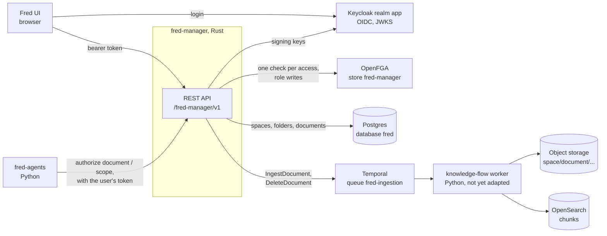

# 2. Context

| Partner | What fred-manager needs from it | Contract |
| --- | --- | --- |
| Keycloak | Access tokens, signing keys | chapter 6, Authentication |
| OpenFGA | `check`, `write`, `read` on its own store | chapter 5, OpenFGA model |
| Postgres | Its tables in the shared `fred` database | chapter 5, Schema |
| Temporal | Starting two workflows | chapter 4, Ingestion submission |
| fred-agents | Calls `/authorize/*` with the user's token, then filters search | chapter 4, Agent search scope |
| UI | Every route except the health probe | chapter 6, Errors |

Today the UI still talks to the control-plane and knowledge-flow backends; how it moves
to `fred-manager` is open (chapter 10).
