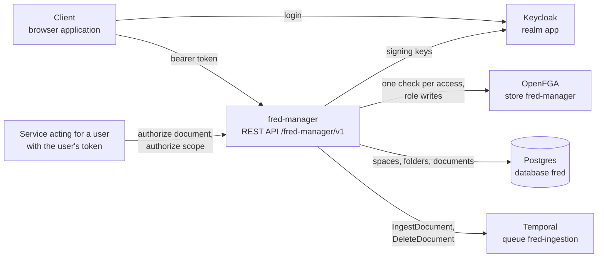

# 2. Context

| Partner | What fred-manager uses | Contract |
| --- | --- | --- |
| Keycloak | Access tokens, signing keys (JWKS) | chapter 6, Authentication |
| OpenFGA | `check`, `write`, `read` on its own store | chapter 5, OpenFGA model |
| Postgres | Its tables in the `fred` database | chapter 5, Schema |
| Temporal | Starting `IngestDocument` and `DeleteDocument` | chapter 4, Ingestion submission |
| Clients | Every route; the health probe needs no token | chapters 4 and 6 |
| Services acting for a user | `/authorize/document`, `/authorize/scope` | chapter 4, Search scope |
