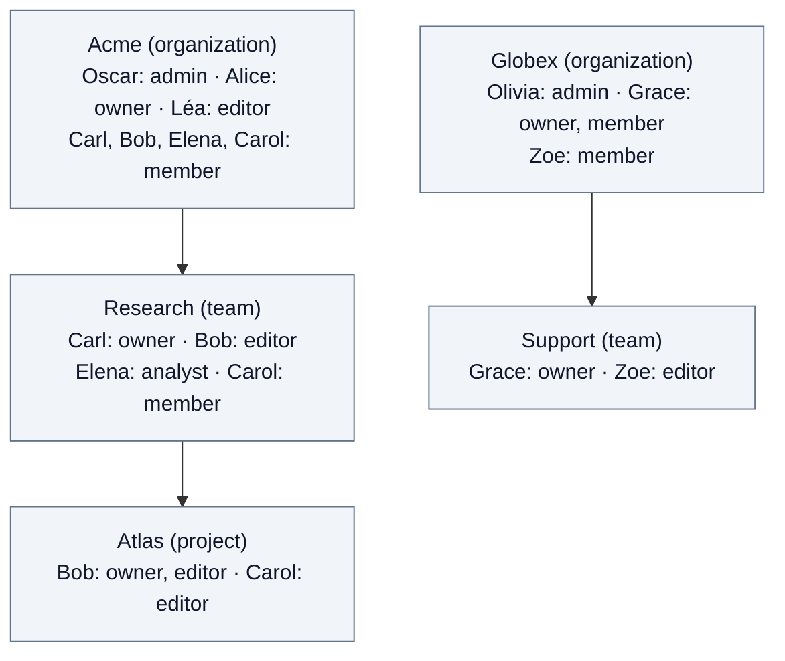

# 2. Journeys

Journeys follow concrete scenarios to explain how Fred's architectural rules
work together. Each journey has its own subchapter and links to the relevant
domain chapters for the underlying rules.

| Subchapter | Reader's question |
| --- | --- |
| [2.1. User journeys](02.1-user-journeys.md) | How does a user go from first login to creating a folder? |
| [2.2. Document journey](02.2-document-journey.md) | How does a user import a PDF, follow processing and read the result? |
| [2.3. Models and assistant use](02.3-agent-administration.md) | How does Alice authorize models, and how does Bob use an assistant to answer questions and prepare a document? |

Follow chapter 2.3 from the organization's model choices to Bob's questions and report.
Each journey explains its own scope; a conversation does not imply document search
or use of external tools.

## Example people and spaces

These fictional people and spaces are the only cast used by the examples and by the
demo provisioning bundle. Each person illustrates one rule; their rights come only
from the roles listed here. The [roles annex](A11-roles.md) defines each role.

| Person | Acme | Research | Atlas | What the example shows | Spaces they see |
| --- | --- | --- | --- | --- | --- |
| **Oscar** (`oscar`) | `organization_admin` | - | - | Technical admin: names Acme's owners. No content, no personal space. | Acme |
| **Alice** (`alice`) | `owner` | - | - | Acme's owner: manages models and created Research, naming Carl its owner. An owner reads no content. | Acme |
| **Léa** (`lea`) | `editor` | - | - | Maintains Acme's common resources but does not see Research: a role stays on its space. | Acme |
| **Carl** (`carl`) | `member` | `owner` | - | Research's owner: manages its members and created Atlas, naming Bob its owner. Reads no Research content. | Acme, Research |
| **Bob** (`bob`) | `member` | `editor` | `owner`, `editor` | Contributes to Research. Holds two roles on Atlas. | Acme, Research, Atlas |
| **Elena** (`elena`) | `member` | `analyst` | - | Evaluates Research and does not see Atlas: a team role does not reach its projects. | Acme, Research |
| **Carol** (`carol`) | `member` | `member` | `editor` | Reader in Research, editor in Atlas: roles at different levels are independent. | Acme, Research, Atlas |

| Person | Globex | Support | What the example shows | Spaces they see |
| --- | --- | --- | --- | --- |
| **Olivia** (`olivia`) | `organization_admin` | - | The same technical admin role in another organization. | Globex |
| **Grace** (`grace`) | `owner`, `member` | `owner` | One person holding roles at two levels. | Globex, Support |
| **Zoe** (`zoe`) | `member` | `editor` | Globex content, invisible from Acme and the reverse. | Globex, Support |

Every team or project role above rests on a direct content role (`member`,
`editor` or `analyst`) on the parent: Carl, Bob, Elena and Carol are members of
Acme, Grace and Zoe of Globex. That prerequisite grants nothing on the child.
Everyone except Oscar and Olivia may open a personal space. None of these people
holds a platform role; the platform account is bootstrapped separately. Dana, the
infrastructure operator of chapter 2.3, configures model sources outside Fred and
has no Fred account. The demo bundle creates these accounts, spaces and roles, and
no personal space.
