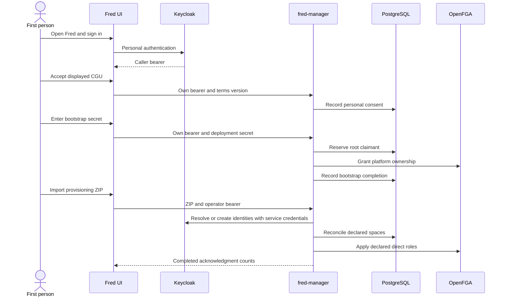
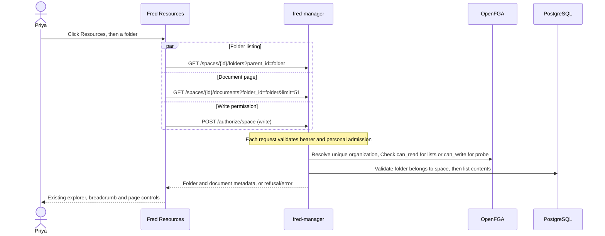

# 2. User journeys

Journeys explain architecture through observable actions. Each one names its
execution context, the authority making each decision and the resulting state.
Rules live in their domain chapters; this chapter shows their composition.

## From an empty platform to an organization's first user

Execution context: Fred's existing application, navigation and screens connected
to fred-manager on `chore/rust-rebac`, using Keycloak, PostgreSQL and OpenFGA.
The reachable journey contains onboarding, memberships, provisioning and resource browsing.
Other product pages and their Python data consumers are not mounted.

| Step | What the person sees or does | Architectural effect |
| --- | --- | --- |
| 1. Open Fred | Sign in with a personal Keycloak account. | Public configuration identifies the login authority. The bearer identifies the caller; it grants no organization membership. |
| 2. Accept the CGU | Read the active terms and explicitly accept. | Manager records that person's subject, version and time in SQL. No role or space is created. |
| 3. Initialize administration | On an unclaimed platform, enter the deployment bootstrap secret. | Manager reserves this caller as root, writes platform ownership in OpenFGA and records completion. |
| 4. Open the platform | Root sees an empty Home view and Provisioning in the administration console. | Platform governance grants no organization membership or content access. |
| 5. Import the ZIP | Select the Make-generated bundle and read the completed report. | Manager uses its own Keycloak service identity to resolve/create users and reconciles declared organizations, teams, projects and direct roles. |
| 6. Change accounts | Sign out, then sign in as an imported person. | The browser starts a fresh session; the previous person's data is not retained. |
| 7. Enter the organization | Accept personal CGU and arrive in the unique organization at `/home`; select its teams or projects to read their hierarchy and roles. | Import has not accepted terms for this person. Manager resolves the unique organization from canonical roles. No organization selector, tenant URL parameter or personal-space creation is involved. |

The account menu displays the authenticated identity and allows logout even before
CGU acceptance or bootstrap, including when admission is unavailable. Unknown or
unsupported URLs return to Home after admission without mounting their consumers.

Unavailable configuration, onboarding state or legal text keeps the protected
journey closed and offers retry. A wrong secret grants nothing. A completed
bootstrap never opens again. Import failures show an error and repair/replay
instructions: a failure does not imply rollback of remote effects.

See [personal consent and bootstrap](03-security.md),
[organizations and provisioning](04-organizations.md), and
[automated journey acceptance](09-quality.md#provisioning-ui-acceptance).
Deployment commands remain in the [manager README](../../apps/fred-manager/README.md).

## Priya opens her personal space

After demo import and personal consent, Priya enters Demo at `/home`. Her declared
organization role includes `personal_space_creator`. The existing Personal space
entry calls generated `POST /me/personal-space`, then refreshes `GET /me/spaces`
before selecting the returned UUID. First opening returns 201; subsequent openings
return 200 with the same UUID. The existing selected-space detail appears, and
Resources appears in the scoped sidebar; Home returns to the list containing fredlab.
The entry keeps its personal avatar, label and styling.
Keyboard activation runs the command; pending state prevents duplicate submissions.
Command or refresh failure shows an error and requires another deliberate action.

Import, login and consent create no personal space. Bob has no creation entitlement
in the demo, so no personal entry appears and the server refuses creation. Removing
Priya's entitlement alone preserves reuse of her readable space. Removing editor
is not repaired by opening; removing all personal read roles prevents opening,
without replacement. Her organization retains revocation authority and no implicit
private-space read. This journey uses manager only, with no control-plane,
knowledge-flow, task or runtime request.

## Priya browses her resources

From her personal-space detail, Priya clicks Resources in the existing scoped
sidebar. `/team/<space UUID>/resources` opens that space's root. Home returns to
her organization's list; selecting fredlab and then Resources opens fredlab's root.
The organization remains implicit and no organization selector appears.

The explorer shows folders and document names/sizes returned by manager. A folder
opens its children; Back and breadcrumb buttons return to ancestors. Documents
advance in pages of 50 using Next, Previous and First. Folders appear on the first
page. The footer shows the current page without claiming an unknown total or last
page. Refreshing the browser returns to the space root.

Successful emptiness displays the existing empty-folder message. Loading hides
previous rows; 403 and 409 show denied access (including retired spaces or conflicting
organization context), 404 an absent space/folder, and other failures
an unavailable-service message. Reload retries both reads. Entering a space, folder
or page verifies current authority before showing rows, including after an abandoned
request. A response from an earlier visit cannot populate the current view.

Importing the demo ZIP provisions users and roles, not documents. An empty personal
space or team therefore displays an empty result until metadata exists. The automated
browser fixture creates its sample metadata separately in its disposable database.
See [content ownership and read contract](05-documents.md) and
[request costs and acceptance](09-quality.md#resource-browsing-acceptance).

## Priya creates a folder

Priya's personal space grants her `editor`; the demo bundle also grants her `editor`
on fredlab. In Resources, the UI checks `write` through manager and displays the
existing New folder control only after a successful permission response and resource
reads. Its existing dialog names the current destination. Priya enters a name and
confirms; the generated client posts `space_id`, optional `parent_id` and `name` to
`/folders`. The server checks current authority again and returns the persisted folder.

The dialog closes after success and the first page of that location reloads, so the
new folder is visible and can be opened. A duplicate keeps the dialog open with its
entered name and a conflict message. Refresh rereads resources and write permission.
Read-only users retain navigation and refresh. This journey calls manager only;
control-plane and knowledge-flow do not receive a request.

See [folder validation and failures](05-documents.md#folder-creation) and the
[action/role matrix](03a-action-role-matrix.md), including the differences from Python.

## Joining and governing organizations, teams and projects

Bob's TSN roles attach him to TSN; Priya's demo roles attach her to Demo. Each person
enters their own organization after login and personal consent. Changing accounts
clears the previous person's cached data. A second assignment is refused, whether
requested through provisioning or direct role administration. An account without
space roles sees the empty Home state; platform governance remains independent.

The [organization chapter](04-organizations.md#one-person-one-organization) defines
attachment, workspace selection and the separate meanings of identity and permissions.

## From a document upload to an authorized answer

## Creating an agent and equipping it with capabilities

## Running a conversation and inspecting its results

## Evaluating, administering and operating the platform

## An operator retires a space

An authenticated platform owner who has accepted CGU calls `DELETE /spaces/{id}`
for a project, team or organization. Manager returns 202 with a durable receipt.
The scope immediately disappears from Priya's workspace lists; direct resource
requests and mutations refuse it. Organization deletion includes personal spaces.
An organization owner or team administrator alone cannot request this operation.
The UI has no new deletion control.

The operator follows `GET /deletions/{operation_id}`. After the configured delay,
the separate worker removes folders, OpenFGA references and space rows. The receipt
reports completion only after that cleanup. Repeating DELETE returns the same
receipt, including after the target disappears. Document-bearing scopes and
standalone personal-space requests are refused. The delay provides retention,
not an undo window. See [lifecycle operation](A3-manager-operations.md#space-deletion-lifecycle).
