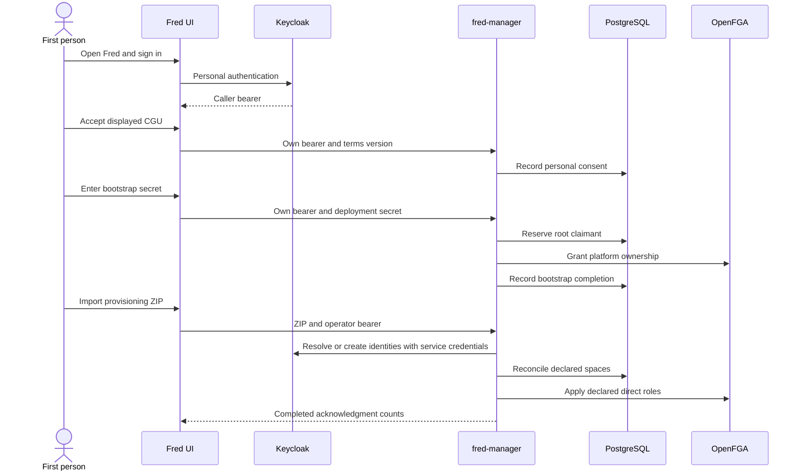

# 2. User journeys

Journeys explain architecture through observable actions. Each one names its
execution context, the authority making each decision and the resulting state.
Rules live in their domain chapters; this chapter shows their composition.

## From an empty platform to an organization's first user

Execution context: Fred's existing application, navigation and screens connected
to fred-manager on `chore/rust-rebac`, using Keycloak, PostgreSQL and OpenFGA.
The complete existing Fred UI is mounted after manager consent/bootstrap.
Manager owns onboarding, provisioning and membership/personal navigation. Other
product pages retain their existing service calls and ordinary failure states.

| Step | What the person sees or does | Architectural effect |
| --- | --- | --- |
| 1. Open Fred | Sign in with a personal Keycloak account. | Public configuration identifies the login authority. The bearer identifies the caller; it grants no organization membership. |
| 2. Accept the CGU | Read the active terms and explicitly accept. | Manager records that person's subject, version and time in SQL. No role or space is created. |
| 3. Initialize administration | On an unclaimed platform, enter the deployment bootstrap secret. | Manager reserves this caller as root, writes platform ownership in OpenFGA and records completion. |
| 4. Open the platform | Root opens Fred and reaches Provisioning in the administration console; the team list is empty. | Platform governance grants no organization membership or content access. |
| 5. Import the ZIP | Select the Make-generated bundle and read the completed report. | Manager uses its own Keycloak service identity to resolve/create users and reconciles declared organizations, teams, projects and direct roles. |
| 6. Change accounts | Sign out, then sign in as an imported person. | The browser starts a fresh session; the previous person's data is not retained. |
| 7. Enter the organization | Accept personal CGU and reach the usual Home dashboard; select a team or personal space using the existing navigation. Read the organization name in Profile. | Import has not accepted terms for this person. Manager resolves the unique organization from canonical roles. No organization selector, tenant URL parameter or personal-space creation is involved. |

The account menu displays the authenticated identity and allows logout even before
CGU acceptance or bootstrap, including when admission is unavailable. After admission,
Profile opens the existing `/settings` page even without an organization or space.
It shows the signed-in identity and manager's effective platform roles, including
`platform_owner`, with distinct loading, unavailable and empty-role states. The
existing controls persist language, offered UI theme and light/dark/system mode
in the browser. The same page links to CGU consultation (`/gcu`), privacy information
(`/gdpr`) and shipped release notes (`/release-notes`). Consulting CGU does not
record another acceptance; direct URLs pass through the same admission guards.
The profile also reads the organization name from current manager memberships.
The account menu exposes the configured external support link and the existing
published patch-note history. Account/legal pages retain their standalone layout.
The original product routes remain registered; unknown URLs use the existing error page.

Unavailable configuration, onboarding state or legal text keeps the protected
journey closed and offers retry. A wrong secret grants nothing. A completed
bootstrap never opens again. Import failures show an error and repair/replay
instructions: a failure does not imply rollback of remote effects.

See [personal consent and bootstrap](03-security.md),
[organizations and provisioning](04-organizations.md), and
[automated journey acceptance](09-quality.md#provisioning-ui-acceptance).
Deployment commands remain in the [manager README](../../apps/fred-manager/README.md).

## Priya opens her personal space

After demo import and personal consent, Priya reaches the usual Home dashboard at `/home`. Her declared
organization role includes `personal_space_creator`. The existing Personal space
entry calls generated `POST /me/personal-space`, then refreshes `GET /me/spaces`
before selecting the returned UUID. First opening returns 201; subsequent openings
return 200 with the same UUID. Navigation opens `/team/<UUID>/agents`. The existing
team sidebar exposes Agents, Resources, Prompts and the other original conditional
entries; Home returns to the team list containing fredlab.
The entry keeps its personal avatar, label and styling.
Keyboard activation runs the command; pending state prevents duplicate submissions.
Command or refresh failure shows an error and requires another deliberate action.

Import, login and consent create no personal space. Bob has no creation entitlement
in the demo, so no personal entry appears and the server refuses creation. Removing
Priya's entitlement alone preserves reuse of her readable space. Removing editor
is not repaired by opening; removing all personal read roles prevents opening,
without replacement. Her organization retains revocation authority and no implicit
private-space read. The opening command and membership refresh use manager. The ordinary pages
keep their existing service consumers.

## Priya opens Resources

The existing team sidebar opens `/team/<UUID>/resources`. `TeamResourcesPage`
uses the original `DocumentWorkspace`, statistics, quota and import presentation.
Its library/document data, controls and service failures follow the existing
control-plane and knowledge-flow bindings. It does not reinterpret a manager folder
UUID as a knowledge-flow tag or report a Python mutation as a manager mutation.
Manager's separate folder/document API and authorization contracts are described in
[content ownership](05-documents.md); they do not supply this full UI data contract.

## Joining and governing organizations, teams and projects

Bob's TSN roles attach him to TSN; Priya's demo roles attach her to Demo. Each person
enters their own organization after login and personal consent. Changing accounts
clears the previous person's cached data. A second assignment is refused, whether
requested through provisioning or direct role administration. An account without
space roles has no team entry; platform governance remains independent.

The [organization chapter](04-organizations.md#one-person-one-organization) defines
attachment, workspace selection and the separate meanings of identity and permissions.

## From a document upload to an authorized answer

## Creating an agent and equipping it with capabilities

## Running a conversation and inspecting its results

## Evaluating, administering and operating the platform

## An operator retires a space

An authenticated platform owner who has accepted CGU calls `DELETE /spaces/{id}`
for a project, team or organization. Manager returns 202 with a durable receipt.
The scope immediately disappears from Priya's workspace lists; direct resource
requests and mutations refuse it. Organization deletion includes personal spaces.
An organization owner or team administrator alone cannot request this operation.
The UI has no new deletion control.

The operator follows `GET /deletions/{operation_id}`. After the configured delay,
the separate worker removes folders, OpenFGA references and space rows. The receipt
reports completion only after that cleanup. Repeating DELETE returns the same
receipt, including after the target disappears. Document-bearing scopes and
standalone personal-space requests are refused. The delay provides retention,
not an undo window. See [lifecycle operation](A3-manager-operations.md#space-deletion-lifecycle).
