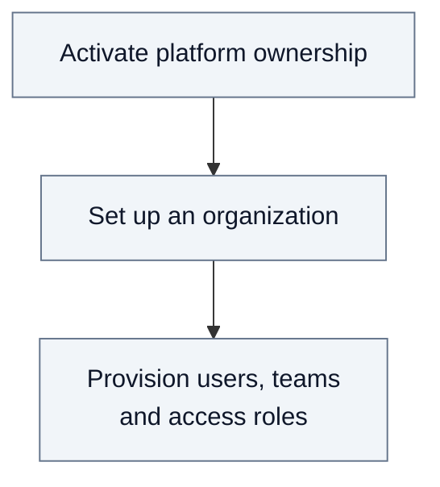
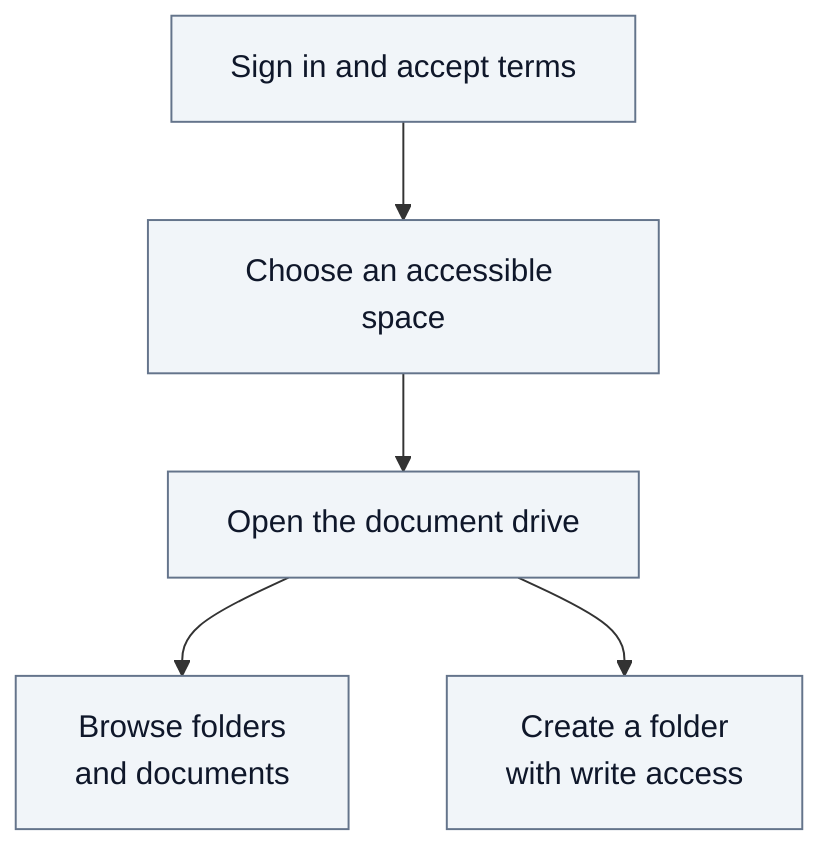

# 2.1. User journeys

Getting to a document drive involves two people: a platform owner who prepares
the organization and its access, then a business user who works in an authorized
space. Signing in alone does not grant access to documents.

## From an empty platform to an organization's first user

On a new installation, the person operating the platform creates the `owner`
account through the registration form, signs in, accepts the terms of use and
activates platform ownership with the installation's bootstrap token. This is a
one-time setup, separate from provisioning the organization's accounts.
Platform ownership allows this account to govern organizations and appoint
their owners and admins, without automatic access to their content.

### A platform owner creates an organization

In **Organizations**, the owner enters a name and selects an organization owner
and one or more admins from the directory: Oscar and Alice respectively in the Acme
example. Creating the organization does not itself give those people access to
team documents.

### Provisioning the business account

In **Provisioning**, the platform owner imports a prepared bundle of accounts,
organizations, teams and roles. The [example bundle](02-journeys.md#example-people-and-spaces)
defines the accounts and grants used throughout these journeys. This import
requires a compatible Keycloak installation. The result reports success or the
cause of failure; completed changes can remain after a failure.

This provisioning journey describes the current platform-owner permission, which is
broader than the agreed bootstrap and organization-creation remit; see the
[permission comparison](A11-roles.md#responsibility-boundaries-and-current-enforcement).
The following journey uses Bob's separate business account, with editor access
already assigned to Research in Acme.

## Personal display choices

In Profile, each person chooses a theme, display mode and language. Fred saves
these choices with sidebar and list-sort preferences for reuse across browsers.
They load after sign-in, before application content appears. Without saved
preferences, Fred uses the platform theme, system display mode and browser
language. Pane widths and trace expansion remain specific to the browser.

## Bob opens Resources

Bob signs in and accepts the current terms of use. He selects an accessible
team from Home, then opens **Resources**, the document drive for that space.

The breadcrumb shows his current folder. To create `Papers`, he enters its name
and confirms; the drive refreshes and the folder remains after reloading.
A duplicate name or missing write permission prevents creation and displays an
error. An admin role alone does not grant content write access.

## Bob opens his personal space

If entitled, Bob can choose **Personal space** instead of a team. Fred creates
it on first opening and reuses it afterwards. It has its own content permissions;
organization and team roles do not automatically grant access to its contents.

Continue with the [document journey](02.2-document-journey.md) to import a PDF.
See [Security](03-security.md) for access rules and the
[technical annex](A5-user-journeys.md) for detailed contracts and source references.
