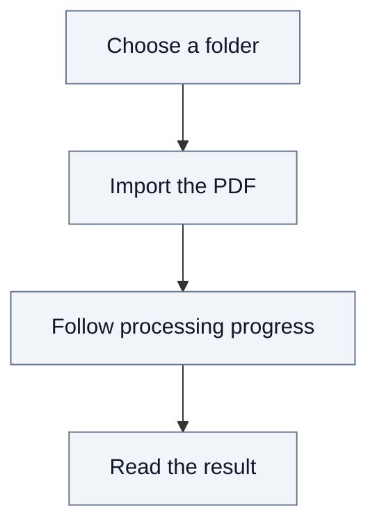

# 2.2. Document journey: importing a PDF

Priya wants to add `paper.pdf` to her team's document drive. She belongs to the
TSN organization and has editor access to the fredlab team. Document processing
is enabled for this installation.

## From upload to reading

In **Resources**, Priya creates the `ArxivAi` folder, opens it and imports her PDF
with the `fast` processing profile.

**Uploading and processing are distinct.** Once the upload completes, Fred keeps
the original. Processing then extracts the content and prepares the result.
Priya can follow progress and reload the page without losing that state.

When processing succeeds, she can view the original PDF, read the extracted text
and download the original. Access remains governed by her current permissions.
Documents imported through this path are not exposed to agent search.

## When something prevents completion

- **Import refused:** a name conflict, insufficient quota or missing write access
  prevents the import. Priya must resolve the cause before trying again.
- **Processing fails after upload:** the original remains stored. Retrying processing
  uses that original without requiring another upload.

See [Documents and knowledge](05-documents.md) for the governing rules, and the
[technical annex](A4-document-journey.md) for source references, processing details
and inspection of stored results.
