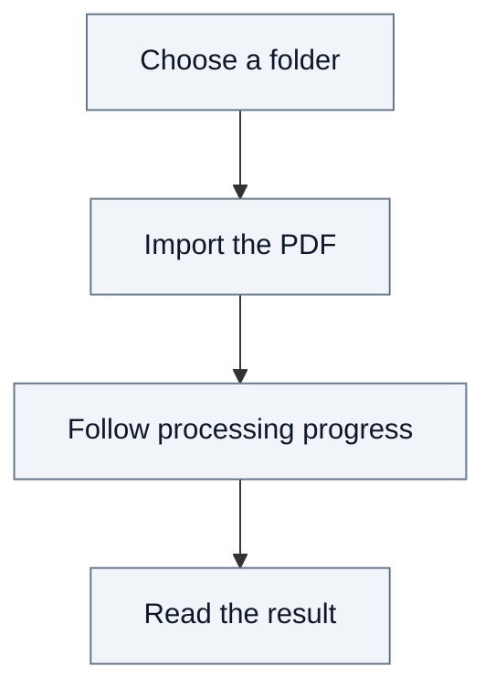

# 2.2. Document journey: importing a PDF

Bob wants to add `paper.pdf` to his team's document drive. He belongs to the
Acme organization and has editor access to the Research team. Document processing
is enabled for this installation.

## From upload to reading

In **Resources**, Bob creates the `Papers` folder, opens it and imports his PDF
with the `fast` processing profile.

**Uploading and processing are distinct.** Once the upload completes, Fred keeps
the original. Processing then extracts the content and prepares the result.
Bob can follow progress and reload the page without losing that state.

When processing succeeds, he can view the original PDF, read the extracted text
and download the original. Access remains governed by his current permissions.
Documents imported through this path are not exposed to agent search.

## Concurrent imports and publication

Suppose another editor imports a PDF into a different team in Acme while Bob's
file is processing. Both files can transfer and process concurrently. Each import
takes Acme's organization write lock separately to reserve its destination and quota,
publish its stored original, and publish its final indexing result. When
processing is requested with the upload, its admission is recorded with the
original's publication. A later processing request has its own protected admission.

The lock keeps each check-and-record step consistent with competing writes,
revocations and space retirement. For example, two editors cannot both reserve
the same remaining quota based on an outdated total. A revocation that takes
effect during file transfer prevents publication under the former permission;
it does not recall data already delivered. These are durable consistency and
authorization guarantees, not merely a way to keep progress displays current.

A batch of 1,000 documents does not retain the organization lock for the entire
batch: it releases it between the protected steps of individual files. Another
editor can create a folder between them, without waiting for all processing to
finish. Many simultaneous steps can still cause waiting. Transfers, stored-object
verification and processing work happen outside this organization lock; worker
stage reservations also have a separate shared capacity coordination point.
Additional Control Plane replicas share the same database locks rather than
providing an independent write lane per replica.

See the [coordination overview](01-system-overview.md#13-coordinating-document-writes)
and [open performance question](A10-open-issues.md#oi-1-document-write-concurrency).

## When something prevents completion

- **Import refused:** a name conflict, insufficient quota or missing write access
  prevents the import. Bob must resolve the cause before trying again.
- **Processing fails after upload:** the original remains stored. Retrying processing
  uses that original without requiring another upload.

See [Documents and knowledge](05-documents.md) for the governing rules, and the
[technical annex](A4-document-journey.md) for source references, processing details
and inspection of stored results.
