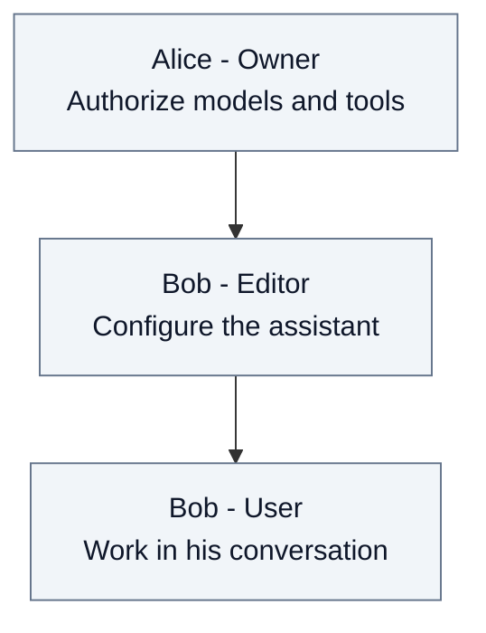
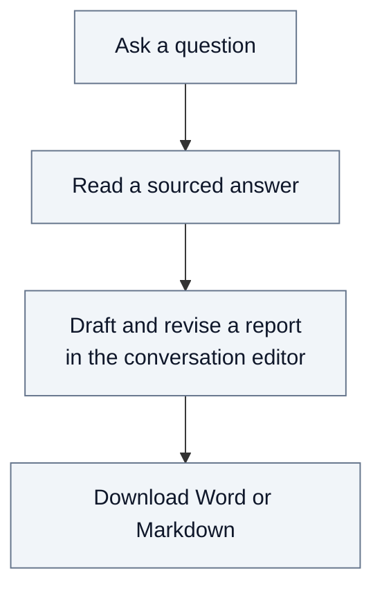
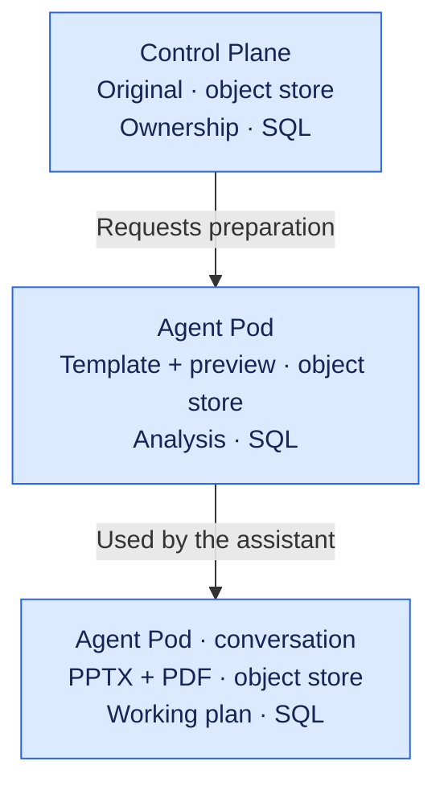

# 2.3. Prepare and use an assistant in a space

Bob is an editor in the **Research space**. He wants an assistant to answer from
accessible documents and help write a report. Carol uses the same space, but
cannot read Bob's conversation merely because she belongs to it.

## 1. Authorize the available means

A **model** generates responses. A **capability** equips an assistant with tools,
for example document search or document writing. A capability comes from a
library in an Agent Pod; authorizing an offer from one pod does not authorize
an equivalent offer from another.

Here one hierarchy rule matters: **Alice, owner of Acme, authorizes models and
pod offers for the organization containing Research.** Team and project policies
can further restrict capability offers. A local owner cannot open an offer that
the organization forbids. Technical Admin is not the role making these business
choices; model connections and secrets are deployment prerequisites.

Discovery does not grant permission, and permission does not equip every agent.
The [offer contract](A2-manager-contracts.md#pod-capability-offers) describes the
catalogue, restrictions and stored choices.

## 2. Configure an assistant for the task

Bob creates a **Custom assistant** in Research and selects its authorized tools.
He chooses document search for grounded answers and document writing for his
report. Keeping this selection focused limits unnecessary tools and instructions.

Before sending, Bob chooses an authorized model if no applicable default exists.
A missing or unavailable choice keeps the draft and prompts him to resolve it.
Authorizing a model does not guarantee that its service is reachable.

## 3. Work in a conversation

Document search stays within the authorized corpus of the space and its ancestors.
It grants no access to a sibling space or another person's conversation. Bob's
report remains a conversation document; downloading it does not publish it into
the shared drive. See [conversation documents](05-documents.md#55-documents-authored-in-a-conversation).

If a selected capability is revoked, a new turn is refused until the selection
is made usable again; a turn already admitted may finish. The
[admission contract](A2-manager-contracts.md#chat-model-preparation-and-turn-admission)
and [security annex](A6-security.md#document-search-within-a-turn) hold the detailed checks.

## 4. Generate a PowerPoint presentation

Bob equips his assistant with the authorized **PowerPoint Builder** capability
and uploads a template. Python preparation cleans the file, analyses its slide
patterns and produces a template preview. Bob then asks the assistant to build a
presentation in his conversation; the UI displays its preview and offers the PPTX
for download. Preparation establishes technical usability, not editorial quality.

Control Plane coordinates preparation through Temporal; the pod retrieves the
original from Control Plane. The data crosses these responsibility boundaries:

**Legend:** 🟦 Fred

| Responsibility | Owner |
| --- | --- |
| Template ownership, access and preparation coordination | Control Plane |
| PowerPoint preparation and generation, through the capability library | Agent Pod |
| Configuration, previews and downloads through authorized APIs | UI |

**A template is reusable configuration; a presentation belongs to a conversation.**
An agent's own template is attached to that agent in its space. A common template
is attached to the organization and the same logical pod; the library supplies a
default when neither applies. Files live in object storage; SQL holds ownership,
preparation state, the template inventory and file references. The prepared data
follows the reusable template's lifecycle.
Conversation deletion cleans up its generated files and working plan, preserving
the reusable template. [Storage details](A9-documents.md#powerpoint-builder-data)
identify the tables, object paths and their owners.
