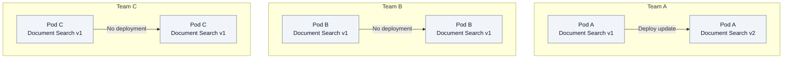

# 2.3. Alice administers agents for Acme

This journey specifies agreed behavior whose complete implementation is pending.
Capability inventory read/refresh and organization model administration APIs are
implemented, together with instance model settings and resolver data contracts.
The administration UI and complete journey have not been validated;
model policy is persisted but is not yet enforced by the runtime.
It uses the [Alice, Bob and Carol conventions](00-introduction.md). Applications
and Knowledge Bases are outside this scope.

Alice wants to offer one assistant and three of five available models to Acme.
Her administration role grants no access to Bob's documents.

## Alice understands what each pod provides

Alice inspects each Agent Pod's templates and capabilities. Models come from a
separate platform catalog of approved discovery sources. Each model retains its
source and exact upstream identity, independently of the pods. For each capability, she sees its purpose, version, configuration and consuming
templates. The owning pod stays visible, including in any global inventory:
two Document Search offerings remain distinct even when they share a name.

The catalog describes deployed code; it does not isolate untrusted Python.
The platform approves pod deployments. Missing or unavailable offerings are
reported explicitly, never substituted with another pod's capability. The latest
observation and its date remain distinct from withdrawal: a failed refresh retains
the previous inventory. Configuration descriptions expose no saved values or private
connection settings; discovery establishes no execution availability.

## Teams upgrade their pods independently

**What changes when only one team adopts a new library release?** Three teams
share Fred's Document Search library. Team A integrates and validates v2, then
deploys its pod. Teams B and C can continue running v1 in the same Fred instance.
This diagram compares releases, not runtime calls.

Alice sees each pod's actual version. Each pod owns configuration validation and
must handle its existing instances while respecting Fred's runtime contract.
Shared libraries remain the foundation: coexistence enables gradual adoption,
without requiring forks, a service per version or extra permission switches.

## Alice chooses what Acme may use

| Alice's decision | Effect |
| --- | --- |
| Permit three models | Saves Acme's explicit permitted set and optional default/fallback from that set. Other organizations are unaffected; this administrative decision alone does not enforce invocation restrictions. |
| Authorize one agent template | Eligible spaces can use it, with its configured capabilities. This grants no membership or document access. |
| Inspect and configure capabilities | Configuration belongs to the offering's pod. There is no separate user/capability permission. |

Alice reviews required and optional capabilities, model requirements and external
connections before authorizing the template. Team or personal-space exceptions,
where exposed, govern agent use. Missing configuration, an excluded model or an
unavailable dependency prevents readiness; enabling an agent never permits a
forbidden model. Backend requests obey the same rules as the UI.

Provider destinations and credentials remain under platform control. Alice
chooses approved offerings; she cannot change a shared endpoint through her
organization role alone. She can request a refresh of an existing approved source.
Discovery creates no permission; presence, chat qualification and discovery health
are reported separately. During an outage, existing choices remain diagnosable and
can be cleared or revoked, while new selections wait for a successful observation
at the current source revision. Concurrent edits cannot silently replace one another.

## Bob configures and uses an instance

With Research write access and template-use permission, Bob creates an instance.
The instance API stores a recommendation from the organization's permitted
platform offers and optional temperature, token limit and top-p values. New choices
require successful current discovery; descriptive edits preserve an old choice even
when it is unavailable or revoked. Reopening restores saved values. The existing
form displays the saved source/model identity or legacy profile diagnostic; model
selection in that form is not connected. Provider compatibility and invocation
checks are not established by saving these settings.

Neither request parameters nor prompt text can add undeclared tools, select a
different pod's capability by name, permit a forbidden model or change an approved
destination. Execution respects Bob's current authority and conversation scope.
Document Search enforces document visibility; Carol's Support membership grants
no access to Bob's Research conversation or documents.

## External access and later changes remain controlled

A Jira capability is a library; access to a particular Jira server requires an
approved destination, credentials and allowed operations. Activating an agent
cannot approve that connection. Missing approval makes the dependency unavailable;
reading documents and writing Jira issues retain their respective controls.

Alice can withdraw a model or agent permission. Affected configurations are
identified without erasing settings or histories. Current policy applies at
operation boundaries; running activities follow the agreed bounded-stop rules.
Already emitted data cannot be recalled.

Control Plane owns catalog projection, organization choices, instance/session
metadata and routing. Agent Pods own capability validation, model execution,
tools, messages and checkpoints.
