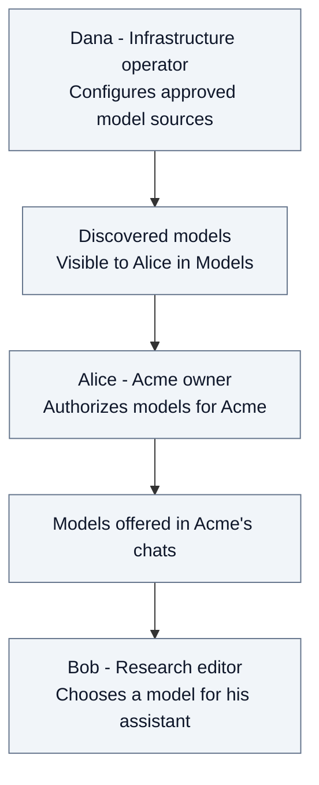
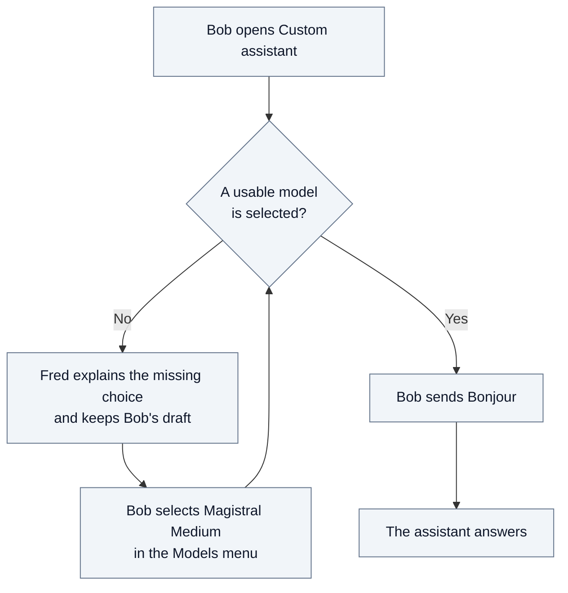
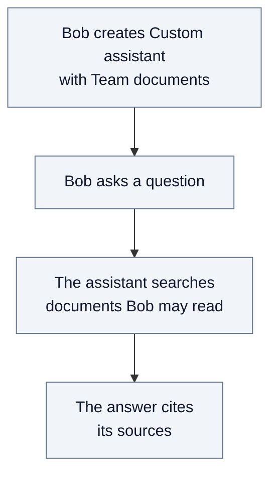

# 2.3. From available models to Bob's first answer

Alice wants Acme's teams to use an assistant with approved models. Bob, an editor
in Research, opens that assistant, sends his first message, then lets it answer
from Research's documents. Carol is a member
of the same team: she can read its shared documents, but neither team membership
nor using the same model gives her access to Bob's conversation.

## Who makes a model usable?

**Dana** is the infrastructure operator: she configures approved model
connections and credentials. This operational responsibility does not introduce
another demo account or grant business content rights. Alice is Acme's
organization owner; model choices are part of her business responsibility.
Oscar, Acme's organization admin, has a separate institutional mandate and does
not choose models or inspect business agents and content through that role.
Bob uses the chat. Discovering a model does not authorize it or select it.

Alice sees the inventory and its discovery status in **Models**. She authorizes
the models Acme may use and can choose an organization default. She can refresh
the inventory; changing a provider connection or its credentials belongs to Dana.

Bob sees the chat's selectable offers, not the administration controls. An
unavailable saved choice remains explainable but cannot grant permission.
Alice's model choices apply to Acme; they do not change another organization's
policy or give Alice access to team conversations.

## Which capabilities can an assistant use?

A capability, such as document search, is a function an Agent Pod provides to
its assistants. In **Capabilities**, Alice sees one row per Agent Pod, here
`fred-agents`, with the date of its last inventory. Opening the row lists the
capabilities that pod offers; a capability the pod no longer offers stays
visible, dimmed. Alice can refresh the inventory. If the pod does not answer,
the row shows it as unavailable and keeps the last list received.

Each capability row carries an **Enabled for all** switch. A capability is off
until Alice turns it on: only then is it offered, in every Acme team and personal
space, when someone creates an assistant or changes its capabilities. The decision
belongs to one pod: the same capability on another pod stays off until enabled
there, and another organization's choice changes nothing for Acme. A capability
the pod no longer offers can be turned off, not on.

Turning a capability off asks for confirmation and removes it from assistant
forms. An assistant already configured with it keeps answering, but its
capabilities can be saved again only without it, or once it is re-enabled.

## Bob gets his first answer

Bob opens **Custom assistant** in Research. In this example, Alice has authorized
**Magistral Medium**, but neither the assistant nor Acme supplies a default choice.

The menu remains accessible while sending is blocked. Fred does not silently
choose a model just because one is available. The early check explains missing
or refused choices; the actual model call can still fail if the service cannot
be reached or its credentials are unusable.

| Question | What Bob can rely on |
| --- | --- |
| Does enabling the assistant select a model? | No. The assistant and the model choice are separate. |
| Must Alice define a default first? | No. Bob can explicitly select an authorized model in the chat. |
| Can Carol use the same model? | In a chat she is entitled to use; this gives her no access to Bob's conversation. |

## Bob's assistant answers from Research's documents

When Bob creates his Custom assistant in Research, he can turn on **Team
documents** under *Data and knowledge*. The assistant can then search the
documents Bob may read and answer with their sources.

The search covers the published documents of Research and of its parent, Acme.
It never reaches a sibling team or another organization. Documents still being
processed or already deleted are not found.

| Question | What Bob can rely on |
| --- | --- |
| Can the assistant find more than Bob could read? | No. Its search is limited to the space of the conversation and its parents, which Bob's role lets him read. |
| Can Carl, Research's owner, read documents through it? | No. Using an assistant requires a content role in the space; Carl holds none. |
| Can Bob restrict it to a folder or give it a file in the chat? | No. It searches the whole space and its parents; chat attachments are not supported. If Bob turns either option on, Fred refuses to save the assistant and says why. |

[Security](03-security.md#35-model-permission-and-conversation-access) explains
these boundaries; the [technical annex](A2-manager-contracts.md#chat-model-preparation-and-turn-admission)
details selection and admission. The system overview shows which component
performs [the model call](01-system-overview.md#14-model-governance-and-agent-execution)
and [the document search](01-system-overview.md#15-document-search-during-a-conversation).
