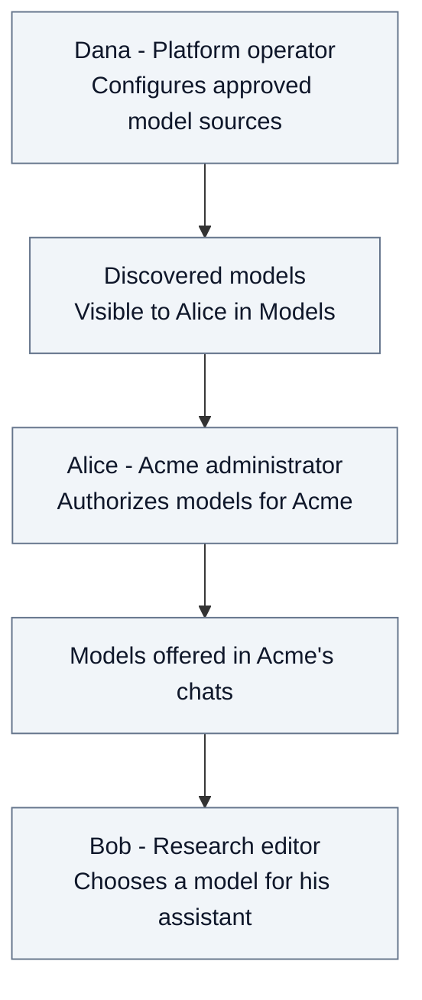
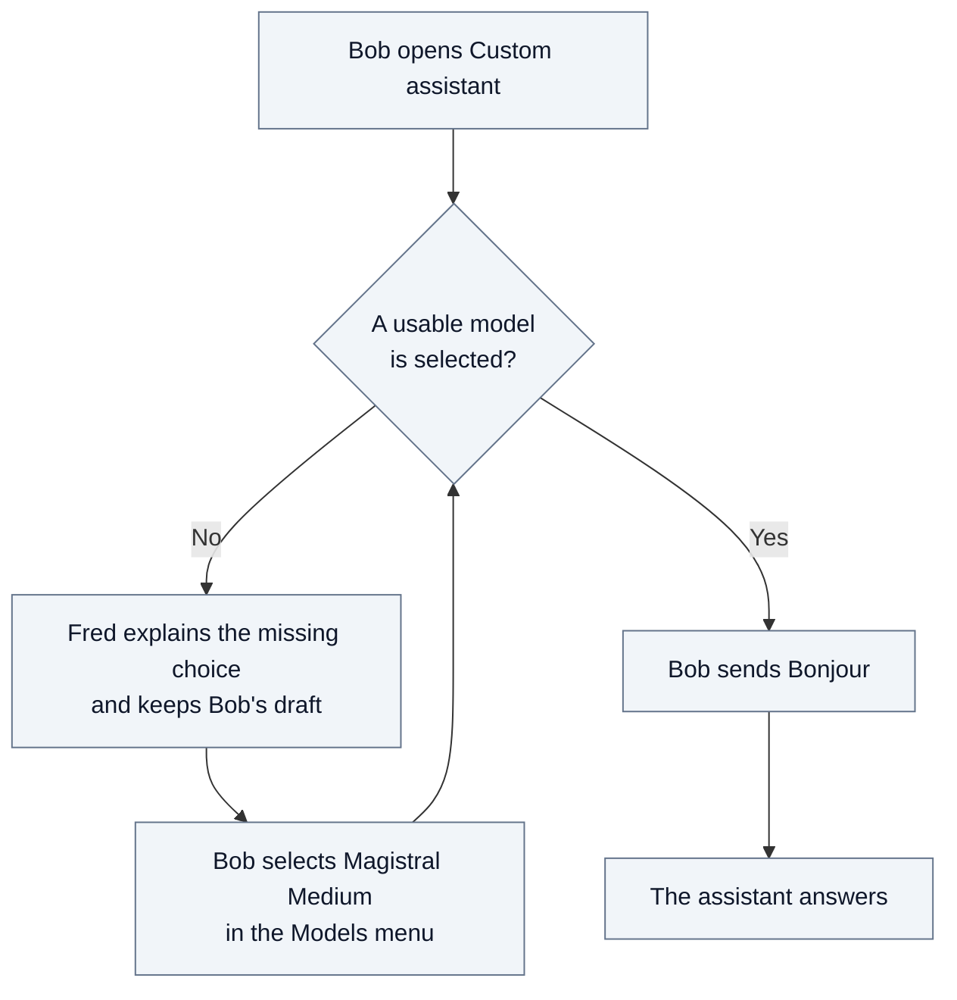

# 2.3. From available models to Bob's first answer

Alice wants Acme's teams to use an assistant with approved models. Bob, an editor
in Research, opens that assistant and sends his first message. Carol works in
Support; using the same model does not give her access to Bob's conversation.

## Who makes a model usable?

Dana operates the platform. Alice administers Acme. Bob uses the chat. Each makes
a different decision; discovering a model does not authorize it or select it.

Alice sees the inventory and its discovery status in **Models**. She authorizes
the models Acme may use and can choose an organization default. She can refresh
the inventory; changing a provider connection or its credentials belongs to Dana.

Bob sees the chat's selectable offers, not the administration controls. An
unavailable saved choice remains explainable but cannot grant permission.
Alice's model choices apply to Acme; they do not change another organization's
policy or give Alice access to team conversations.

## Bob gets his first answer

Bob opens **Custom assistant** in Research. In this example, Alice has authorized
**Magistral Medium**, but neither the assistant nor Acme supplies a default choice.

The menu remains accessible while sending is blocked. Fred does not silently
choose a model just because one is available. The early check explains missing
or refused choices; the actual model call can still fail if the service cannot
be reached or its credentials are unusable.

| Question | What Bob can rely on |
| --- | --- |
| Does enabling the assistant select a model? | No. The assistant and the model choice are separate. |
| Must Alice define a default first? | No. Bob can explicitly select an authorized model in the chat. |
| Can Carol use the same model? | In a chat she is entitled to use; this gives her no access to Bob's conversation. |

This exchange uses the assistant without document search or external tools.
[Security](03-security.md#35-model-permission-and-conversation-access) explains
the boundaries; the [technical annex](A2-manager-contracts.md#chat-model-preparation-and-turn-admission)
details selection and admission. The [system overview](01-system-overview.md#14-model-governance-and-agent-execution)
shows which component performs each responsibility.
