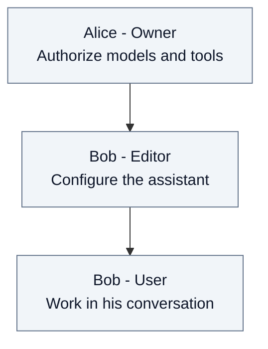
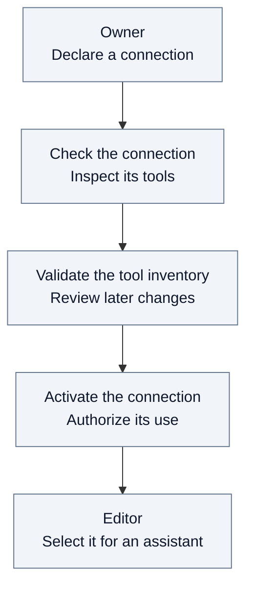
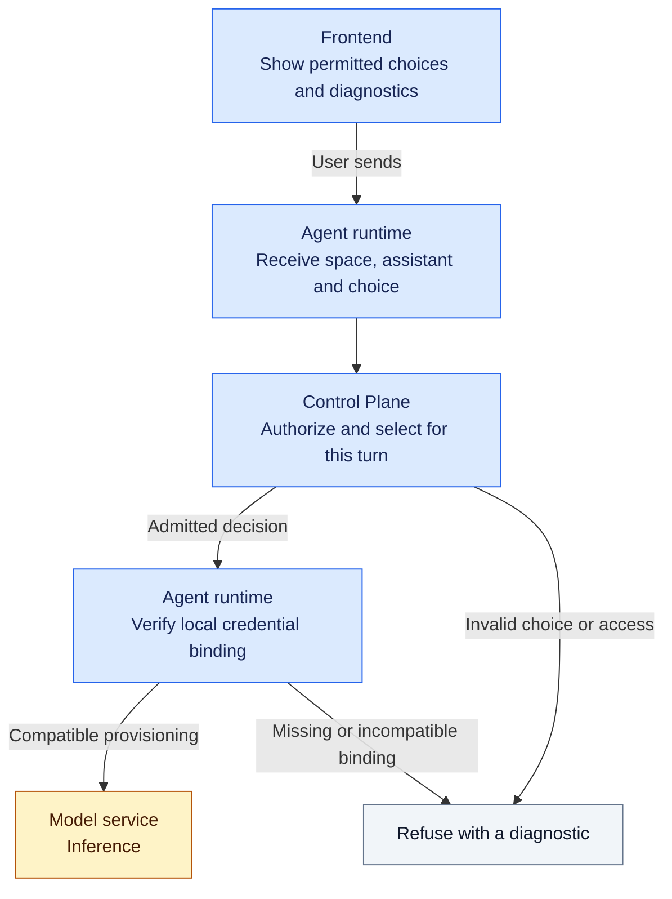
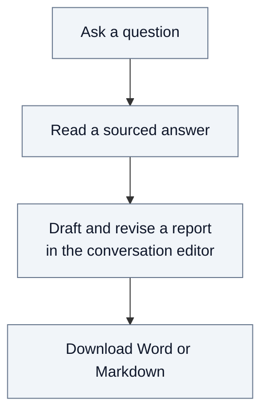
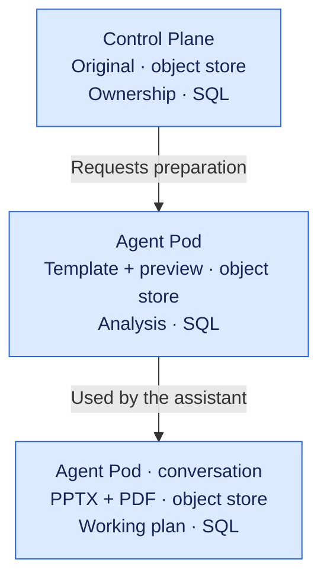

# 2.3. Prepare and use an assistant in a space

Bob is an editor in the **Research space**. He wants an assistant to answer from
accessible documents and help write a report. Carol uses the same space, but
cannot read Bob's conversation merely because she belongs to it.

## 1. Authorize the available means

A **model** generates responses. A **capability** equips an assistant with tools,
for example document search or document writing. Tools can come from a library
in an Agent Pod or from a declared **MCP connection** to an external tool server.
Authorizing one offer does not authorize equivalent offers from other sources.

**Alice, owner of Acme, manages models and MCP in the organization's Features
area.** Bob selects the permitted means for his assistant in Research. Technical
Admin alone does not make these business choices. Team and project capability
restrictions can narrow the organization's permissions, never widen them.

| Question | Models | MCP connections |
| --- | --- | --- |
| Where does the connection come from? | Model sources and credentials are configured at deployment; Models administers their offers. | The Owner declares a connection in MCP; required credentials must also be provisioned for the services that use it. |
| What does the Owner govern? | Permitted models and optional default choices. | The reviewed tool inventory, technical activation and authorization of the connection. |
| What equips the assistant? | A permitted model selected for the turn. | A connection selected for a compatible assistant, within its permitted offers. |

To analyze CSV or Excel files, Alice enables the native **Tabular** capability;
Bob selects its own card on a General or Deep assistant, independently of the
document-reading packs. No connection, test or publication
is needed in MCP. The same space restrictions apply as for other native capabilities.
Knowledge Flow availability is checked through actual execution: an outage does
not change permission or erase the selection. The form explains a capability
restriction in text, independently of its selection indicator.

### A default model is not a default connector

A conversation can use an explicit model choice, otherwise the assistant's
recommendation, otherwise the organization's optional default. Without an
applicable choice, Fred asks for one. A deployment profile can initialize the
organization's model choices; this does not mean every fresh installation has a
working model automatically.

MCP connections are declared explicitly. There is no organization-wide MCP
substitute chosen to fill a missing tool selection. Authorizing a connection
permits its use; it does not equip every assistant with it.

### Understand what MCP validation changes

This shows the preparation steps, not a mandatory order of every UI action.
Discovery records what the server announces. Validation accepts the inventory
Fred may expose; later additions, modifications and removals require review.
Technical activation and business authorization remain separate controls.
A successful check from Control Plane does not prove connectivity from an Agent Pod.

Discovery does not grant permission, and permission does not equip every agent.
The [offer contract](A2-manager-contracts.md#pod-capability-offers) and
[MCP boundaries](A13-models.md#mcp-connection-boundary) supply the technical references.

## 2. Configure an assistant for the task

Bob creates a **Custom assistant** in Research and selects its authorized tools.
He chooses document search for grounded answers and document writing for his
report. Keeping this selection focused limits unnecessary tools and instructions.

Before sending, Bob chooses an authorized model if no applicable default exists.
A missing or unavailable choice keeps the draft and prompts him to resolve it.
Authorizing a model does not guarantee that its service is reachable.

The same Control Plane decision serves Python and Rust execution. Preparation
helps Bob choose; only admission authorizes the turn. A model-policy change is
observed by new admissions; an already admitted turn keeps its decision.

**Legend:** 🟦 Fred · 🟨 COTS · 🟪 Extensions · ⬜ Concepts

This is the decision sequence: the Agent Pod obtains admission from Control
Plane, while embedded Ralph's host resolves it internally. Neither trusts the
browser's preparation as an execution grant. The
[selection contract](A2-manager-contracts.md#chat-model-preparation-and-turn-admission)
defines precedence, withdrawal fallback and refusal conditions.

## 3. Work in a conversation

Document search stays within the authorized corpus of the space and its ancestors.
It grants no access to a sibling space or another person's conversation. Bob's
report remains a conversation document; downloading it does not publish it into
the shared drive. See [conversation documents](05-documents.md#55-documents-authored-in-a-conversation).

With Deep, Bob can also open **Conversation files** to list the assistant's
working files, inspect their text and download their current contents. Uploaded
attachments and explicitly published deliverables remain available in the same
panel. Each file read requires current access to Bob's conversation.

If a selected capability is revoked, a new turn is refused until the selection
is made usable again; a turn already admitted may finish. The
[admission contract](A2-manager-contracts.md#chat-model-preparation-and-turn-admission)
and [security annex](A6-security.md#document-search-within-a-turn) hold the detailed checks.

## 4. Generate a PowerPoint presentation

Bob equips his assistant with the authorized **PowerPoint Builder** capability
and uploads a template. Python preparation cleans the file, analyses its slide
patterns and produces a template preview. Bob then asks the assistant to build a
presentation in his conversation; the UI displays its preview and offers the PPTX
for download. Preparation establishes technical usability, not editorial quality.

Control Plane coordinates preparation through Temporal; the pod retrieves the
original from Control Plane. The data crosses these responsibility boundaries:

**Legend:** 🟦 Fred

| Responsibility | Owner |
| --- | --- |
| Template ownership, access and preparation coordination | Control Plane |
| PowerPoint preparation and generation, through the capability library | Agent Pod |
| Configuration, previews and downloads through authorized APIs | UI |

**A template is reusable configuration; a presentation belongs to a conversation.**
An agent's own template is attached to that agent in its space. A common template
is attached to the organization and the same logical pod; the library supplies a
default when neither applies. Files live in object storage; SQL holds ownership,
preparation state, the template inventory and file references. The prepared data
follows the reusable template's lifecycle.
Conversation deletion cleans up its generated files and working plan, preserving
the reusable template. [Storage details](A9-documents.md#powerpoint-builder-data)
identify the tables, object paths and their owners.
