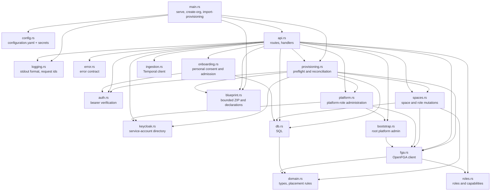

# 3. Building blocks

## fred-manager

A library crate (`src/lib.rs`) with a thin binary (`src/main.rs`): integration tests
drive the library against real Postgres and OpenFGA.

| Module | Owns | Rule it enforces |
| --- | --- | --- |
| `api` | HTTP surface, one OpenFGA check per content access | handlers stay thin; mutations live in `spaces` and `platform` |
| `auth` | `CurrentUser` extractor, JWKS cache | chapter 6 |
| `spaces` | space/role mutations, folder creation and local write authorization | organization lock plus atomic guard (I4, I5) |
| `onboarding` | versioned consent, admitted/own-human extractors | acceptance is independent of roles and memberships (I19) |
| `bootstrap` | the one-time root grant | two steps under the bootstrap lock (I9) |
| `domain` | `Space`, `Folder`, `Document`, roles, parent rules | pure functions, unit-tested (I1, I7) |
| `db` | content and space SQL | placement columns written by inserts only (I2) |
| `fga` | pinned store/model, check, read, guarded write; offline cutover | roles stay in OpenFGA; SQL publishes only the store/model binding |
| `ingestion` | `IngestDocument`, `DeleteDocument` submission | one workflow id per document and operation |
| `logging` | output format, request span, completion event | chapter 6 (I11, I13) |
| `error` | status codes, `{"detail": ...}` bodies | chapter 6 |

`roles` defines typed platform roles and scoped capabilities. `platform` serializes
role mutations with bootstrap. `keycloak` owns one shared HTTP client and a synchronized
service-token cache. `api::governance_router` groups identity, platform administration
space listing, ZIP import and self-capability routes independently of the Temporal client.

The same `utoipa-axum` registrations build the runtime routers and OpenAPI paths.
`utoipa::ToSchema` derives request/response schemas from the Rust DTOs. The binary's
`generate-openapi` command runs before configuration and logging initialization;
it emits the canonical `/fred-manager/v1` contract without constructing service state.
The frontend generates `fredManagerOpenApi.ts` through its standard RTK codegen
tool and registers the slice in the shared Redux store. A handwritten enhancement
encodes the import's generated binary argument as FormData; paths, methods and
response types remain generated.
The generation target corrects the code generator's required-body typing for the
optional ingestion request and fails if that upstream output changes. The bootstrap and import
endpoints disable automatic retry on 401 because expiry can follow committed
effects; the shared base query still refreshes before each explicit attempt.

`blueprint::Bundle` validates the bounded ZIP and normalizes declarations without exposing credentials
through Debug or serialization. HTTP and CLI parse on a blocking worker without
filesystem extraction. `Importer` performs read-only preflight, per-identity
mutations, then additive space/role reconciliation. The binary connects without SQL
migration or FGA model synchronization, and does not initialize Temporal for import.

## Frontend provisioning

`ProvisioningPage` consumes the generated import mutation through its FormData
adapter. `useManagerPlatformAdmin` shares the manager `/me` RTK query between
navigation, admin landing and page guard. It does not infer manager authority from
control-plane roles. The page uses the shared `PageHeader`, `FileDropzone` and
`Button` components and the mutation's pending, error and completed-report state.
The control-plane retains ownership of shell admission and its Migration page.
