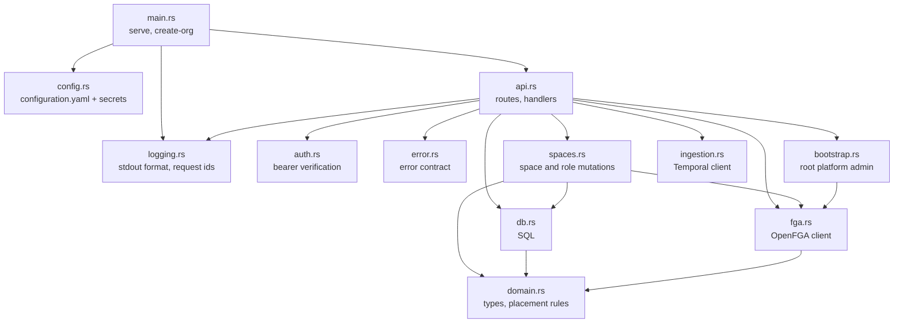

# 3. Building blocks

## fred-manager

A library crate (`src/lib.rs`) with a thin binary (`src/main.rs`): integration tests
drive the library against real Postgres and OpenFGA.

| Module | Owns | Rule it enforces |
| --- | --- | --- |
| `api` | HTTP surface, one OpenFGA check per content access | handlers stay thin; mutations live in `spaces` |
| `auth` | `CurrentUser` extractor, JWKS cache | chapter 6 |
| `spaces` | create space, grant, revoke | check and write under the organization lock (I4, I5) |
| `bootstrap` | the one-time root grant | two steps under the bootstrap lock (I9) |
| `domain` | `Space`, `Folder`, `Document`, roles, parent rules | pure functions, unit-tested (I1, I7) |
| `db` | every SQL statement | placement columns written by inserts only (I2) |
| `fga` | store discovery, model sync, check, write, read | idempotent writes |
| `ingestion` | `IngestDocument`, `DeleteDocument` submission | one workflow id per document and operation |
| `logging` | output format, request span, completion event | chapter 6 (I11, I13) |
| `error` | status codes, `{"detail": ...}` bodies | chapter 6 |
