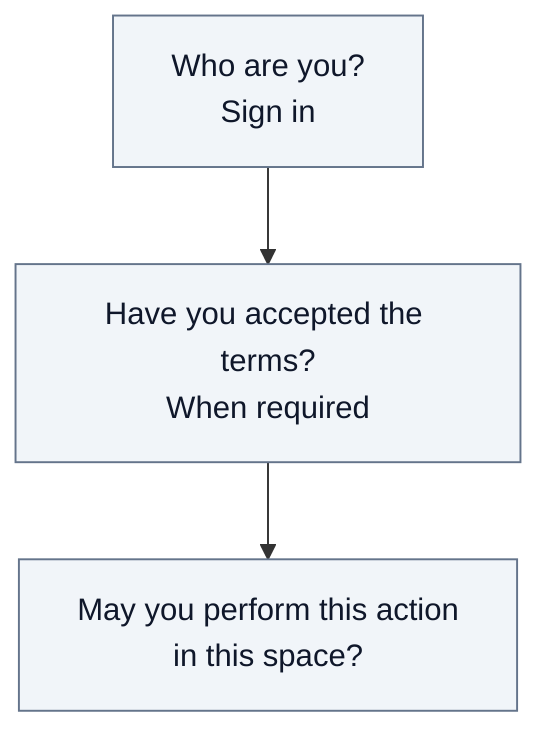
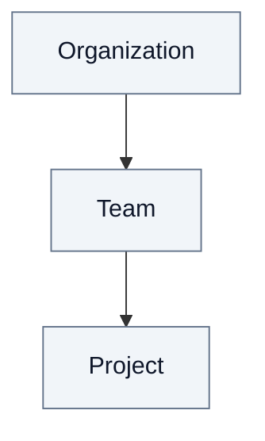

# 3. Security

Fred separates identity, admission and permission. This chapter explains access
to organizations, spaces, documents and managed conversations through Control Plane.

## 3.1. Signing in is not permission

The configured identity provider authenticates the person. Each person accepts
their own terms of use when required. Neither step creates membership or content
rights. Every protected action is checked by the server; a visible UI control is
not an authorization.

## 3.2. Governance and content access

Business management and content access are separate. An **admin** manages the
workspace and its community; the organization admin also manages model choices.
Reading or contributing to content requires a content role.

An **owner** has a limited institutional mandate. The organization owner executes
express steering committee decisions, without a business role or right to know
business data and agents. This agreed boundary is not fully enforced by current
permissions: roles can accumulate and some actors can grant themselves other roles.

The [roles annex](A11-roles.md) is the reference for responsibilities, effective
permissions, attribution rules and the gaps to examine in security reviews.

## 3.3. Where rights apply

**Editor, admin and analyst** roles apply to their space and its
descendants. **Member** applies only to the space where it is granted. Platform
and organization-owner roles do not pass down as content rights.

A person belongs to one organization. Folders and documents use their owning
space's permissions. **Personal spaces inherit no content rights** from the
organization or teams; creating one requires a separate entitlement.

## 3.4. Rights remain current

Reads and writes use current permissions. For document processing, the worker's
service identity does not replace the initiating user's authority: original
access and publication recheck that user's rights. A committed revocation during
upload prevents publication; an already authorized read may finish.

The [technical security annex](A6-security.md) describes authentication,
service identities and enforcement. The [action and role matrix](A7-action-role-matrix.md)
provides exact permissions, conditions and implementation references.

## 3.5. Model permission and conversation access

Alice, Acme's organization admin, can authorize a model for Acme without being
allowed to read Bob's Research conversation. Oscar's organization-owner role
does not grant model-management permission. Bob needs access to the space and
permission to use its assistant;
Carol's membership in the same Research team lets her read its shared documents,
but does not open Bob's conversation. Selecting the same model never merges their
rights or conversations.

The browser's choice is a request, not authority. Fred verifies it on the server.
Each new turn acquires its authorized context; an admitted turn may finish with
that context after a policy change. Cancellation and run termination remain
separate controls. The [technical boundary](A6-security.md#managed-agent-turn-authority)
explains how the person's rights stay distinct from the pod's service identity.

## 3.6. Documents used by an assistant

An assistant reads documents on behalf of the person in the conversation, never
with broader rights. Using it requires a content role in its space. Its search
is limited to that space and its parents. Bob can read them because any content
role on a space requires a content role on its parent.

The vector index is not an authorization source. Each result is checked against
the document's current placement and publication before the model sees it.
Search rights follow the turn context; a role removed during a turn applies from
the next message. The [technical annex](A6-security.md#document-search-within-a-turn)
lists the checks and their implementation.
