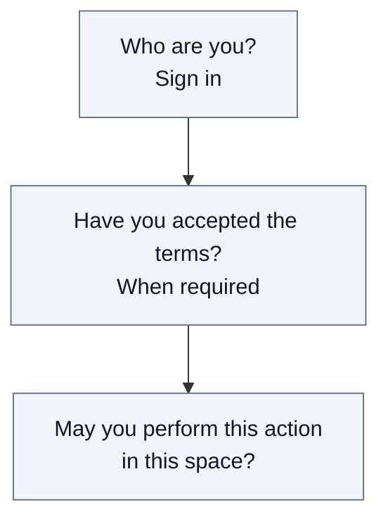
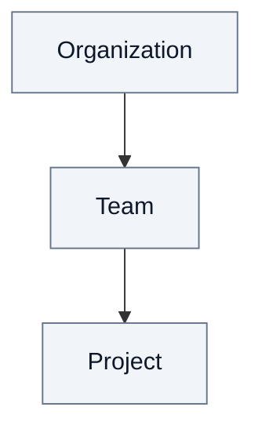

# 3. Security

Fred separates identity, admission and permission. This chapter explains access
to organizations, spaces, documents and managed conversations through Control Plane.

## 3.1. Signing in is not permission

The configured identity provider authenticates the person. Each person accepts
their own terms of use when required. Neither step creates membership or content
rights. Every protected action is checked by the server; a visible UI control is
not an authorization.

### Independent platform initialization

An SSO session shared with Swift identifies a person without importing their Swift
account or rights into Weaver. The installer selects their SSO identity and supplies
Weaver's installation secret to establish its first platform administrator. This
creates no organization or business membership. Personal terms of use then govern
access to protected operations. The [implementation boundary and validation scope](A6-security.md#independent-platform-initialization)
distinguish this initial setup from later user provisioning and migration.

## 3.2. Governance and content access

Fred separates technical administration from business work. The
[role reference](A11-roles.md#reference-roles) defines this responsibility boundary;
its enforcement comparison records where current permissions differ.

- An **admin** is technical. The platform admin creates organizations and names
  their admin and initial owner; the organization admin names and replaces the
  organization's owners and reads supervision aggregates. The technical mandate
  also covers platform constraints such as capacity quotas and security policies,
  not the choice of applications, models or capabilities for business use.
  These responsibilities do not grant content access. There is no team or project admin.
- An **owner** (French: *responsable*) manages a space and its community: its
  members, its resources and its sub-spaces. Business configuration of applications,
  agents, models, capabilities and templates belongs to this responsibility,
  within technical and security constraints. The organization owner creates teams;
  a team owner creates projects. Each creation
  names the new space's owner; the creator receives no role there.
- Reading or contributing to content requires a content role: **member** reads,
  **editor** reads and writes, **analyst** reads and evaluates. Owner alone grants
  no content access.

Roles are cumulative and explicit. An organization admin may also hold a content
role on that organization; an owner may also be an editor on the same team.
Neither admin nor owner automatically implies member or editor. Someone tasked
with examining and modifying reported content needs the corresponding content
role in that space, in addition to any governance role. Granting that role is a
separate decision; receiving an alert does not itself confer access.

For example, Nova's responsible person holds owner and member on Nova, but only
owner on Pilote. They may manage Pilote's memberships without reading its agents,
documents or conversations. Explicitly adding editor on Pilote would permit content
read/write there; it would not change their organization roles or confer access to
another team. The member role on Nova satisfies the parent prerequisite and grants
nothing on Pilote.

One person may hold several roles; nothing currently prevents an admin from also
being an owner. The [roles annex](A11-roles.md) is the reference for
responsibilities, effective permissions, attribution rules and the gaps to examine
in security reviews.

## 3.3. Where rights apply

**A role applies only to the space where it is granted.** No role reaches a child
space. Léa, an editor of Acme, does not see the Research team; Elena, an analyst
of Research, does not see its Atlas project. Roles held at several levels are
independent: Carol reads Research and edits Atlas.

To hold a role on a team or project, a person first needs a direct content role
on its parent. This prerequisite grants nothing on the child. In the other
direction, a search from a space may include its ancestors' common resources, but
only those the person can read through a direct role on that ancestor.

A person may hold roles in several organizations; each one is reached only through
the roles held there. Folders and documents use their owning space's permissions. **Personal spaces inherit no content rights** from the
organization or teams. An **organization participant** holds a business role (owner, member,
editor or analyst) on an active collective space whose organization and parent are
also active. Participation lets a person open their own personal space and browse
the organization's published prompts; an admin role alone does neither. Losing the
last such role closes both accesses without deleting personal data. Private prompts
require a local content-reading role; publishing requires an editor role on the team.

## 3.4. Rights remain current

Reads and writes use current permissions. For document processing, the worker's
service identity does not replace the initiating user's authority: original
access and publication recheck that user's rights. A committed revocation during
upload prevents publication; an already authorized read may finish.

The [technical security annex](A6-security.md) describes authentication,
service identities and enforcement. The [action and role matrix](A7-action-role-matrix.md)
provides exact permissions, conditions and implementation references.

## 3.5. Model permission and conversation access

Alice, Acme's organization owner, can authorize a model for Acme without being
allowed to read Bob's Research conversation. Oscar's organization-admin role
does not grant model-management permission. Bob needs access to the space and
permission to use its assistant;
Carol's membership in the same Research team lets her read its shared documents,
but does not open Bob's conversation. Selecting the same model never merges their
rights or conversations.

The browser's choice is a request, not authority. Fred verifies it on the server.
Each new turn acquires its authorized context; an admitted turn may finish with
that context after a policy change. Cancellation and run termination remain
separate controls. The [technical boundary](A6-security.md#managed-agent-turn-authority)
explains how the person's rights stay distinct from the pod's service identity.

## 3.6. Documents used by an assistant

An assistant reads documents on behalf of the person in the conversation, never
with broader rights. Using it requires a content role in its space. Its search
is limited to that space and the ancestors the person can read. From Research,
Bob's assistant also searches Acme because Bob is a member of Acme.

The vector index is not an authorization source. Each result is checked against
the document's current placement and publication before the model sees it.
Search rights follow the turn context; a role removed during a turn applies from
the next message. The [technical annex](A6-security.md#document-search-within-a-turn)
lists the checks and their implementation.
