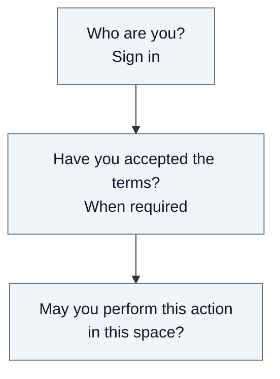
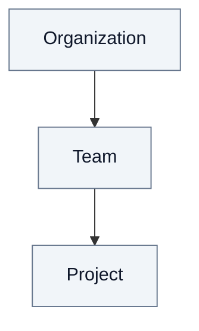

# 3. Security

Fred separates identity, admission and permission. This chapter explains access
to organizations, spaces, documents and managed conversations through Control Plane.

## 3.1. Signing in is not permission

The configured identity provider authenticates the person. Each person accepts
their own terms of use when required. Neither step creates membership or content
rights. Every protected action is checked by the server; a visible UI control is
not an authorization.

Hosted applications are trusted extensions registered by an organization Owner.
Application and KB service deployments are dedicated to one organization. SQL reserves
application HTTP origins and collector workload identities to their owning organization;
API checks and offer policy prevent use from a different organization. Operators
must also isolate service credentials and storage; alias addresses do not prove
a separate deployment.
Their static UI receives no
credentials; the host supplies authenticated API requests through Control Plane
without sending tokens in frame messages. The shared browser origin is a trust
boundary, not isolation from hostile application code. Each API admission checks
the current space permission and capability policy; the application still checks
its own resource ownership and action rights.

### Independent platform initialization

An SSO session shared with Swift identifies a person without importing their Swift
account or rights into Weaver. The installer selects their SSO identity and supplies
Weaver's installation secret to establish its first platform administrator. This
creates no organization or business membership. Personal terms of use then govern
access to protected operations. The [implementation boundary and validation scope](A6-security.md#independent-platform-initialization)
distinguish this initial setup from later user provisioning and migration.

## 3.2. Governance and content access

Fred separates technical administration from business work. The
[role reference](A11-roles.md#reference-roles) defines this responsibility boundary;
its enforcement comparison records where current permissions differ.

- An **admin** is technical. The platform admin creates organizations and names
  their admin and initial owner; the organization admin names and replaces the
  organization's owners and reads supervision aggregates. The technical mandate
  also covers platform constraints such as capacity quotas and security policies,
  not the choice of applications, models or capabilities for business use.
  Platform roles never grant content access or membership. An organization admin
  is a member of that organization, like every other space role. There is no team
  or project admin.
- An **owner** (French: *responsable*) manages a space and its community: its
  members, its resources and its sub-spaces. Business configuration of applications,
  agents, models, capabilities and templates belongs to this responsibility,
  within technical and security constraints. The organization owner creates teams;
  a team owner creates projects. Each creation
  names the new space's owner; the creator receives no role there.
- **Member** is being in the space: it reads the content and uses its assistants.
  Every other space role is an addition to it: **editor** adds writing,
  **analyst** adds evaluation, **owner** adds governance of the space, and the
  organization admin and observer add their technical mandate.

Every space role implies membership of that space. Granting a role also grants
`member`; membership cannot be revoked alone: removing a person from a space
removes all their roles there. Roles remain cumulative: an owner is not an editor
unless granted editor. Platform roles are the exception: a platform admin governs
organizations without any membership, and becomes a member only by taking a space role.

For example, Nova's responsible person holds owner on Nova and on Pilote, so they
read both. Adding editor on Pilote would permit content writes there; it would not
change their organization roles or confer access to another team. Membership of
Nova satisfies the parent prerequisite and grants nothing on Pilote.

One person may hold several roles; nothing currently prevents an admin from also
being an owner. The [roles annex](A11-roles.md) is the reference for
responsibilities, effective permissions, attribution rules and the gaps to examine
in security reviews.

## 3.3. Where rights apply

**A role applies only to the space where it is granted.** No role reaches a child
space. Léa, an editor of Acme, does not see the Research team; Elena, an analyst
of Research, does not see its Atlas project. Roles held at several levels are
independent: Carol reads Research and edits Atlas.

To hold a role on a team or project, a person first needs to be a member of its
parent. This prerequisite grants nothing on the child. In the other
direction, a search from a space may include its ancestors' common resources, but
only those the person can read through a direct role on that ancestor.

A person may hold roles in several organizations; each one is reached only through
the roles held there. Folders and documents use their owning space's permissions. **Personal spaces inherit no content rights** from the
organization or teams. An **organization participant** is a member of an active collective space whose
organization and parent are also active. Participation lets a person open their own
personal space and browse the organization's published prompts; a platform role
alone does neither. Losing the
last such role closes both accesses without deleting personal data. Private prompts
require a local content-reading role. Their [ownership and lifecycle](06-resources.md#prompts)
follow the owning space: creator provenance grants no special rights, departure
preserves content, and collective-space editors retain their ordinary permissions.

## 3.4. Rights remain current

Reads and writes use current permissions. For document processing, the worker's
service identity does not replace the initiating user's authority: original
access and publication recheck that user's rights. A committed revocation during
upload prevents publication; an already authorized read may finish.

The [technical security annex](A6-security.md) describes authentication,
service identities and enforcement. The [action and role matrix](A7-action-role-matrix.md)
provides exact permissions, conditions and implementation references.

## 3.5. Model permission and conversation access

Alice, Acme's organization owner, can authorize a model for Acme without being
allowed to read Bob's Research conversation. Oscar's organization-admin role
does not grant model-management permission. Bob needs access to the space and
permission to use its assistant;
Carol's membership in the same Research team lets her read its shared documents,
but does not open Bob's conversation. Selecting the same model never merges their
rights or conversations.

The browser's choice is a request, not authority. Fred verifies it on the server.
Each new turn acquires its authorized context; an admitted turn may finish with
that context after a policy change. Cancellation and run termination remain
separate controls. The [technical boundary](A6-security.md#managed-agent-turn-authority)
explains how the person's rights stay distinct from the pod's service identity.

## 3.6. Documents used by an assistant

An assistant reads documents on behalf of the person in the conversation, never
with broader rights. Using it requires a content role in its space. Its search
is limited to that space and the ancestors the person can read. From Research,
Bob's assistant also searches Acme because Bob is a member of Acme.

The vector index is not an authorization source. Each result is checked against
the document's current placement and publication before the model sees it.
Search rights follow the turn context; a role removed during a turn applies from
the next message. The [technical annex](A6-security.md#document-search-within-a-turn)
lists the checks and their implementation.
