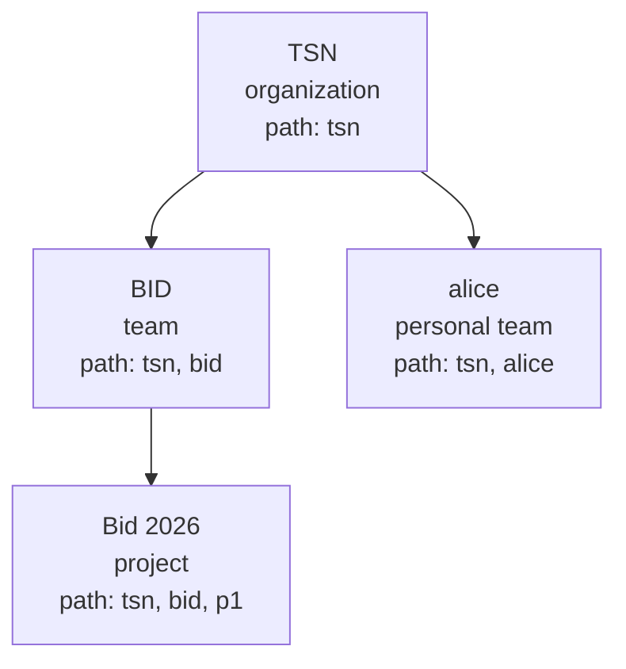

# 4. Organizations and provisioning

Execution context: Fred's organization/team/project model implemented by manager.
Authentication, consent and role authority are defined in [Security](03-security.md).

## Spaces and memberships

An organization is a root. A team belongs to one organization; a project belongs
to one non-personal team. A personal space is a team with one owner and no project.
Names are unique within the parent; identically named teams in different organizations
remain different spaces. Placement is immutable; names can change.

A role on a child requires a content role on its parent. Management and content
roles remain separate: a team administrator still needs parent content access,
and receives no implicit content role on the team. Roles do not propagate between
spaces. A personal space accepts no additional member; its organization can revoke
its owner's access. Every non-personal space retains an administrator.

The tree is in SQL; OpenFGA has no parent relation. `path` holds ancestors then self.

| Scope requested from | Search scope (`space_id` in) |
| --- | --- |
| BID | TSN, BID |
| Bid 2026 | TSN, BID, Bid 2026 |
| alice | TSN, alice |

Folders classify only and carry no rights. A document's artefacts have no
authorization identity of their own: they are stored under its storage prefix
`<space_id>/<document_id>/`, and `IngestDocument` hands over `space_id`, `document_id`
and `folder_path`, ids only, so indexed content is filtered by scope and a rename
changes nothing outside the row.

## Provisioning people and spaces

The ZIP explicitly declares identities, organizations, teams, projects and roles.
An empty projects array is valid. The [declaration contract](A2-manager-contracts.md#provisioning-declarations)
is the exact wire reference; the [user journey](02-user-journeys.md#from-an-empty-platform-to-an-organizations-first-user)
shows its observable effects.

Whole-bundle preflight rejects predictable errors before provisioning writes.
Organizations resolve by root name, teams by organization/name and projects by
team/name. Existing identity fields, passwords, committed space IDs and undeclared
roles are preserved. Requested grants are repaired; no content role or CGU
acceptance is invented. A platform-admin declaration requires bootstrap root,
including on replay.

Keycloak, PostgreSQL and OpenFGA do not share a transaction. An error can leave
created identities or acknowledged grants; replay follows correction of the cause
and never reuses rolled-back space IDs. A successful report counts resolved and
created identities, committed reconciled spaces and acknowledged grants. HTTP 200
means reconciliation completes. The [import sequence](A1-manager-runtime.md#authenticated-provisioning-import)
details these boundaries.

## Invitations, selection and membership administration

## Leaving, deleting and transferring ownership

## Export and portability
