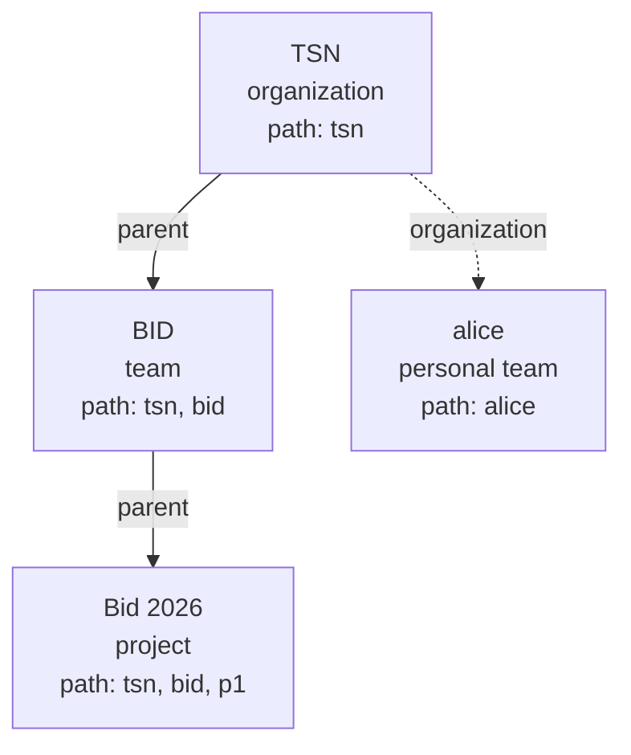

# 4. Organizations and provisioning

Execution context: Fred's organization/team/project model implemented by manager.
Authentication, consent and role authority are defined in [Security](03-security.md).

## One person, one organization

A Fred instance can host several organizations, but a person belongs to at most one
of them (I23). Before assignment, the person belongs to none. An organization is the
person's business context, not a space selector or a login preference.

| Concept | Meaning |
| --- | --- |
| Identity | The authenticated UID from the configured identity provider, not an email domain or a browser parameter. |
| Organization | The unique organization containing the person's committed direct space roles, including owner and admin roles. |
| Team and project | Selectable workspaces inside that organization, subject to their own permissions. |
| Personal space | A private workspace managed by the same organization; attachment does not create it. |
| Platform role | Authority to administer Fred independently of organization membership; no implicit access to business content. |

Manager reads all pages of canonical OpenFGA direct roles, then resolves their
distinct organization IDs with one SQL query over existing space rows, including
retired rows. Tuples without a SQL row confer no attachment. SQL holds immutable
placement, not a second membership record.
Every granted role counts towards attachment, including governance-only roles;
attachment itself grants no extra permission. The same resolver validates
`/me/spaces`, which subsequently excludes retired spaces from display. An empty
visible list does not free a person from an attachment retained during deletion.
Removing the last role in an
organization removes attachment, subject to the existing dependent-role rules.
Context resolution does not repair or revalidate parent membership prerequisites
for existing grants: those checks run when assigning roles. An isolated direct
project role therefore resolves to its SQL organization in both context and
membership discovery; permission remains an OpenFGA decision.

Bob's provisioning roles attach him to TSN. After authentication and personal CGU,
`GET /me/spaces` returns his authorized memberships within that context. Home
retains its usual dashboard and team/personal navigation at `/home`; the organization
name appears in Profile. Team/project selection uses a space identifier. There is
no organization picker, switch or organization identifier in the landing URL. A supplied identifier never
changes server authority. An explicit invalid space selection shows no space.

Creation, direct grants and ZIP import reject a second organization attachment,
including concurrent attempts. Business reads, authorization probes and mutations
check context as well as OpenFGA permissions. Unattached people receive no business
access; platform-only people retain their authorized administration paths.
Contradictory existing grants cause a conflict, not an arbitrary tenant choice.
Administrators can remove unwanted grants using the existing revocation rules;
no data or roles are automatically removed. See [operations](A3-manager-operations.md#organization-conflict-recovery).

## Spaces and memberships

An organization is a root. A team belongs to one organization; a project belongs
to one non-personal team. A personal space is a team with one owner, no parent and
no project; its organization manages it. Names are unique among siblings and among
organizations; identically named teams in different organizations remain different
spaces. Placement is immutable.

API creation and ZIP declarations store names in NFC without surrounding whitespace,
then require 1..180 Unicode scalar values without control characters. Inner spaces and
slashes are preserved; these labels are not folder paths. Uniqueness and name resolution
compare this stored form, so names differing only by surrounding whitespace or Unicode
composition collide. Invalid API names return 422, and invalid ZIP
declarations are rejected before external writes. Existing names are not rewritten.

Editor, admin and analyst reach every descendant space; member stays local. An
analyst of an organization therefore sees all its teams and projects, and a
project cannot be hidden from its team's editors, administrators or analysts.
Management and content roles remain separate: an administrator manages the space
and its descendants and reads none of their content without a content role.

A role on a child requires a direct content role on its parent: a person is a
member of a team before holding a project role, even when an ancestor role already
lets them read the team. A personal space accepts no additional member and inherits
nothing; its organization can revoke its owner's access, and the owner leaves the
organization only after leaving the personal space and removing creation eligibility. Every non-personal space
retains an administrator.

Personal-space creation is an explicit organization entitlement. The demo declares
it for Priya in the organization's roles. First activation creates one private
workspace; further activations reuse it under current read authority. Import and
organization creation grant no implicit entitlement and create no personal space.
See the [Priya journey](02-user-journeys.md#priya-opens-her-personal-space).

SQL stores each space's identity, kind, name, personal owner and immutable placement:
`organization_id` is the root's own ID for an organization, and the containing
organization for every other space. `parent_id` is null for roots and personal
spaces, the organization for a team, and the team for a project. Creation validates
parent kinds and writes these values before publishing matching FGA links and roles;
the SQL transaction commits only after FGA acceptance. Failed commits leave no SQL
attachment even if FGA accepted the tuples.

OpenFGA retains the `parent` links its model evaluates. A personal space has an
`organization` link instead, which no permission uses. Paths are derived from SQL
placement without FGA placement Reads: ancestors then self, or just self for a
personal space. Current permission still requires an OpenFGA Check.

| Scope requested from | Search scope (`space_id` in) |
| --- | --- |
| BID | TSN, BID |
| Bid 2026 | TSN, BID, Bid 2026 |
| Bid 2026, levels `project` | Bid 2026 |
| alice | alice |

A caller may restrict a scope to some of the organization, team and project levels;
levels only remove spaces from it.

Folders classify only and carry no rights. Document metadata inherits its owning
space's authority; read and scope probes use immutable space identifiers.

## Platform organization administration

The platform registry exposes active organizations, independently of content
membership, in pages of at most 100 names/identifiers. Only admitted platform owners
can list or create them. The form searches candidates after two characters and
lets the owner select each contact independently. Keycloak searches the realm;
the local OIDC directory searches personal profiles already observed during
authenticated onboarding, before or after consent. HTTP creation resolves the exact existing owner/admin
usernames and writes those two direct roles, with no implicit member grant. One
account may hold both roles. Name uniqueness and each nominee's single organization
attachment are rechecked under the platform lock before guarded publication.
Retired organizations reserve their name until cleanup, and are absent from the list.
Organization creation does not create a personal space.

## Provisioning people and spaces

The ZIP explicitly declares identities, organizations, teams, projects and roles.
An empty projects array is valid. The [declaration contract](A2-manager-contracts.md#provisioning-declarations)
is the exact wire reference; the [user journey](02-user-journeys.md#from-an-empty-platform-to-an-organizations-first-user)
shows its observable effects.

Whole-bundle preflight rejects predictable errors before provisioning writes,
including contradictory organization assignments, noncanonical usernames and known
effective-email conflicts for new identities. Existing attachments are checked again
after capturing the guards before publishing each organization subtree. Usernames are never silently normalized.
Organizations resolve by root name, teams by organization/name and projects by
team/name. Existing identity fields, passwords, committed space IDs and undeclared
roles are preserved. Requested grants are repaired; no content role or CGU
acceptance is invented. A new organization declares at least one owner and one
admin, possibly the same person; owner is refused on teams and projects. Import
requires a platform owner, authenticated once at admission and rechecked before each
write; bearer expiry after admission does not interrupt it.

Keycloak, PostgreSQL and OpenFGA do not share a transaction. An error can leave
created identities or acknowledged grants; replay follows correction of the cause
and never reuses rolled-back space IDs. A successful report counts resolved and
created identities, committed reconciled spaces and acknowledged grants. HTTP 200
means reconciliation completes. The [import sequence](A1-manager-runtime.md#authenticated-provisioning-import)
details these boundaries.

## Invitations, selection and membership administration

## Leaving, deleting and transferring ownership

A platform owner retires a project, an ordinary team with its projects, or an
organization with all ordinary and personal descendants. Retirement closes access
immediately; physical cleanup follows the configured delay. Accounts, consent and
platform roles survive. Document-bearing scopes are refused before any retirement.

SQL stores the operation, retired row IDs and an immutable root-parent snapshot
for recovery and pending name reservation. This snapshot never authorizes access.
Names remain reserved while their rows are pending, even after FGA link removal.
Overlapping parent/child requests conflict; replay of the same UUID returns its
receipt. Cleanup removes descendants before parents, retaining rows until external
references are absent. SQL parent/organization foreign keys also prevent removing
a parent while a child row remains. Missing FGA links are not repaired by the SQL
placement copy; a child omitted from FGA discovery can therefore prevent cleanup
of its parent until the inconsistent state is resolved. [Runtime](A1-manager-runtime.md#space-deletion-lifecycle)
and [operations](A3-manager-operations.md#space-deletion-lifecycle) describe execution.

## Export and portability
