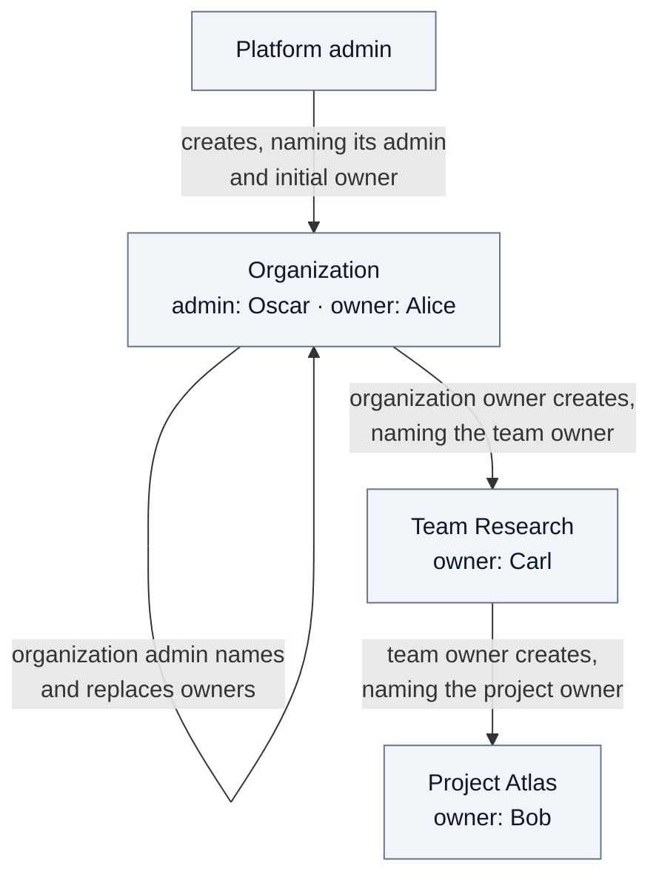
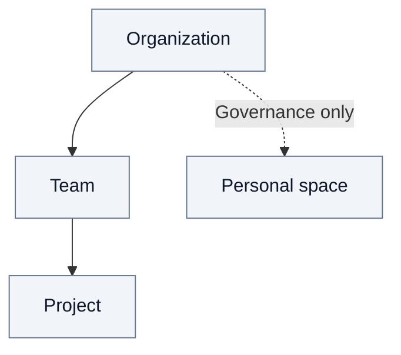
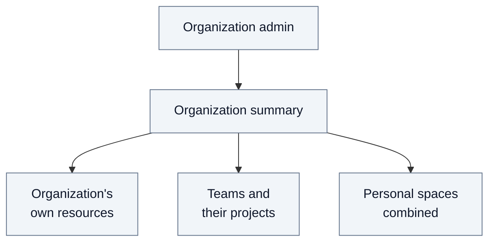

# 4. Organizations and spaces

An **organization** brings together people and their working spaces. **Teams**
support shared work; **projects** organize work within a team. A **personal space**
is dedicated to one person while remaining under the organization's governance.
It is a distinct kind of space, not a collective team.

## Who creates and names whom

The organization is both an institutional boundary and a shared business workspace.
Technical Admin roles exist at platform and organization level. Owners are
responsible for business choices within their space, including application,
model and capability configuration and how a team is divided into projects.

The organization owner manages the community and common resources, such as an
organization corpus or assistant, with analysts, editors and members. A team or
project owner does the same for their space. The creator of a space receives no
role there: Alice created Research but holds no role in it. The organization
admin names and replaces the organization's owners and reads supervision
aggregates, without content access or business-structure authority. The
[roles annex](A11-roles.md) details each mandate and the organization access
allowlist that remains unimplemented.

## Spaces and memberships

Each team belongs to one organization, and each project to one team. People see
and use these spaces according to roles held directly on each space. The hierarchy
grants no child-space rights; see [Security](03-security.md).
Folders organize documents within a space; they do not create another access boundary.

## People in several organizations

One Fred installation can host several organizations. A person may hold roles in
several of them; governance decides. Each organization stays isolated: a person
sees and uses its spaces only through the roles held there. Signing in creates no
attachment, and platform administration roles are separate from organization
membership.

The UI lists the person's accessible working spaces. It was designed for one
organization per person: the personal-space entry on Home and the organization
administration area still use the first organization listed. Choosing among
several organizations is not offered yet.

## Personal spaces

Any person with a business role (owner, member, editor or analyst) in the organization
opens Personal space to create it once; later openings reuse it. An admin role alone
does not qualify.
It has no projects, accepts no additional members and inherits no content rights
from the organization or teams. The organization can revoke the user's access.
Creating an account or organization does not automatically create a personal space.

## Organization supervision

The organization admin opens **Organization supervision** from Administration.
These technical aggregates are part of the admin's mandate. The summary covers documents, processing, published results and direct role counts,
without exposing content or personal identities. Selecting a team opens its detail
in a side panel; Refresh reloads the summary and the open detail.

Team details include their projects. Organization totals cover all teams,
regardless of the page consulted. Retired documents awaiting purge are counted
separately. Published counts describe recorded results, not live storage health.

## Platform administration

A platform admin creates an organization and names its admin and initial owner.
Those responsibilities do not automatically grant access to documents. Provisioning
can also import accounts, teams, projects and explicit roles together; the
[user journey](02.1-user-journeys.md) illustrates this setup.

The current API also lets a platform admin retire a space and its descendants,
beyond the agreed limited platform-admin remit: access closes first,
then cleanup follows. A scope containing documents cannot be retired through this
operation. User accounts are retained.

The [technical annex](A8-organizations.md) details membership rules, provisioning,
placement and cleanup contracts, with links to implementation references.
