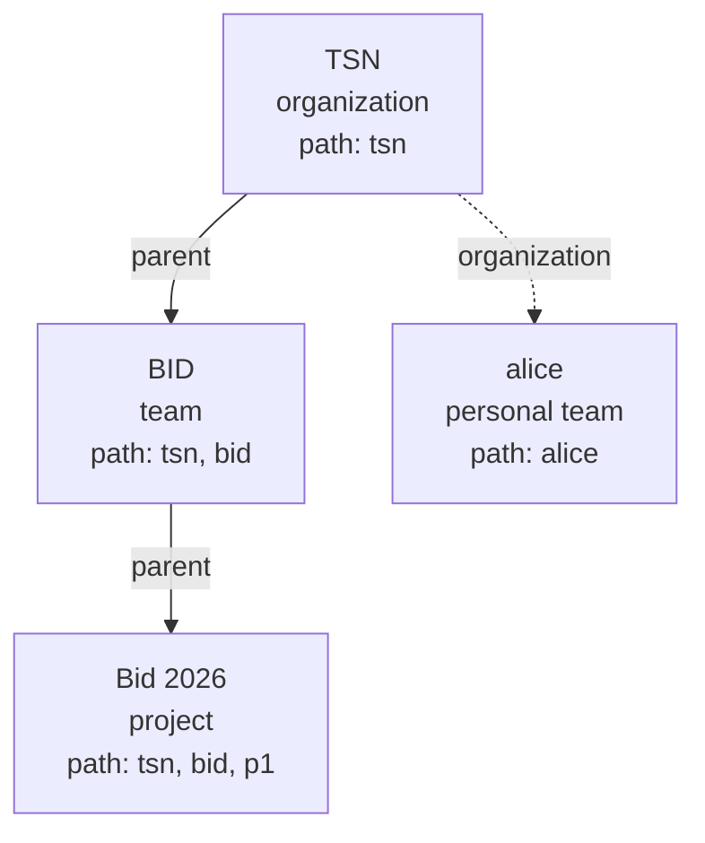

# 4. Organizations and provisioning

Execution context: Fred's organization/team/project model implemented by manager.
Authentication, consent and role authority are defined in [Security](03-security.md).

## Spaces and memberships

An organization is a root. A team belongs to one organization; a project belongs
to one non-personal team. A personal space is a team with one owner, no parent and
no project; its organization manages it. Names are unique among siblings and among
organizations; identically named teams in different organizations remain different
spaces. Placement is immutable; names can change.

Editor, admin and analyst reach every descendant space; member stays local. An
analyst of an organization therefore sees all its teams and projects, and a
project cannot be hidden from its team's editors, administrators or analysts.
Management and content roles remain separate: an administrator manages the space
and its descendants and reads none of their content without a content role.

A role on a child requires a direct content role on its parent: a person is a
member of a team before holding a project role, even when an ancestor role already
lets them read the team. A personal space accepts no additional member and inherits
nothing; its organization can revoke its owner's access, and the owner leaves the
organization only after leaving the personal space. Every non-personal space
retains an administrator.

The tree lives in OpenFGA as `parent` links; SQL stores only each space's identity,
kind, name and personal owner. A personal space has an `organization` link instead,
which no permission uses. A space's path holds its ancestors then itself.

| Scope requested from | Search scope (`space_id` in) |
| --- | --- |
| BID | TSN, BID |
| Bid 2026 | TSN, BID, Bid 2026 |
| Bid 2026, levels `project` | Bid 2026 |
| alice | alice |

A caller may restrict a scope to some of the organization, team and project levels;
levels only remove spaces from it.

Folders classify only and carry no rights. A document's artefacts have no
authorization identity of their own: they are stored under its storage prefix
`<space_id>/<document_id>/`, and `IngestDocument` hands over `space_id`, `document_id`
and `folder_path`, ids only, so indexed content is filtered by scope and a rename
changes nothing outside the row.

## Provisioning people and spaces

The ZIP explicitly declares identities, organizations, teams, projects and roles.
An empty projects array is valid. The [declaration contract](A2-manager-contracts.md#provisioning-declarations)
is the exact wire reference; the [user journey](02-user-journeys.md#from-an-empty-platform-to-an-organizations-first-user)
shows its observable effects.

Whole-bundle preflight rejects predictable errors before provisioning writes.
Organizations resolve by root name, teams by organization/name and projects by
team/name. Existing identity fields, passwords, committed space IDs and undeclared
roles are preserved. Requested grants are repaired; no content role or CGU
acceptance is invented. A new organization declares at least one owner and one
admin, possibly the same person; owner is refused on teams and projects. Import
requires a platform owner.

Keycloak, PostgreSQL and OpenFGA do not share a transaction. An error can leave
created identities or acknowledged grants; replay follows correction of the cause
and never reuses rolled-back space IDs. A successful report counts resolved and
created identities, committed reconciled spaces and acknowledged grants. HTTP 200
means reconciliation completes. The [import sequence](A1-manager-runtime.md#authenticated-provisioning-import)
details these boundaries.

## Invitations, selection and membership administration

## Leaving, deleting and transferring ownership

## Export and portability
