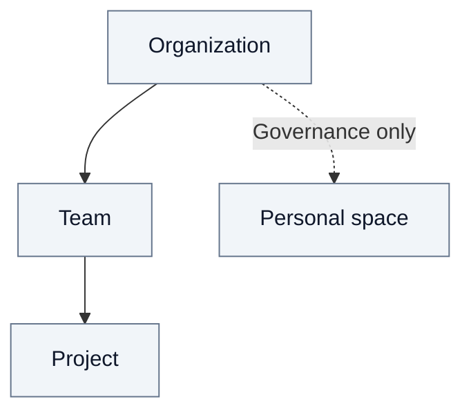
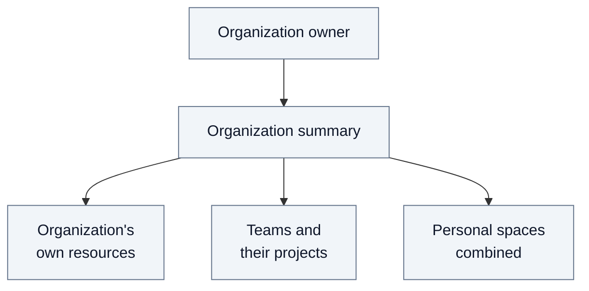

# 4. Organizations and spaces

An **organization** brings together people and their working spaces. **Teams**
support shared work; **projects** organize work within a team. A **personal space**
is dedicated to one person while remaining under the organization's governance.
It is a distinct kind of space, not a collective team.

## Spaces and memberships

Each team belongs to one organization, and each project to one team. People see
and use these spaces according to their roles. A project's place in the hierarchy
also determines which rights it inherits; see [Security](03-security.md).
Folders organize documents within a space; they do not create another access boundary.

## One person, one organization

One Fred installation can host several organizations. A person is attached to
**at most one organization** and may participate in several of its teams and
projects. Signing in does not create that attachment. Platform administration
roles are separate from organization membership.

The UI shows the organization in Profile and lets the user choose accessible
working spaces. It does not offer an organization switcher.

## Personal spaces

An entitled user opens Personal space to create it once; later openings reuse it.
It has no projects, accepts no additional members and inherits no content rights
from the organization or teams. The organization can revoke the user's access.
Creating an account or organization does not automatically create a personal space.

## Organization supervision

The organization owner consults a technical summary through the API. It covers
documents, processing, published results and direct role counts, without exposing
content or personal identities. There is no supervision screen.

Team details include their projects. Organization totals cover all teams,
regardless of the page consulted. Retired documents awaiting purge are counted
separately. Published counts describe recorded results, not live storage health.

## Platform organization administration

A platform owner creates an organization and appoints its owner and administrator.
Those responsibilities do not automatically grant access to documents. Provisioning
can also import accounts, teams, projects and explicit roles together; the
[user journey](02.1-user-journeys.md) illustrates this setup.

A platform owner can retire a space and its descendants: access closes first,
then cleanup follows. A scope containing documents cannot be retired through this
operation. User accounts are retained.

The [technical annex](A8-organizations.md) details membership rules, provisioning,
placement and cleanup contracts, with links to implementation references.
