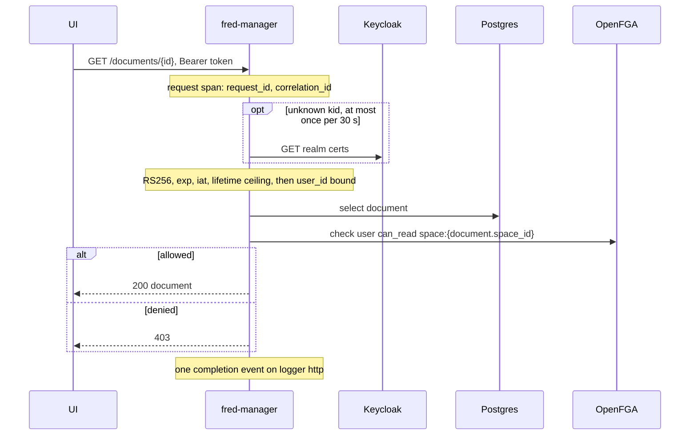
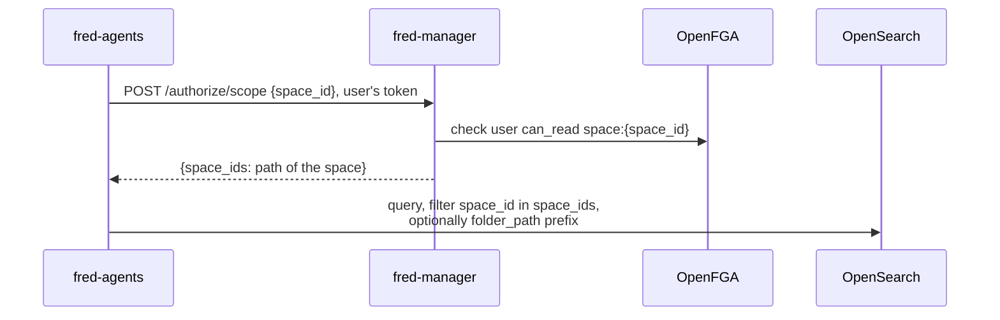
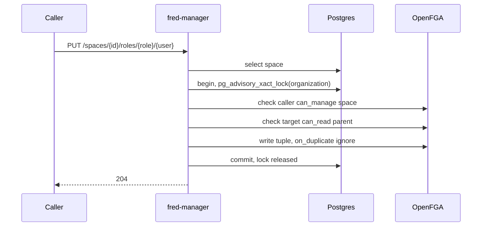
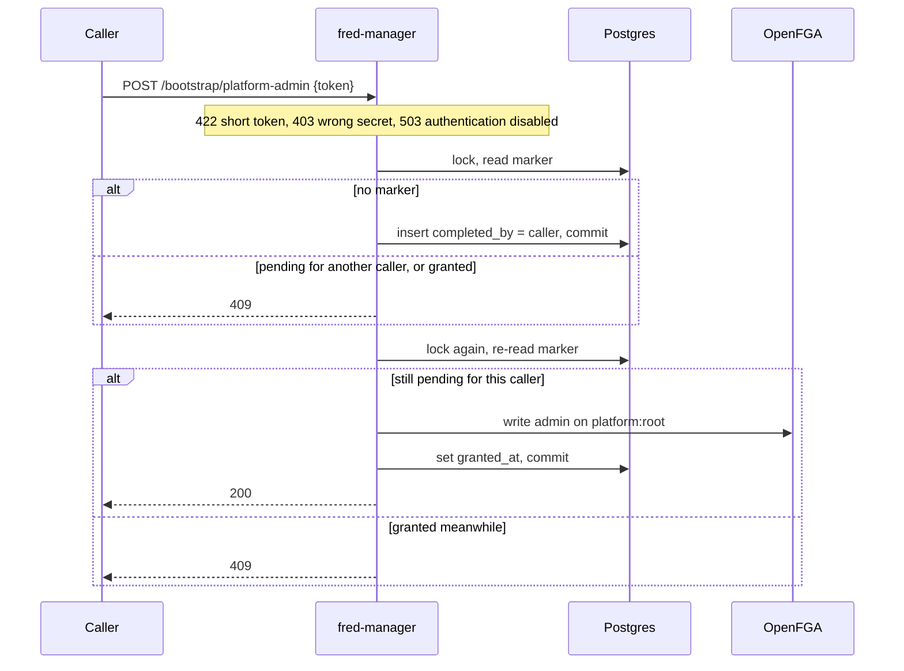
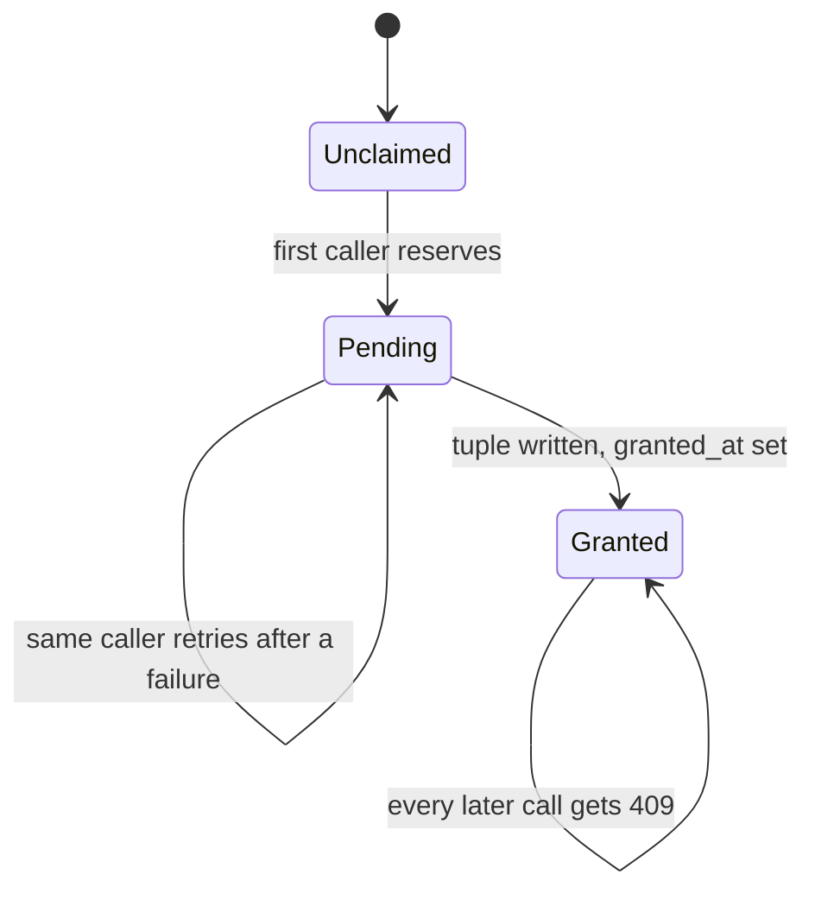
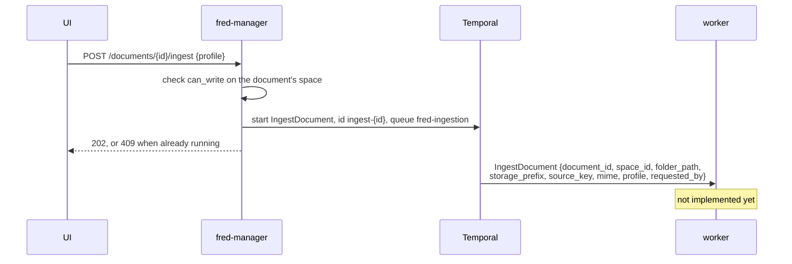

# 4. Runtime

## fred-manager HTTP surface

Every route but the health probe requires a bearer token (chapter 6).

<!-- generated: routes apps/fred-manager/src/api.rs /fred-manager/v1 -->
| Method | Path | Handler |
| --- | --- | --- |
| GET | `/fred-manager/v1/healthz` | `inline` |
| POST | `/fred-manager/v1/bootstrap/platform-admin` | `bootstrap_platform_admin` |
| GET | `/fred-manager/v1/me` | `me` |
| GET | `/fred-manager/v1/me/spaces` | `my_spaces` |
| POST | `/fred-manager/v1/me/personal-space` | `create_personal_space` |
| POST | `/fred-manager/v1/spaces` | `create_space` |
| PUT | `/fred-manager/v1/spaces/{id}/roles/{role}/{user}` | `grant` |
| DELETE | `/fred-manager/v1/spaces/{id}/roles/{role}/{user}` | `revoke` |
| GET | `/fred-manager/v1/spaces/{id}/folders` | `list_folders` |
| GET | `/fred-manager/v1/spaces/{id}/documents` | `list_documents` |
| POST | `/fred-manager/v1/folders` | `create_folder` |
| PATCH | `/fred-manager/v1/folders/{id}` | `rename_folder` |
| DELETE | `/fred-manager/v1/folders/{id}` | `delete_folder` |
| POST | `/fred-manager/v1/documents` | `create_document` |
| GET | `/fred-manager/v1/documents/{id}` | `get_document` |
| PATCH | `/fred-manager/v1/documents/{id}` | `rename_document` |
| DELETE | `/fred-manager/v1/documents/{id}` | `delete_document` |
| POST | `/fred-manager/v1/documents/{id}/ingest` | `ingest_document` |
| POST | `/fred-manager/v1/authorize/document` | `authorize_document` |
| POST | `/fred-manager/v1/authorize/scope` | `authorize_scope` |
<!-- end generated -->

## Content access

One OpenFGA check on the space that owns the content, whatever the content is: a
document, its metadata, a page of a folder.

## Agent search scope

The agent calls with the user's own token. The scope is the space and its ancestors,
never its descendants (I7): a team conversation never sees its projects' content.

## Role and space mutations

`grant`, `revoke`, `create_space` and `create_personal_space` take a transaction-scoped
advisory lock keyed by the organization, then check and write under it (I4, I5).

Revocation also reads the target's roles and the space's children under the lock, and
refuses with 409 when the target would keep a role in a child without reading its
parent. A personal space is managed from its organization: an organization admin may
revoke its owner's roles, nobody may grant any (I6).

## Root platform-admin bootstrap

Two proofs: the caller's verified bearer and the deploy-time secret
(`app.bootstrap_token_env_var`, compared in constant time). Two transactions under one
advisory lock (I9).

## Ingestion submission

`POST /documents` registers a document and returns its `storage_prefix`
(`<space_id>/<document_id>/`) and `source_key` (`<prefix>source`). Uploading the source
is not built yet. Workflow ids are `ingest-<document_id>` and `delete-<document_id>`:
a second ingestion while one runs answers 409.

Deletion submits `DeleteDocument {document_id, space_id, storage_prefix}` before
deleting the row, so a failure leaves a retryable document rather than orphaned chunks.
