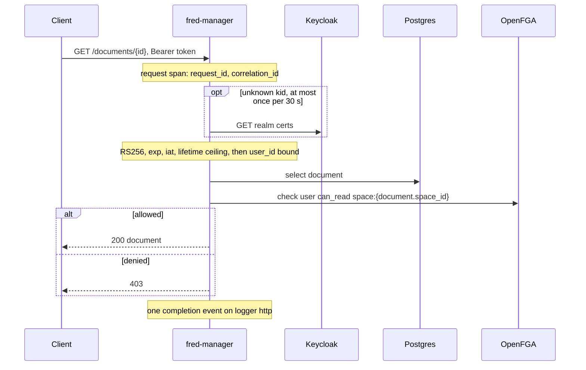
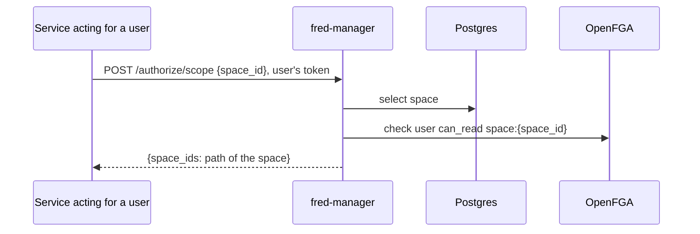
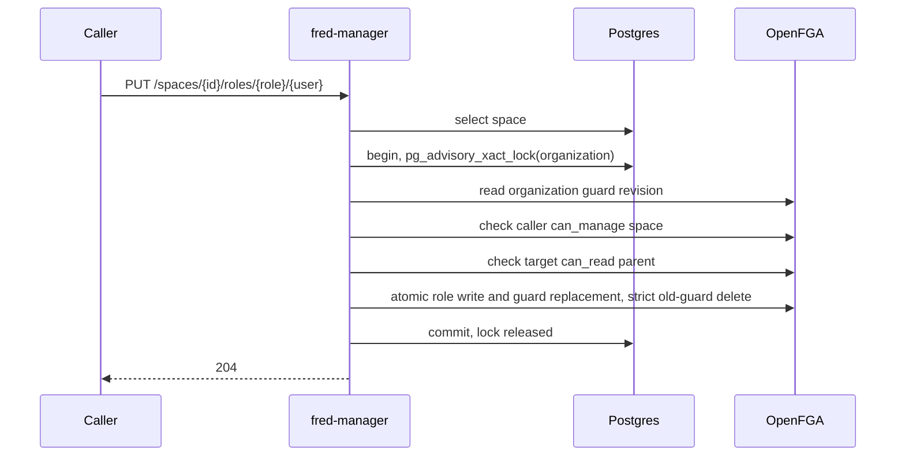
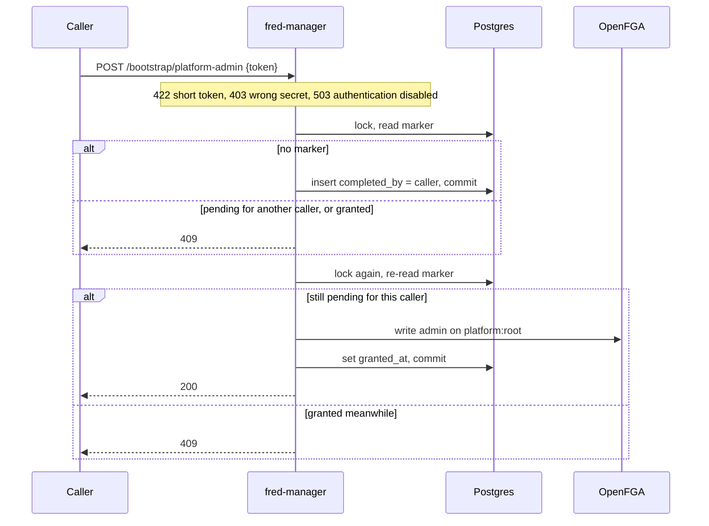
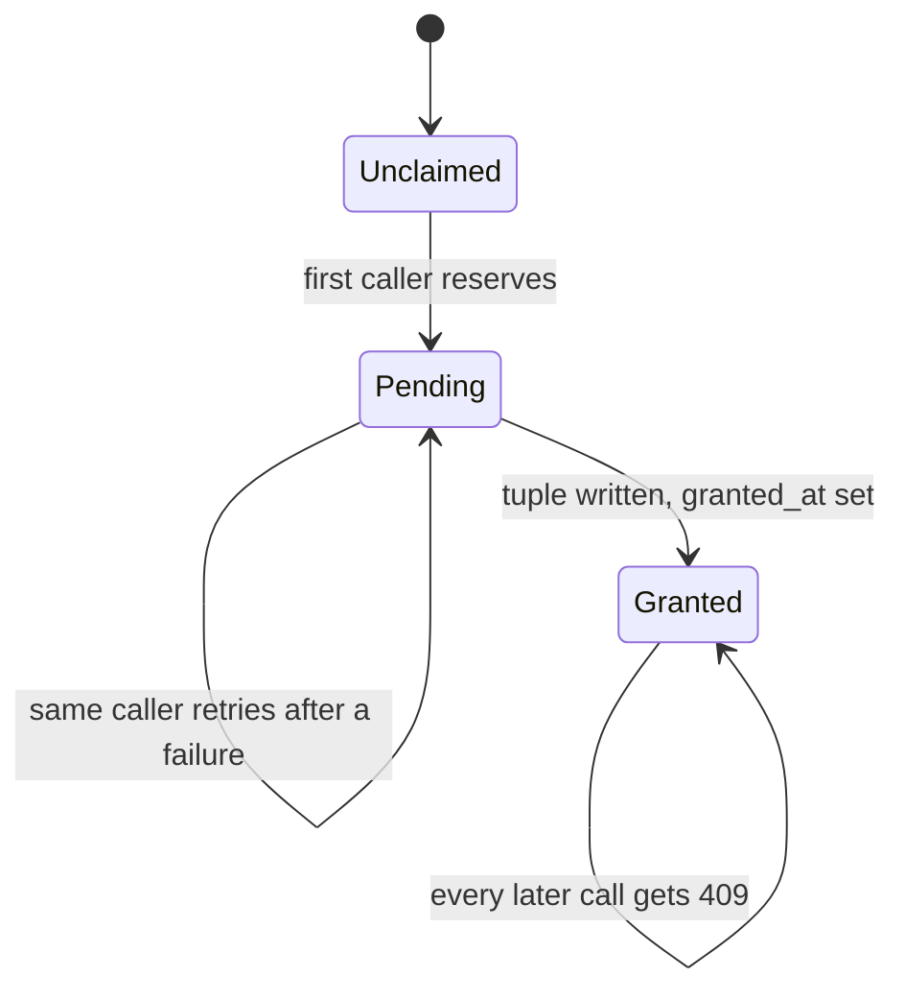
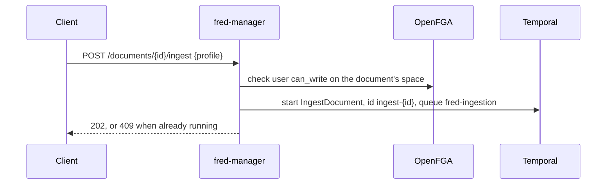
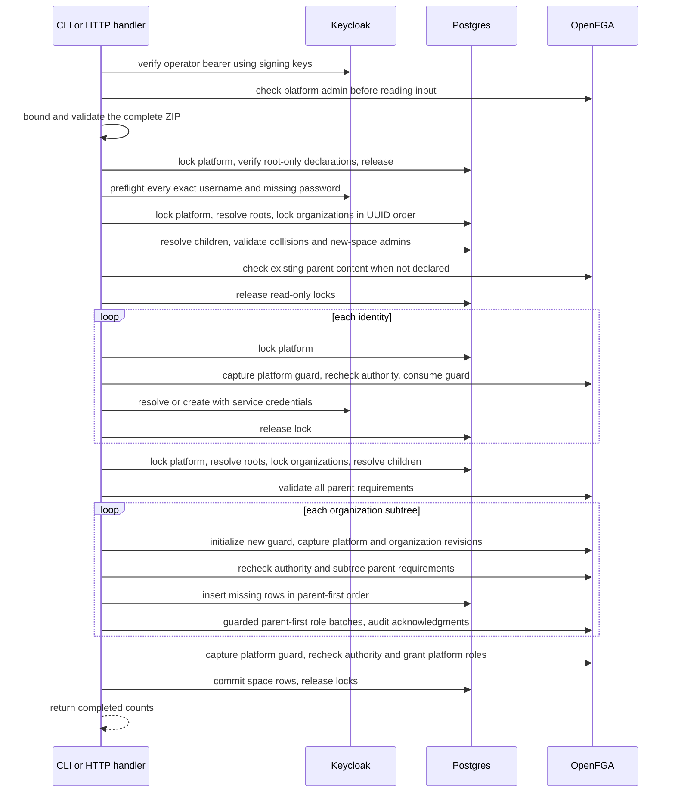

# 4. Runtime

## fred-manager HTTP surface

Every route but the health probe requires a bearer token (chapter 6).

<!-- generated: routes apps/fred-manager/src/api.rs /fred-manager/v1 -->
| Method | Path | Handler |
| --- | --- | --- |
| GET | `/fred-manager/v1/admin/teams` | `team_registry` |
| POST | `/fred-manager/v1/authorize/document` | `authorize_document` |
| POST | `/fred-manager/v1/authorize/platform` | `authorize_platform` |
| POST | `/fred-manager/v1/authorize/scope` | `authorize_scope` |
| POST | `/fred-manager/v1/authorize/space` | `authorize_space` |
| POST | `/fred-manager/v1/bootstrap/platform-admin` | `bootstrap_platform_admin` |
| POST | `/fred-manager/v1/documents` | `create_document` |
| DELETE | `/fred-manager/v1/documents/{id}` | `delete_document` |
| GET | `/fred-manager/v1/documents/{id}` | `get_document` |
| PATCH | `/fred-manager/v1/documents/{id}` | `rename_document` |
| POST | `/fred-manager/v1/documents/{id}/ingest` | `ingest_document` |
| POST | `/fred-manager/v1/folders` | `create_folder` |
| DELETE | `/fred-manager/v1/folders/{id}` | `delete_folder` |
| PATCH | `/fred-manager/v1/folders/{id}` | `rename_folder` |
| GET | `/fred-manager/v1/healthz` | `health` |
| POST | `/fred-manager/v1/import-export/import` | `import_blueprint` |
| GET | `/fred-manager/v1/me` | `me` |
| POST | `/fred-manager/v1/me/personal-space` | `create_personal_space` |
| GET | `/fred-manager/v1/me/spaces` | `my_spaces` |
| POST | `/fred-manager/v1/spaces` | `create_space` |
| GET | `/fred-manager/v1/spaces/{id}/documents` | `list_documents` |
| GET | `/fred-manager/v1/spaces/{id}/folders` | `list_folders` |
| DELETE | `/fred-manager/v1/spaces/{id}/roles/{role}/{user}` | `revoke` |
| PUT | `/fred-manager/v1/spaces/{id}/roles/{role}/{user}` | `grant` |
| GET | `/fred-manager/v1/users/platform-roles` | `list_platform_roles` |
| DELETE | `/fred-manager/v1/users/{user}/platform-roles/{role}` | `revoke_platform_role` |
| PUT | `/fred-manager/v1/users/{user}/platform-roles/{role}` | `grant_platform_role` |
<!-- end generated -->

## Content access

One OpenFGA check on the space that owns the content, whatever the content is: a
document, its metadata, a page of a folder.

## Search scope

A service acting for a user calls with that user's own token. The scope is the space
and its ancestors, never its descendants (I7): from a team, a project's content is out
of scope. The caller filters indexed content with `space_id` in the returned ids, and
narrows to a folder with a `folder_path` prefix.

## Role and space mutations

`grant`, `revoke`, `create_space` and `create_personal_space` take a transaction-scoped
advisory lock keyed by the organization, capture its guard revision, then check and
write under it (I4, I5). SQL locks order live callers; OpenFGA guard consumption
rejects stale remote writes that outlive their caller or transaction.

Revocation also reads the target's roles and the space's children under the lock, and
refuses with 409 when the target would keep a role in a child without reading its
parent. Removing the last administrator of a non-personal space is refused with 409 (I14).
Removing a role never grants a replacement content role. A personal space is managed from its organization: an organization admin may
revoke its owner's roles, nobody may grant any (I6).

## Root platform-admin bootstrap

Two proofs: the caller's verified bearer and the deploy-time secret
(`app.bootstrap_token_env_var`, compared in constant time). Two transactions under one
advisory lock (I9).

## Ingestion submission

`POST /documents` registers a document and returns its `storage_prefix`
(`<space_id>/<document_id>/`) and `source_key` (`<prefix>source`). Workflow ids are
`ingest-<document_id>` and `delete-<document_id>`: a second ingestion while one runs
answers 409.

| Workflow | Input |
| --- | --- |
| `IngestDocument` | `document_id`, `space_id`, `folder_path`, `storage_prefix`, `source_key`, `mime`, `profile` (default `medium`), `requested_by` |
| `DeleteDocument` | `document_id`, `space_id`, `storage_prefix` |

Deletion submits `DeleteDocument {document_id, space_id, storage_prefix}` before
deleting the row, so a failure leaves a retryable document rather than orphaned chunks.

## Platform administration and self checks

`GET /me` returns effective platform roles, including the roles implied by platform
admin. `GET /users/platform-roles` returns direct grants only, to platform admins.
`PUT` and `DELETE /users/{user}/platform-roles/{role}` acquire the bootstrap/platform
lock and recheck the caller's platform-admin permission. Only the completed bootstrap
root can grant or revoke platform admin, and its own admin grant cannot be removed.
Granting requires a Keycloak subject that exists in the configured directory; revoking
a stale direct grant does not require the identity to still exist (I15).

Platform roles use canonical names `platform_admin`, `platform_observer`, `team_manager`,
`feature_manager` and `prompt_editor`; mutation paths also accept `admin` and `observer`.
Deleting an absent direct grant returns 404, even when the role is effective through admin.

`POST /authorize/platform` accepts `{ "permission": "create_team" }`;
`POST /authorize/space` accepts `{ "space_id": "<uuid>", "permission": "run_evaluations" }`.
Both return `{ "allowed": true|false }` for the authenticated caller only. The typed
capabilities are defined in `roles.rs` and the model in chapter 5. Space checks first
resolve the space, returning 404 for an unknown id.

`GET /admin/teams` requires `can_list_all_teams` and returns at most 100 non-personal
team metadata records ordered by UUID. `?after=<uuid>` continues after the last id;
it confers no content access.

Team creation accepts either management of the parent organization or the platform
`can_create_team` capability. It takes the platform lock before the organization lock,
then checks authorization. The nominated team administrator must read the parent.
The caller receives no implicit role; project creation still requires local governance.

## Authenticated provisioning import

`fred-manager import-provisioning <bundle.zip> --token-file <path>` verifies the
operator bearer, connects to SQL without migrating and verifies migration
versions/checksums. It loads the published FGA store/model and checks platform admin.
Multipart `POST /import-export/import` checks the authenticated caller's platform
admin authority before reading exactly one `file` field. Both parse the same ZIP
on a blocking worker and invoke `Importer`. A platform-admin declaration also
requires the completed bootstrap root, including on replay.

Predictable bundle, passwordless-identity, missing new-space-admin and parent-access
errors fail whole-bundle preflight before provisioning writes (I18). Directory
traversal holds no mutation lock. Child names are read only after acquiring all
organization locks. Reconciliation retains those locks and the platform lock through
SQL commit. It captures revisions before rechecking authority and parent access,
then carries acknowledged revisions through batches of at most 96 space-role tuples
plus four guard operations (I4, I5). A subtree with no role writes consumes its guard
explicitly. Platform grants use the platform guard and recheck identity existence.

Organizations resolve by root name, teams by organization/name, projects by team/name.
Existing committed IDs are reused; incompatible-kind and personal-space collisions
are refused. Bundle references only identify declarations within that input.
Exact username lookup is paginated and rejects ambiguous/inexact replies; a creation
conflict triggers a fresh lookup. Existing profiles and credentials are preserved.

Reconciliation is additive (I17): undeclared roles remain and requested grants are
repaired. Renaming a declaration identifies a different space. Identities and
acknowledged FGA grants can survive a failed SQL transaction; there is no distributed
rollback. New rows commit after their initial grants, and rolled-back UUIDs are never
reused. The CLI exits nonzero on failure; HTTP returns safe phase/count information.
HTTP 200 means reconciliation completes, not merely that an upload is accepted.

Local folder/document mutations capture the organization guard, authorize, consume
the guard and commit SQL under the same organization lock. Placement reads use the
held SQL connection. Temporal submission holds that lock through dispatch; its
remote effects have the dispatch boundary described by I5 in chapter 5.
