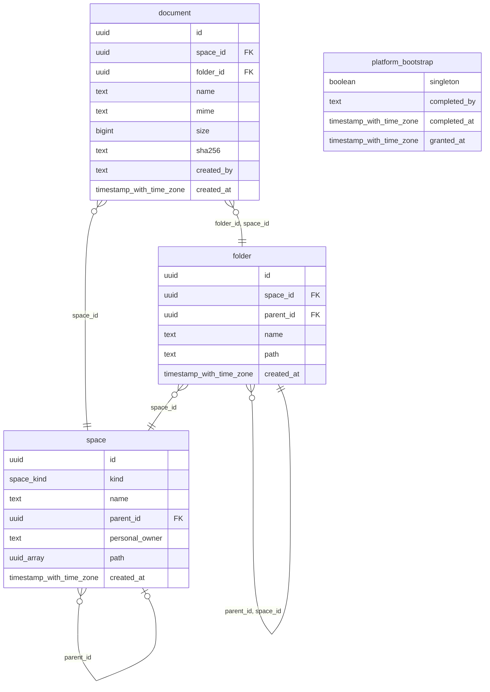
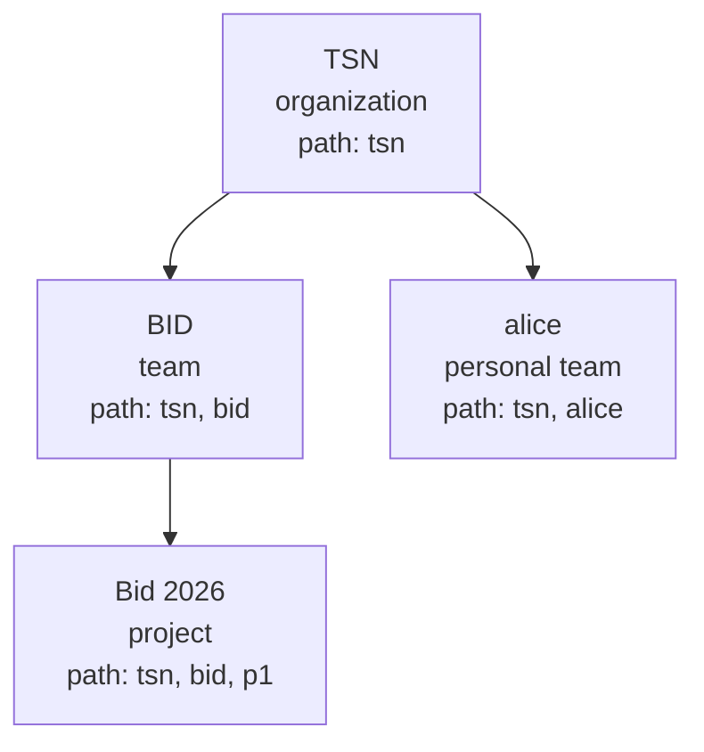

# 5. Data and authorization

## fred-manager schema

Generated by tbls from `apps/fred-manager/migrations` (`make er`). The tables live in
the `fred` database, created by sqlx migrations at startup. An applied migration is
never edited: sqlx checksums each file.

<!-- generated: mermaid docs/architecture/generated/fred-manager.er.mmd -->

<!-- end generated -->

What the schema enforces by itself:

| Rule | Mechanism |
| --- | --- |
| Organization has no parent, others have one | `check ((kind = 'organization') = (parent_id is null))` |
| A personal space is a team | `check (personal_owner is null or kind = 'team')` |
| One personal space per owner and organization | `unique (parent_id, personal_owner)` |
| Unique names among siblings | `unique nulls not distinct` on `(parent, name)` |
| A document's folder is in the document's space | composite foreign key `(folder_id, space_id)` |
| A sub-folder is in its parent's space | composite foreign key `(parent_id, space_id)` |
| A non-empty folder cannot be deleted | foreign keys, answered 409 |
| Placement never changes | `before update` triggers on `space`, `folder`, `document` |
| One root bootstrap, ever | `platform_bootstrap` single row (`singleton` key) |

## Space tree

The tree is in SQL; OpenFGA has no parent relation. `path` holds ancestors then self.



| Conversation in | Search scope (`space_id` in) |
| --- | --- |
| BID | TSN, BID |
| Bid 2026 | TSN, BID, Bid 2026 |
| alice | TSN, alice |

Folders classify only and carry no rights. A document's artefacts have no
authorization identity of their own: they are stored under its storage prefix
`<space_id>/<document_id>/`, and `IngestDocument` hands over `space_id`, `document_id`
and `folder_path`, ids only, so indexed content is filtered by scope and a rename
changes nothing outside the row.

## OpenFGA model

Store `fred-manager`, found or created at startup, model written when
`sync_schema_on_init` is set. User ids are Keycloak subjects.

<!-- generated: include apps/fred-manager/openfga/model.fga text -->
```text
model
  schema 1.1

type user

# One object, platform:root. Platform roles grant no access to any space's content.
type platform
  relations
    define admin: [user]
    define observer: [user] or admin
    define team_manager: [user] or admin
    define feature_manager: [user] or admin
    define prompt_editor: [user] or admin
    define can_create_team: team_manager
    define can_list_all_teams: team_manager or feature_manager
    define can_delete_team: admin
    define can_rescue_team_admin: admin
    define can_edit_agent_class_path: admin
    define can_observe_platform: observer
    define can_administer_users: admin
    define can_manage_platform: admin
    define can_manage_capabilities: feature_manager
    define can_edit_platform_prompt: prompt_editor

# One type, direct roles only, no parent relation: the tree lives in SQL.
# A role on a space requires a content role on its parent (enforced by fred-manager).
type space
  relations
    define member: [user]
    define editor: [user]
    define admin: [user]
    define analyst: [user]
    define can_read: member or editor or analyst
    define can_write: editor
    define can_manage: admin
    define can_run_evaluations: analyst or admin
    define can_manage_evaluation_corpus: analyst or admin
    define can_read_conversations_for_evaluation: analyst
```
<!-- end generated -->

## Invariants

| Id | Invariant | Held by |
| --- | --- | --- |
| I1 | An organization is a root, a team's parent is an organization, a project's parent is a non-personal team. | `domain::check_parent`, schema checks |
| I2 | Placement never changes: a space's parent and path, a folder's space, parent and path, a document's space and folder. Names may change. | triggers |
| I3 | A document's folder, and a sub-folder's parent, belong to the same space. | composite foreign keys |
| I4 | Holding a role on a space requires a content role on its parent, under any concurrency. | `spaces`, organization lock |
| I5 | A caller's right is evaluated at the moment of its write: a request authorized before a revocation cannot finish after it. | caller check under the lock |
| I6 | A personal space never gains a member, and its organization can always remove its owner. | `spaces::grant`, `spaces::revoke` |
| I7 | A space's search scope is its ancestors and itself, never its descendants. | `space.path` |
| I8 | Space admin and platform admin roles read no content. | OpenFGA `can_read = member or editor or analyst` |
| I9 | Root bootstrap promotes one caller, once; it never reopens, not even for its own admin after removal. | `bootstrap::grant_root`, marker |
| I10 | Only an RS256 token from the realm, unexpired, with an integer past `iat` and a lifetime within the ceiling, authenticates. | `auth` |
| I11 | Log lines never carry credential- or content-named fields; dependencies never log their own text. | `logging` |
| I12 | A document page continues after its cursor's sort values, even when that document is gone. | keyset cursor |
| I13 | Every line of a request carries its request id, and the request ends with one `http` event. | `logging::request_logging` |
| I14 | Every non-personal space retains at least one administrator after role revocation. | `spaces::revoke`, organization lock |
| I15 | Only the completed bootstrap root changes platform-admin grants; its own grant is protected. New platform grants target an existing Keycloak subject. | `platform`, platform lock, directory lookup |
| I16 | Every acknowledged role mutation emits a security audit event before SQL commit, independently of application severity and text/JSON format. | `logging::audit_relation`, mutation services |
| I17 | Provisioning replay preserves existing identities, committed space IDs and undeclared grants, and repairs requested grants without reusing rolled-back space IDs. | `provisioning`, exact directory lookup, SQL uniqueness |
| I18 | Import requires a verified platform administrator and compatible initialized state; predictable preflight failures cause no provisioning or initialization writes. | CLI read-only initialization, `Importer::preflight`, root guard |

Roles are cumulative and scoped to one space. Analyst grants content read and the capabilities
`run_evaluations`, `manage_evaluation_corpus` and `read_conversations_for_evaluation`.
Admin grants space management and the first two evaluation capabilities, without
content read or evaluation-conversation read.
No space or platform role propagates to another space.

Platform admin implies all platform capabilities. Team manager grants team creation and listing;
feature manager grants `manage_capabilities` and team registry listing; prompt editor grants
`edit_platform_prompt`; observer grants `observe_platform`. These grants do not imply space membership or content access.
`openfga/model.fga` is the authoritative permission matrix; `make model` compiles its
supported direct/union expressions to `model.json`, and `make check-model` checks parity.

## Provisioning declarations

The bundle has `organization: { name, admins }` and a `users` array. Organization name
and admins are nonempty; admins reference usernames in that array. User fields match
the control-plane `users.json`: `username`, optional `email`, `first_name`, `last_name`,
`password`, and default-empty `teams`, `team_roles`, `platform_roles`.

| Declaration | Direct grants |
| --- | --- |
| Organization admin | Organization `admin` and `member` |
| Any team role | Organization `member`, plus the declared team role |
| `team_member`, `team_editor`, `team_admin`, `team_analyst` | Team `member`, `editor`, `admin`, `analyst`, respectively |
| `teams` entry without an explicit role for that team in the same user entry | Team `member` |
| Platform role only | Platform grant, no space grant |

Explicit team roles accumulate and suppress the `teams` member fallback for that user
and team. Every new team requires a declared team admin. Platform aliases `admin` and
`observer` normalize to `platform_admin` and `platform_observer`; equivalent declarations
are deduplicated. Unknown fields/roles, duplicate usernames, duplicate role-object keys,
empty names and non-assignable lifecycle roles are rejected, never ignored.

Missing identities require a nonempty password and are created enabled with a
non-temporary credential. Absent or empty email uses `<username>@example.com`;
optional first/last names are passed when supplied. Existing identity fields remain intact.
