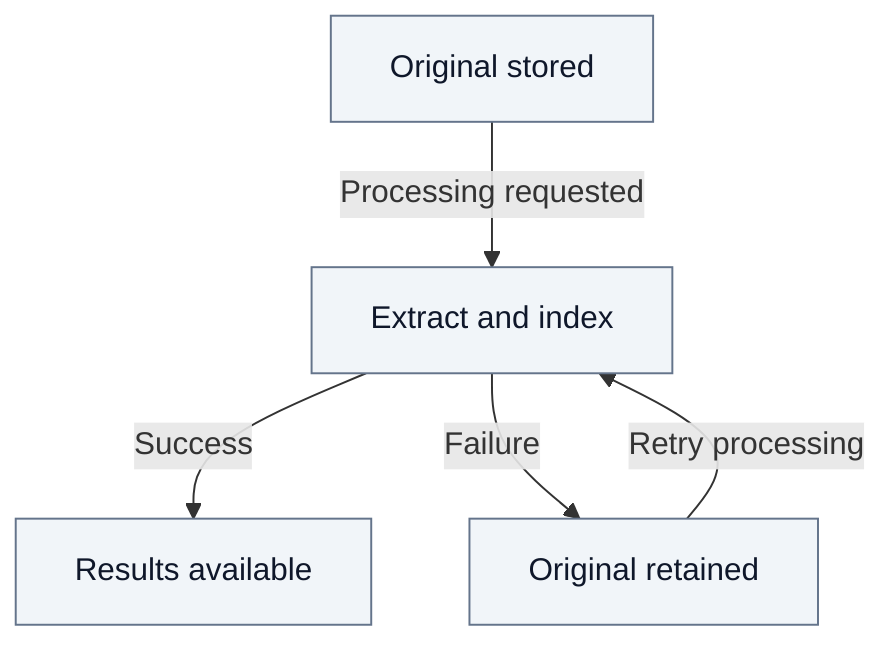
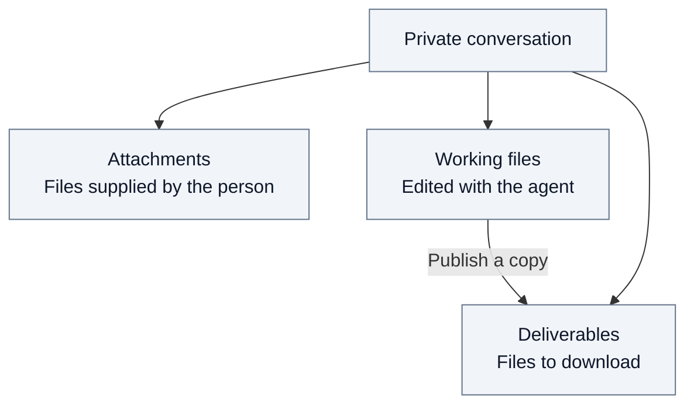
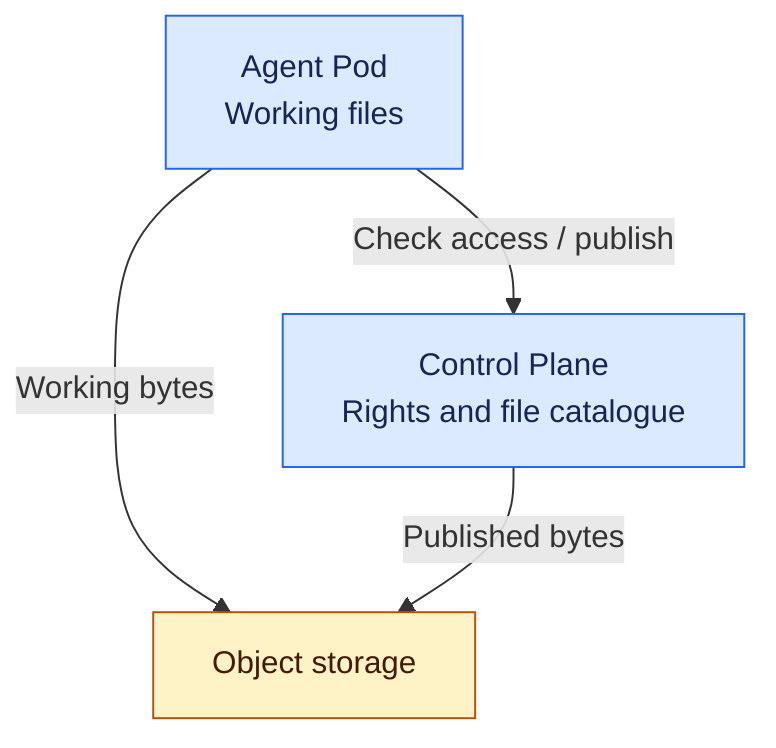
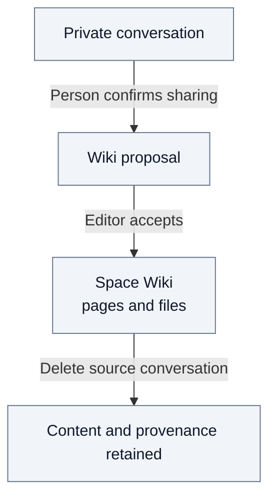

# 5. Documents and knowledge

Fred distinguishes documents stored in a space's drive from working documents
authored in a conversation. Drive documents retain their original file and can
produce derived results, such as extracted text and search indexes. Conversation
documents support drafting and revision with an assistant.

## 5.1. Organize and import

Drive documents belong to a space and are organized into folders in its drive.
Their access rights come from that space, not from individual folders.
Readers can consult content; editors can import documents and manage folders.

An import checks the destination, filename and available quota. A name conflict
does not overwrite an existing document. Each file has its own outcome: one
failed upload does not undo the others. Once stored, the original is preserved
unchanged. The [coordination overview](01-system-overview.md#13-coordinating-document-writes)
explains how Control Plane protects these reservations and publications when
several editors write concurrently.

## 5.2. Process the content

Processing can start with the upload or later from a stored document. The chosen
profile determines how the content is processed. Control Plane coordinates every
attempt; Knowledge Flow extracts and indexes its authorized original. A failed attempt can be retried
without uploading the original again. Progress and results remain available
after reloading the page.

## 5.3. Read the result

The drive lists the stored documents and their processing state. Users can
download the original and, after successful processing, view the available file
preview and extracted text. Current access rights are checked when reading.

Published results included in search can be used by agents within the corpus
authorized at the start of their turn. An upload alone, or the presence of indexed
vectors, does not make a document available to agent search. The
[document journey](02.2-document-journey.md) illustrates import and preview with a PDF.

## 5.4. Remove folders and clean up failures

Folders can be renamed. A folder subtree can be deleted only when it contains
neither documents nor pending uploads; space retirement has the same restriction.
Document replacement and deletion are unavailable in this path.

Automatic cleanup removes abandoned upload data and obsolete processing outputs,
while preserving stored originals and published results. Cancelling a queued
upload does not delete a stored document.

For drive documents, see [Security](03-security.md) for permissions and the
[technical annex](A9-documents.md) for storage layout, processing states,
retry and cleanup contracts, and implementation references.

## 5.5. Documents authored in a conversation

Files belong to the conversation, not to everyone in its space. Its owner can
find attachments, working files and published deliverables in the file panel.

**Legend:** 🟦 Fred · 🟨 COTS · ⬜ Concepts

Deep's working files persist between turns and offer text preview and download.
Publishing a deliverable creates a separately managed file: later workspace
edits do not change it. A deliverable is neither a drive document nor searchable
knowledge. The document editor also supports drafting with the assistant and
Word or Markdown export.

### Who controls the files?

Control Plane owns conversation access and the published-file catalogue. The
Agent Pod owns the working filesystem. Object storage holds bytes, never rights.
Independent browsing and downloads check current conversation access; this is
separate from the authority of an already admitted turn.

Deleting the conversation withdraws access immediately; physical cleanup runs
in the background. See the [implementation reference](A9-documents.md#documents-authored-in-a-conversation)
for storage, reads and export contracts.

### Sharing a page or file in the Wiki

The Wiki holds the pages and files a space's members share. Only editors accept
or refuse proposals; their own proposals are accepted at once. A file proposal
is a frozen copy counted in the space quota; refusal or withdrawal deletes it.
Accepted content retains author and agent provenance without opening the source
conversation. Wiki files are never indexed. Publication records a sharing decision,
not verification of the content; a review deadline expresses freshness separately.
