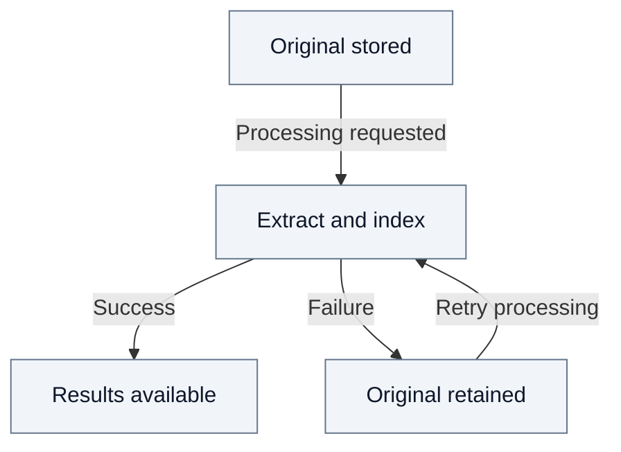

# 5. Documents and knowledge

Fred keeps the **original document** and, when processing is requested, produces
**derived results** such as extracted text and search indexes. Storing a file
and processing its content are distinct steps.

## 5.1. Organize and import

Documents belong to a space and are organized into folders in its drive.
Their access rights come from that space, not from individual folders.
Readers can consult content; editors can import documents and manage folders.

An import checks the destination, filename and available quota. A name conflict
does not overwrite an existing document. Each file has its own outcome: one
failed upload does not undo the others. Once stored, the original is preserved
unchanged. The [coordination overview](01-system-overview.md#13-coordinating-document-writes)
explains how Control Plane protects these reservations and publications when
several editors write concurrently.

## 5.2. Process the content

Processing can start with the upload or later from a stored document. The chosen
profile determines how the content is processed. A failed attempt can be retried
without uploading the original again. Progress and results remain available
after reloading the page.

## 5.3. Read the result

The drive lists the stored documents and their processing state. Users can
download the original and, after successful processing, view the available file
preview and extracted text. Current access rights are checked when reading.

In this document path, storage and processing do not expose the document to
agent search. The [document journey](02.2-document-journey.md) illustrates import
and preview with a PDF.

## 5.4. Remove folders and clean up failures

Folders can be renamed. A folder subtree can be deleted only when it contains
neither documents nor pending uploads; space retirement has the same restriction.
Document replacement and deletion are unavailable in this path.

Automatic cleanup removes abandoned upload data and obsolete processing outputs,
while preserving stored originals and published results. Cancelling a queued
upload does not delete a stored document.

See [Security](03-security.md) for permissions and the
[technical annex](A9-documents.md) for storage layout, processing states,
retry and cleanup contracts, and implementation references.
