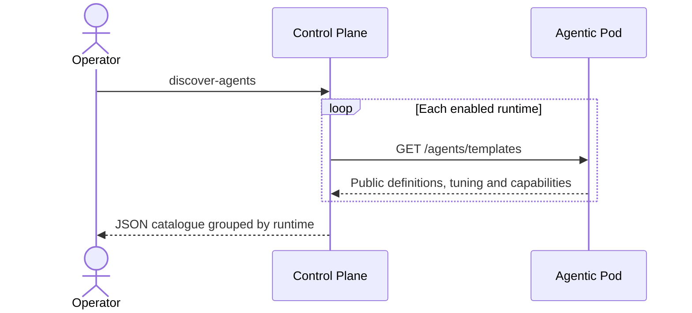

# 6. Agents and conversations

## Agent definitions, instances and configuration

The operator command `control-plane discover-agents` reads public definitions
live from the runtimes declared in `platform.runtime_catalog_sources`. Each enabled
source receives `GET <base_url>/agents/templates`, with a 10-second timeout.
The JSON result groups the unchanged template metadata by configured `runtime_id`.
Tuning and capability declarations remain runtime-owned. Internal templates are
excluded by the runtime's default visibility filter.

Discovery does not persist definitions or create agent instances. PostgreSQL has
no table for this catalogue. In Swift, `agent_instance` stores team enrollment
records (`team_id` is mandatory), not the discovered definitions. Reusing that
table for discovery would change its meaning.

The command exits on an unreachable runtime, non-success HTTP status or malformed
catalogue, without returning partial JSON. Swift's business listing instead skips
unavailable sources; this command is an operator inspection surface, not that
team-scoped listing. No HTTP route, team permission grant or execution is involved.

Implementation: [agents.rs](../../apps/control-plane/src/agents.rs), dispatched
by [main.rs](../../apps/control-plane/src/main.rs). Configuration and invocation:
[component README](../../apps/control-plane/README.md#discover-agent-definitions).

## Conversation state and memory

## Execution, streaming and cancellation

## Tools, artifacts and results

## Evaluation and observability
