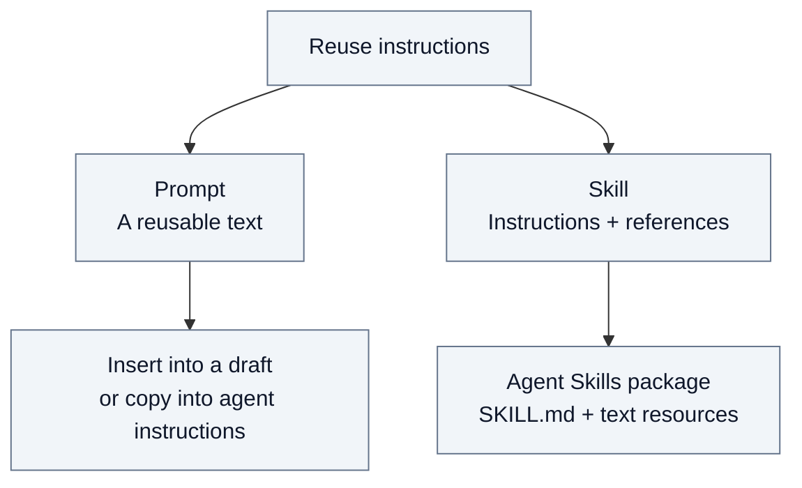
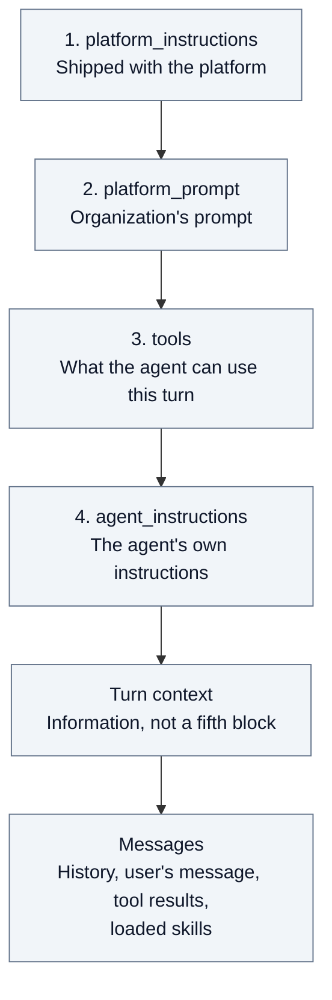
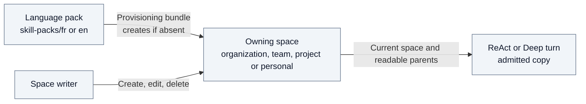
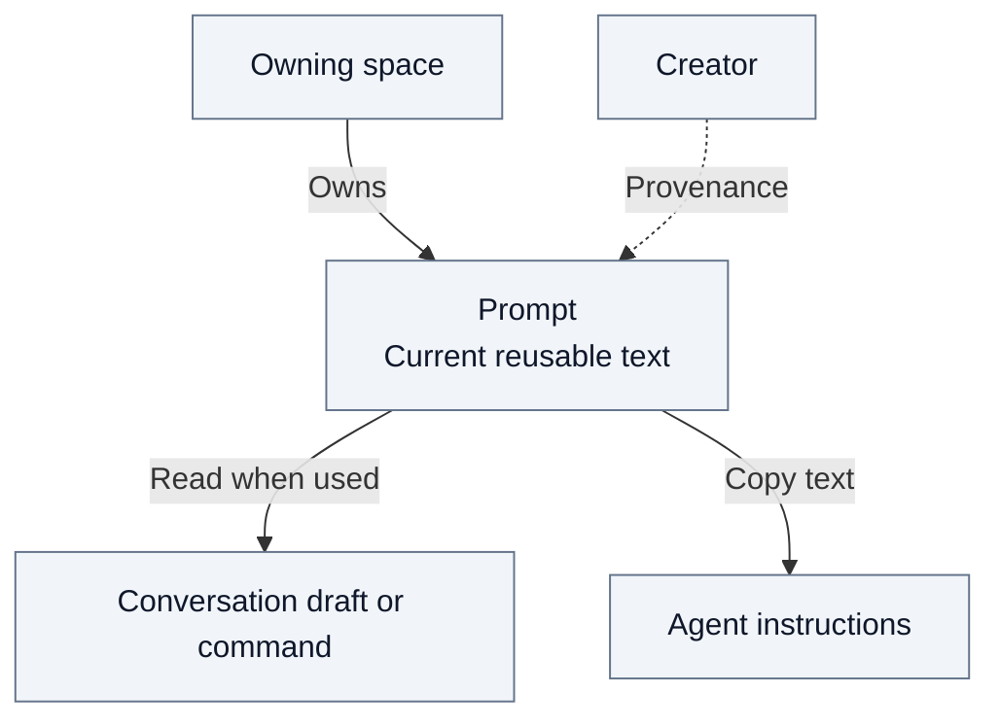
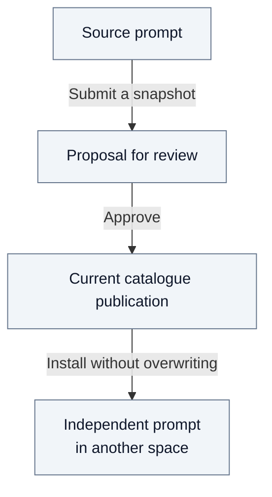

# 6. Resources and ownership

A space is a work perimeter: organization, team, project or personal. A resource's
owning space and its creator are different facts. Permissions belong to the space;
creation provenance does not grant a private right over collective content.

## Resource map

| Resource | Placement / authority | Stored definition | Use and lifecycle boundary |
| --- | --- | --- | --- |
| Prompt | Any of the four spaces; Control Plane | SQL text, metadata, local category and caller favorites | Reusable current text; source-space permissions and deletion |
| Skill | Owning space; Control Plane | Instruction package and text references | Agent Skills format within Fred's supported profile; instructions grant no tool rights |
| Agent instance | Team, project or personal space; Control Plane | SQL configuration referring to a pod template | Configuration is distinct from the person's conversations |
| Agent template | Supplied by an Agent Pod; organization authorization | Pod declaration and Control Plane policy | Defines available behavior; an instance selects and configures it |
| Tool capability offer | Supplied by a pod; organization ceiling and local restrictions | Pod declaration, SQL catalogue and policy | Offer governance; not the four-space prompt CRUD contract |
| MCP connection | Owning space; currently managed at organization level | Endpoint, credential reference and reviewed tool inventory | Exposed as a capability offer; authorized and selected for a compatible agent |
| Model offer | Model source catalogue; organization policy | SQL observations and policy; protected connection configuration | Selected at turn admission; credentials stay out of the browser |
| Document | Space drive or private conversation | SQL placement and lifecycle; object storage for bytes | Processing and cleanup are explicit operations |
| Conversation | A person within a space | Conversation metadata and execution history | Access to the space alone does not open another person's history |

[Documents](05-documents.md), [assistant configuration](02.3-agent-administration.md)
and [security](03-security.md) explain their domain boundaries. Sharing an ownership
concept does not mean all resources use the same storage or management API.

People identify resources by their display name and, when useful, their logical
name and owning space. Internal identifiers preserve references; they are not
user-facing names. A connection's address locates a service, not its business identity.

## Prompts and skills: two forms of instructions

**Legend:** ⬜ Concepts

The [Agent Skills format](https://agentskills.io/specification) combines Markdown
instructions with YAML metadata and optional accompanying files. Fred's supported
profile accepts text resources, not binary assets or script execution. This format
compatibility concerns **skills**; it does not turn every simple prompt into a package.
Neither form grants access to a model, document or MCP tool.

The [format reference](A5-user-journeys.md#skill-format-boundary) identifies the
validation anchor and supported limits. The prompt library below remains the
canonical explanation of simple text reuse.

## How instructions reach the model

**Legend:** ⬜ Model context of one agent turn, highest authority first

| Level | Text | How it enters |
| --- | --- | --- |
| Instructions | The four system blocks | System prompt, in the order above |
| Procedures | [Skills](#skills) | Only when loaded through their declared tool or supplied as a selected skill |
| Data | Everything else: documents, wiki pages, web and tool results, file names, turns from another agent | In messages and tool results; a few items also appear in the system prompt (see the runtime reference). |

| Block | Author | Contract |
| --- | --- | --- |
| `platform_instructions` | Shipped with the platform; nobody edits it | States the precedence rule and that external content is data, never instruction. |
| `platform_prompt` | Organization administrator | A shipped default applies until saved; a saved empty value removes the block. |
| `tools` | The turn's tools | Tool list, MCP connection instructions, skills catalogue (ReAct, metadata only), documents-only rule when active. |
| `agent_instructions` | The agent's editor | The editor's text. |

The order is the authority: each block prevails over the next, the four blocks over the
user's request, and the user's request over everything else. Capabilities currently add
their instructions after the four blocks. A prompt used in a conversation arrives as the
user's text, not as a block. No instruction grants access to a tool, model or
document. The [runtime reference](A1-manager-runtime.md#model-context-assembly)
details the turn context, escaping, capabilities and engines.

## Skills

| Concern | Contract |
| --- | --- |
| Distribution | The platform distributes language packs as data; the binary ships no skill. A [provisioning bundle](A2-manager-contracts.md#provisioning-declarations) creates declared packages absent by name in declared spaces and never replaces one. The platform owns no skill; there is no platform scope. |
| Language | One pack per organization: same names and controls, translated descriptions and instructions. Answers follow the conversation's language. |
| Authoring | Write on the owning space creates, edits or deletes a package, in any of the four spaces. Editing a provisioned package makes it the space's own. |
| Scope | A conversation sees the skills of the agent instance's space and of its parents where the person holds a direct read role. Unlike prompts, organization skills therefore reach team and project conversations; a personal space sees only its own. |
| Execution | Only non-embedded ReAct and Deep templates receive the catalogue. A skill grants no tool, model or document access. |

## Prompts

| Concern | Contract |
| --- | --- |
| Identity | Stable UUID; immutable command name unique within the space; editable title. Duplication creates an independent prompt in the same space. |
| Rights | Read to consult/use and manage one's favorites; Write to manage prompts and categories. No creator privilege or technical Admin override. See the [SSI matrix](A7-action-role-matrix.md#content-actions). |
| Organization | Categories are space-local; a used category cannot be deleted. Tags and favorites filter the library. |
| Editing | Only edited fields are sent. Independent field edits compose; the last committed edit wins on a field changed by both editors. |
| Departure | Removing the author's access preserves the prompt. Collective-space editors keep their ordinary rights. Personal content stays private; no automatic transfer. |
| Deletion | Prompt deletion removes its favorites. Submitted snapshots and independent installations survive deletion of the original prompt or its space. |
| Publication boundary | An approved snapshot exposes the submitted definition to its marketplace audience; it grants no access to the rest of the source space. |

| Consumer | Library and effect |
| --- | --- |
| Management and home search | The four space kinds, subject to current read permission. |
| Conversation | Current space and available personal space of the same organization. Insert text into the draft, or resolve the slash command at send time. |
| Agent configuration | The agent's own space. Copy the selected text; later library edits do not update the saved instructions. |

### Publishing a prompt

The organization marketplace shares approved snapshots. It is separate from the
libraries above: installing a publication creates a prompt in the destination space.

Approving an update replaces the catalogue's current publication; installed copies
keep their content. Withdrawing a publication prevents new installations and
preserves existing copies. Source edits do not alter submitted snapshots.

The [small evidence map](A2-manager-contracts.md#prompt-implementation-anchors) links
three responsibilities and the relevant checks. The [REST inventory](A12-control-plane-api.md#spaces-routes)
provides the exact routes; the [user guide](../../apps/frontend/src/rework/features/helpCenter/content/en/features/prompts.md)
contains the UI instructions.
