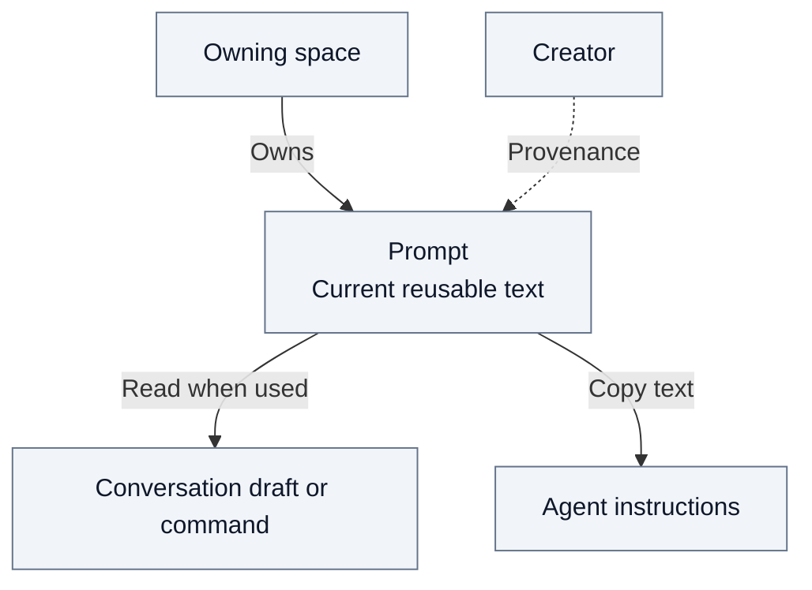

# 6. Resources and ownership

A space is a work perimeter: organization, team, project or personal. A resource's
owning space and its creator are different facts. Permissions belong to the space;
creation provenance does not grant a private right over collective content.

## Resource map

| Resource | Placement / authority | Stored definition | Use and lifecycle boundary |
| --- | --- | --- | --- |
| Prompt | Any of the four spaces; Control Plane | SQL text, metadata, local category and caller favorites | Reusable current text; source-space permissions and deletion |
| Agent instance | Team, project or personal space; Control Plane | SQL configuration referring to a pod template | Configuration is distinct from the person's conversations |
| Agent template | Supplied by an Agent Pod; organization authorization | Pod declaration and Control Plane policy | Defines available behavior; an instance selects and configures it |
| Tool capability offer | Supplied by a pod; organization ceiling and local restrictions | Pod declaration, SQL catalogue and policy | Offer governance; not the four-space prompt CRUD contract |
| Model offer | Model source catalogue; organization policy | SQL observations and policy; protected connection configuration | Selected at turn admission; credentials stay out of the browser |
| Document | Space drive or private conversation | SQL placement and lifecycle; object storage for bytes | Processing and cleanup are explicit operations |
| Conversation | A person within a space | Conversation metadata and execution history | Access to the space alone does not open another person's history |

[Documents](05-documents.md), [assistant configuration](02.3-agent-administration.md)
and [security](03-security.md) explain their domain boundaries. Sharing an ownership
concept does not mean all resources use the same storage or management API.

## Prompts

**Legend:** ⬜ Concepts

| Concern | Contract |
| --- | --- |
| Identity | Stable UUID; immutable command name unique within the space; editable title. Duplication creates an independent prompt in the same space. |
| Rights | Read to consult/use and manage one's favorites; Write to manage prompts and categories. No creator privilege or technical Admin override. See the [SSI matrix](A7-action-role-matrix.md#content-actions). |
| Organization | Categories are space-local; a used category cannot be deleted. Tags and favorites filter the library. |
| Editing | Only edited fields are sent. Independent field edits compose; the last committed edit wins on a field changed by both editors. |
| Departure | Removing the author's access preserves the prompt. Collective-space editors keep their ordinary rights. Personal content stays private; no automatic transfer. |
| Deletion | Prompt deletion removes its favorites. Submitted snapshots and independent installations survive deletion of the original prompt or its space. |
| Publication boundary | An approved snapshot exposes the submitted definition to its marketplace audience; it grants no access to the rest of the source space. |

| Consumer | Library and effect |
| --- | --- |
| Management and home search | The four space kinds, subject to current read permission. |
| Conversation | Current space and available personal space of the same organization. Insert text into the draft, or resolve the slash command at send time. |
| Agent configuration | The agent's own space. Copy the selected text; later library edits do not update the saved instructions. |

The marketplace is a separate consumer, not an additional source in these pickers.
The [small evidence map](A2-manager-contracts.md#prompt-implementation-anchors) links
three responsibilities and the relevant checks. The [REST inventory](A12-control-plane-api.md#spaces-routes)
provides the exact routes; the [user guide](../../apps/frontend/src/rework/features/helpCenter/content/en/features/prompts.md)
contains the UI instructions.
