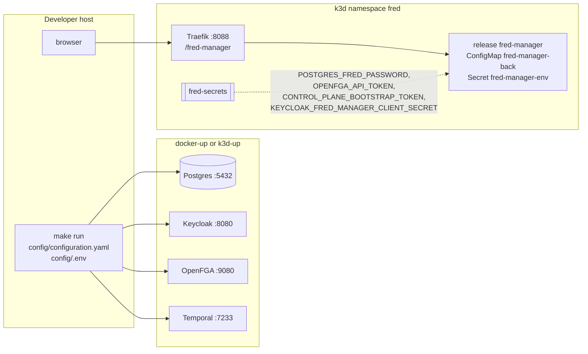

# 7. Deployment

Both stories run against the infrastructure of fred-deployment-factory. fred-manager
creates its tables (sqlx migrations) and its OpenFGA store at startup; the Keycloak
realm starts empty.

| | Host run | k3d release |
| --- | --- | --- |
| Start | `make run` in `apps/fred-manager` | `make k3d-app DIR=../fred/apps/fred-manager` in the factory |
| Configuration | `config/configuration.yaml`, `log_format: text` | values `configuration`, rendered to ConfigMap `fred-manager-back`, `log_format: json` |
| Secrets | `config/.env` | `fred-secrets`, as `extraEnvVars` |
| Addresses | `localhost` ports | `postgres`, `openfga:9080`, `temporal:7233`, `keycloak:8080` |
| Token issuer accepted | `http://localhost:8080/realms/app` | `http://keycloak:8080/realms/app` (hosts entry `127.0.0.1 keycloak`) |
| Public URL | `http://localhost:8400/fred-manager/v1` | `http://localhost:8088/fred-manager/v1` |
| Bootstrap secret | `FRED_BOOTSTRAP_TOKEN` in `.env` | `CONTROL_PLANE_BOOTSTRAP_TOKEN` of `fred-secrets`, generated with the cluster |

The release uses fred's own chart (`deploy/charts/fred`) with every other application
disabled, through `apps/fred-manager/deploy/k3d/` (factory contract: `helmfile.yaml.gotmpl`,
`values.yaml`, `build`). `deploy/k3d/chart` links to that chart without its
`values.schema.json`, whose closed application list `helm lint` enforces even with
`--skip-schema-validation`.

The image (`dockerfiles/Dockerfile-prod`) builds the release binary with `protoc` and
`libprotobuf-dev`, then runs it as user 1000 on Debian slim; migrations and the OpenFGA
model are compiled into the binary.

`deploy/k3d/identities.yaml` declares the `fred-manager` confidential service client and
its `realm-management/query-users`, `view-users` and `manage-users` grants. The factory's
`k3d-app` identity reconciliation populates `KEYCLOAK_FRED_MANAGER_CLIENT_SECRET` in
`fred-secrets`; the release consumes it through `extraEnvVars`.
For a host process using this realm, the same client secret goes in `config/.env`.
`docker-up` alone does not consume the application's identity declaration: the directory
requires a provisioned client with these grants, or `security.m2m.enabled: false` to
run without directory-based role grants.
