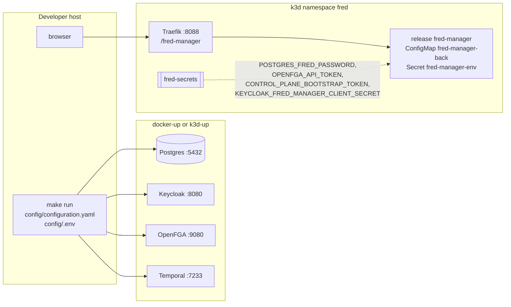

# 7. Deployment

Both stories run against the infrastructure of fred-deployment-factory. fred-manager
creates its tables (sqlx migrations) and its OpenFGA store at startup; the Keycloak
realm starts empty.



| | Host run | k3d release |
| --- | --- | --- |
| Start | `make run` in `apps/fred-manager` | `make k3d-app DIR=../fred/apps/fred-manager` in the factory |
| Configuration | `config/configuration.yaml`, `log_format: text` | values `configuration`, rendered to ConfigMap `fred-manager-back`, `log_format: json` |
| Secrets | `config/.env` | `fred-secrets`, as `extraEnvVars` |
| Addresses | `localhost` ports | `postgres`, `openfga:9080`, `temporal:7233`, `keycloak:8080` |
| Token issuer accepted | `http://localhost:8080/realms/app` | `http://keycloak:8080/realms/app` (hosts entry `127.0.0.1 keycloak`) |
| Public URL | `http://localhost:8400/fred-manager/v1` | `http://localhost:8088/fred-manager/v1` |
| Bootstrap secret | `FRED_BOOTSTRAP_TOKEN` in `.env` | `CONTROL_PLANE_BOOTSTRAP_TOKEN` of `fred-secrets`, generated with the cluster |

The release uses fred's own chart (`deploy/charts/fred`) with every other application
disabled, through `apps/fred-manager/deploy/k3d/` (factory contract: `helmfile.yaml.gotmpl`,
`values.yaml`, `build`). `deploy/k3d/chart` links to that chart without its
`values.schema.json`, whose closed application list `helm lint` enforces even with
`--skip-schema-validation`.

The image (`dockerfiles/Dockerfile-prod`) builds the release binary with `protoc` and
`libprotobuf-dev`, then runs it as user 1000 on Debian slim; migrations and the OpenFGA
model are compiled into the binary.

`deploy/k3d/identities.yaml` declares the `fred-manager` confidential service client and
its `realm-management/query-users`, `view-users` and `manage-users` grants. The factory's
`k3d-app` identity reconciliation populates `KEYCLOAK_FRED_MANAGER_CLIENT_SECRET` in
`fred-secrets`; the release consumes it through `extraEnvVars`.
For a host process using this realm, the same client secret goes in `config/.env`.
`docker-up` alone does not consume the application's identity declaration: the directory
requires a provisioned client with these grants, or `security.m2m.enabled: false` to
run without directory-based role grants.

## Running provisioning

Start the compatible service once to initialize SQL migrations and the extended FGA
model, then accept CGU and complete root bootstrap in the UI. CLI import itself never migrates SQL, creates a store
or synchronizes a model. It needs Postgres, OpenFGA and Keycloak; it does not need the
HTTP server or Temporal to remain running. It loads the published store/model IDs.

From `apps/fred-manager`, with the directory client configured and an operator access
token in a private file:

```sh
make build-demo-bundle
make import-provisioning BUNDLE=target/demo-provisioning-bundle.zip TOKEN_FILE=/path/to/operator-token
```

`build-demo-bundle` packages the five checked-in JSON files with Python's standard
ZIP library and atomically replaces its output. `DEMO_PROVISIONING_FIXTURE_DIR`
and `DEMO_BUNDLE_FILE` override source/output paths, including paths with spaces;
no running service is needed. HTTP clients submit the same ZIP as multipart `file`
to `/fred-manager/v1/import-export/import` on the running server.

The bearer must identify a current platform admin. Only the bootstrap root imports a
bundle containing platform-admin declarations, including declarations already granted.
The operator token is never used to administer Keycloak: that traffic uses the manager's
service identity from `identities.yaml`. Token validity and authority are rechecked during
import; replay after expiry uses a fresh operator token.

## Frontend routing

The frontend uses same-origin `/fred-manager/v1` requests. Vite resolves the
`/fred-manager` prefix before its broad `/fred` rule and proxies to
`VITE_BACKEND_URL_FRED_MANAGER`, default `http://localhost:8400`. Production nginx
proxies `/fred-manager/` to `FRONTEND_FRED_MANAGER_UPSTREAM`, default
`http://fred-manager:8400`, with 3600-second read/send timeouts. It resolves this
optional service at request time, so frontend startup does not require its DNS
name to exist. Local frontend `make docker-run` supplies
`http://host.docker.internal:8400`. Access logs use the bounded `fred-manager`
route family without exposing paths, tokens or upload contents.

## Offline authorization cutover

An unbound installation with spaces, bootstrap state or legacy tuples refuses
normal startup initialization. The operator stops all legacy manager writers and
settles their pending requests before running `make migrate-authorization` from
`apps/fred-manager`. The command uses the same configuration and local operator
trust boundary as `create-org`. It does not detect source quiescence; its paginated
capture requires that precondition.

The command validates the source model's permission semantics, raw direct tuples,
SQL parent/path consistency, personal roles, administrators and parent access. It
copies the validated snapshot into a fresh store, initializes guards and publishes
its store/model IDs in one SQL commit. Space IDs and bootstrap state remain intact.
A replay reads an existing publication or starts a fresh unpublished attempt;
it never resumes writing a partially copied store. Unpublished stores remain
inactive. Late writes to the legacy store cannot change active permissions.

`sync_schema_on_init` allows initialization of an entirely empty installation.
Existing bindings pin the exact model even when a newer model exists. Missing or
incompatible pinned state fails closed. Changing the configured logical store name
does not select a different authorization source behind an existing binding.

## First-user application entry

Manager and frontend from this branch are deployed together. Migration 0005 adds
personal consent storage at manager startup; existing migrations remain intact.
The reference and k3d manager configurations require CGU version `v1`. Legal assets
in the frontend match the configured version; a version change requires renewed
personal acceptance. The frontend depends on manager public configuration before
login and displays a reload action if it is unavailable. Root bootstrap uses the
configured secret and grants no organization membership. The Make ZIP builder and
the UI provisioning page populate explicitly declared memberships.
