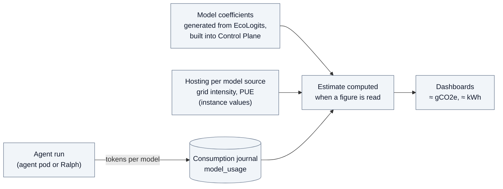
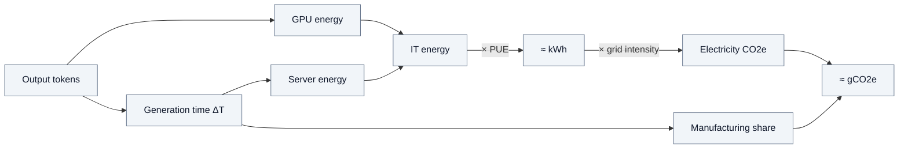

# 7. Environmental footprint

Fred shows an estimated CO2e and energy figure for each person, team, project,
agent and model. It is an estimate, labelled "≈", meant to compare usages and
start conversations about frugality. Fred follows
[EcoLogits](https://ecologits.ai)' inference method and computes the figure from
the consumption journal each time it is read. The
[technical reference](A14-footprint.md) gives every formula, constant and source.

## 7.1. From a turn to a figure

The journal keeps facts only: tokens per run and per model. Nothing estimated is
stored. A better catalogue or a corrected hosting declaration therefore changes
every past figure as soon as it is deployed.

## 7.2. What is counted

| Counted | Not counted |
| --- | --- |
| Output tokens: the text the model generates | Input tokens, cached or not: the prompt, history and documents sent to the model |
| Generation time, estimated from the model and the output tokens | Training of the model |
| Electricity of the servers, times the datacenter's PUE | Network and end-user devices |
| A share of the servers' and GPUs' manufacturing | Document ingestion and embeddings, which do not report to the journal |

Input tokens are not counted because EcoLogits charges inference to the tokens a
model generates, not to those it reads. Reading a long context still costs
something: EcoLogits accounts for it only through a measured generation time,
which Fred does not record yet.

## 7.3. The calculation

The model's size decides how many GPUs it occupies and how much energy each token
costs. The datacenter decides the PUE and the electricity it uses. On a low-carbon
grid, such as in France or Sweden, the manufacturing share is usually the larger
part.

## 7.4. Who sets what

| Level | What it decides | Where | Who changes it |
| --- | --- | --- | --- |
| Method | Hardware and load assumptions: H100 GPUs, batches of 64, server power, three-year lifetime, manufacturing footprint | The pinned EcoLogits release | Fred maintainers, by moving to another EcoLogits release |
| Models | The coefficients of each model Fred knows, and the default for the others | The generated catalogue, built into Control Plane | Fred maintainers: regenerate, then release |
| Hosting | Where each model source runs: grid intensity and PUE | `platform.model_footprints`, in the instance's values | The operator: change the values and redeploy |

The [reference](A14-footprint.md#a144-hosting-a-model-source) explains how to set
the hosting of a source on premises, in a cloud project or behind a provider's API.

## 7.5. When a figure is a fallback

| Situation | Result |
| --- | --- |
| The model is not in the catalogue | Estimated with the default model, marked as a fallback |
| The source has no declared hosting | Estimated with the world-average electricity and PUE, marked as a fallback |
| A required coefficient is missing | That report's estimate is unavailable, never zero |
| No tokens at all | A calculated zero |

The interface keeps the estimate and its methodology note in both fallback cases.
A fallback tells the operator what to declare.

## 7.6. Limits

- **Order of magnitude only.** On the same answer, EcoLogits and Mistral's own
  life-cycle analysis differ by a factor of about 25. Fred follows EcoLogits
  because its method is open and reproducible.
- **Estimated time.** Without a measured generation time, EcoLogits' default
  latency can exceed the real one several times over. On a measured RAG turn,
  the estimate fell about fourfold with the real time.
- **Fixed hardware.** The operator sets electricity and PUE, but not the GPUs or
  their load. For a self-hosted model, a server used far below EcoLogits' batch of
  64 has a larger manufacturing share per answer than estimated.
- **Agentic context.** An agent that calls tools re-sends its whole context at each
  call. Those input tokens are not counted, even when the provider recomputes them.
