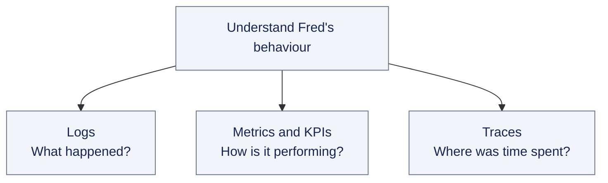
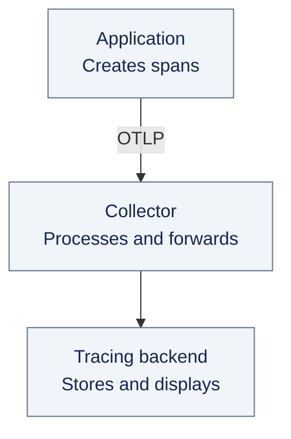
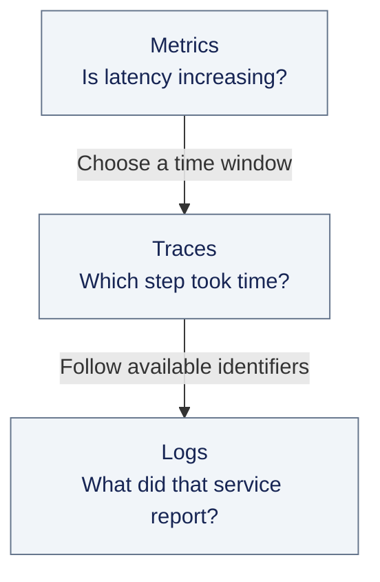

# 8. Operations and observability

## Observability: logs, metrics and traces

When an answer is slow or fails, three kinds of evidence help explain it.
They answer different questions about the same activity.

### Logs: events and outcomes

Logs describe events: a service starts, an action completes or an error occurs.
Each event identifies when and where it happened. Its level distinguishes routine
information, warnings and failures. Shared request identifiers help readers find
related events across services.

Security audit logs record who performed a sensitive action and its outcome.
They have a separate policy so reducing ordinary log noise does not hide those
actions. Services produce the events; the platform collects and retains them.
See the [logging reference](A3-manager-operations.md#logging).

### Metrics and KPIs: measurements and decisions

A **metric** measures activity, such as request duration or error count. A
**key performance indicator (KPI)** uses measurements to answer a question about
service quality or usage.

| Question | Evidence |
| --- | --- |
| Is the service healthy? | Request durations, error counts and resource use |
| How are agents used? | Indicators derived from observed agent activity |
| How much was consumed? | Recorded usage in the consumption journal |

Control Plane owns the consumption journal. It records usage without counting
the same report twice and provides the basis for consumption views. Technical
metrics help operate the service; the journal serves accounting. Cost and
[environmental footprint](07-footprint.md) are estimates derived from consumption,
not direct measurements. See the [measurement reference](A3-manager-operations.md#metrics-and-consumption).

### Traces: the path of an operation

A **trace** connects the steps of one operation. Each step, called a **span**,
records a start, an end and its relationship to other steps. This reveals where
time is spent and which calls overlap; their durations must not simply be added.
Its status distinguishes a reported failure from an operation without a reported
error. Timing alone cannot tell whether an operation succeeded.

OpenTelemetry provides a common language for representing spans and their
relationships, so tools can interpret traces consistently. In an OpenTelemetry
pipeline, applications create spans and send them using **OTLP**, the standard
transport protocol. A Collector can process and forward them; a tracing backend
stores them and provides search and visualization.

The Collector is optional when the backend accepts OTLP directly. The
[technical reference](A3-manager-operations.md#distributed-tracing) identifies
Fred's instrumentation and collection configuration.

### Using the three pillars together

For a slow answer, an investigation can follow this reading order:

Timestamps and shared request identifiers help relate these views to the same
operation. Each view contributes a different part of the explanation.

### Access, content and retention

| Evidence | Access boundary |
| --- | --- |
| Operational logs, technical metrics and traces | Platform-controlled tools and access |
| Consumption views | Personal or collective scope authorized by Control Plane |

Operational telemetry describes behaviour without exposing prompts, answers or
credentials. The platform defines how long operational records are kept.

## Deployment and configuration

The deployment factory owns the local k3d instance values and infrastructure;
Fred supplies the application chart and image build. Helm combines the chart
defaults with the instance values, including the Control Plane's model sources
and each runtime's credential references. The
[operations reference](A3-manager-operations.md) and
[model reference](A13-models.md#deployment-evidence) identify the deployment inputs.
The frontend forwards `/control-plane/v1`, `/apps/` and `/app-services/` to Control
Plane. Application destinations come from its SQL registry, without per-application
gateway configuration. Static assets are public and credential-free; API requests
use authenticated space admission. Each application service owns its deployment,
database schema and workers independently of its Fred registration.

Rust configuration is validated against its generated schema. Credentials are
references to Secrets, never literal values in application configuration.
`control-plane serve` supervises HTTP, original-storage cleanup, the processing
outbox and lifecycle work in one process. Knowledge Flow runs its Temporal worker.
There is no separate `control-plane worker` command in this runtime.

A model source defines a provider connection and its inventory. Weaver cannot add
sources through the UI; deployment configuration supplies them and their credentials.

| Action | Responsible | Where | Restart / redeploy? |
| --- | --- | --- | --- |
| Register, update or suspend an application | Platform Admin | Applications UI, persisted in SQL | No; the service must already be deployed |
| Add or change a model source | Operator | Deployment configuration | Yes, affected services |
| Add a source to an organization | Operator | `platform.organization_models.sources` | Yes, Control Plane |
| Refresh a discovered model inventory | Organization Owner | Models UI | No |
| Add a model to a declared inventory | Operator | Deployment configuration | Yes, Control Plane |
| Authorize models or set organization defaults | Organization Owner | Models UI | No |
| Restrict models or set team/project defaults | Local Owner | Space settings UI | No |
| Select a permitted model | Editor / user | Assistant / conversation UI | No |
| Rotate an injected key | Operator | Secrets | Restart consuming services |

Startup adds declared sources to existing organizations without overwriting UI
permissions or defaults. Removing a declaration is not revocation.
Refreshing an inventory grants no permission; changing a policy provisions no
credential. The [model reference](A13-models.md#deployment-evidence) covers deployment
and rotation; [selection rules](02.3-agent-administration.md#model-default-and-mcp-selection)
explain how defaults apply.

## Ingestion preparation

The Control Plane deployment exports the processing contract from the built worker
image. Buckets, service identities, OpenSearch roles and the search pipeline belong
to the infrastructure (locally, the factory's `k3d/values.yaml`), not to the
application chart. Each organization's corpus is the index
`<manager_processing.vector_store.index>-<organization id>`, created by the worker at
that organization's first indexing. Roles therefore grant this prefix: writes and
index creation to the worker, reads to the API. The local profile grants
`document-vectors-*` and `weaver-kpi`: Swift can share the OpenSearch instance, never
these indexes.

## PostgreSQL ownership

Fred's core services share four isolated schemas in one database. Control Plane
owns `control_plane` (tables, functions, triggers and SQLx history) and `cp_read`
(read contracts).
Knowledge Flow owns `knowledge`; Agent Pod owns `runtime`, including Alembic
history and checkpoints. Their logins are `fred_cp`, `fred_kf`, `fred_runtime`;
`fred_monitor` reads only its platform-role view. Consumers receive SELECT through
reader groups and have no access to the Control Plane schema. `public` is closed.

An administrator runs the deployment-owned bootstrap before schema initialization.
It creates roles, schemas and the vector extension without passwords. Deployment
supplies separate credentials through Secrets, then runs Control Plane SQLx,
runtime migrations, and starts applications, in that order. The optional chart
bootstrap hook is disabled by default: managed installations have their DBA run
the [bootstrap procedure](../../deploy/postgres/README.md). Applications never
receive role-administration privileges. The first installation with this layout
requires a fresh database; no conversion of an old `public` database is attempted.

## Schema initialization and recovery

Weaver Control Plane installs its complete schema on a fresh database. The
pre-install/pre-upgrade initialization Job is repeatable when the schema matches;
it refuses an incompatible database without transforming or resetting data.
API startup verifies the schema and never modifies it. Initialization also rebuilds
missing or outdated Wiki search projections in bounded transactions. Each API replica
runs the same pass at startup, retrying failures every five seconds without stopping
HTTP; shutdown cancels the pass or retry delay. No scheduler or setting is added.
A newer index version produces a warning and ends the pass without downgrading it
or failing initialization. Other initialization errors remain fatal. See the
[SQL catalogue](A2-manager-contracts.md#control-plane-sql-catalogue) and
[initialization procedure](A3-manager-operations.md#sqlx-schema-initialization).

SQL and its matching object namespace form one backup unit. Restore suspends
uploads and cleanup until both are consistent. Application deployment does not
migrate existing Knowledge Flow documents or rename persisted resources.

The Rust ingestion profile does not support application data reset. The reset
helper rejects this configuration before mutation; its Swift erasure contract
must not be widened to include Rust document resources. Recreating a disposable
secondary installation is a separate, explicitly authorized deployment operation.

## Operator diagnostics

The browser offers [self-tests](../../apps/frontend/README.md#weaver-self-tests) to platform administrators who also directly own at least one organization, team, or project. Operators reserve this combination of grants for pre-production testing. A run checks the platform and session once, then exercises each selected space along the organization, team and project path using the operator's rights in that space. The report groups results and skip reasons by level. Two-person isolation and an admitted turn that outlives its original user token are separate manual tests. Results stay on the page until the operator changes the path or leaves. Only identifiers needed to recover disposable fixtures survive a reload.

## Lifecycle

Lifecycle and ingestion use SQL receipts and bounded cleanup/reconciliation.
Disabling new ingestion does not discard accepted work. See the
[operations reference](A3-manager-operations.md) for logging, credentials,
retention and failure handling.
