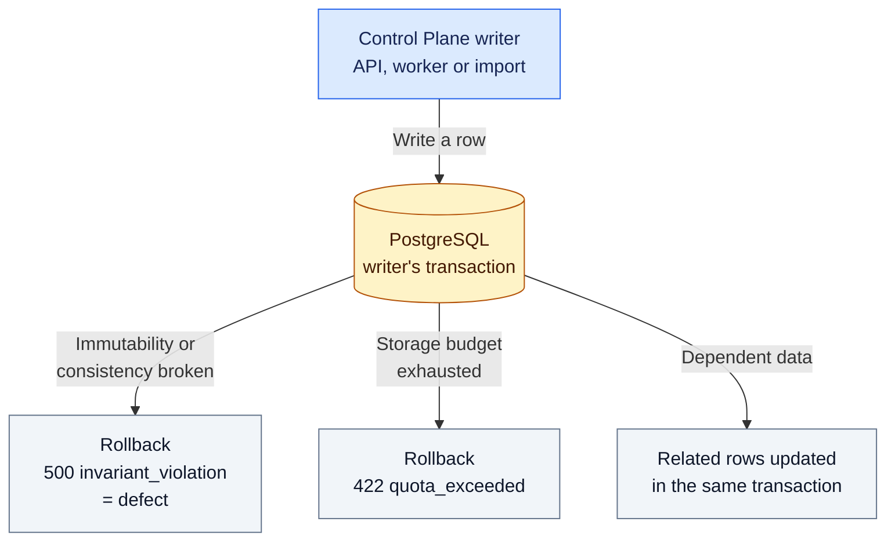

# 9. Quality and invariants

The guarantees below apply to the named manager mechanisms and first-user journey.
They do not certify every Fred component. Invariant IDs remain stable when the
explanations move between chapters. These are current implementation guarantees;
the [owner/admin comparison](A11-roles.md#responsibility-boundaries-and-current-enforcement) separately
records the agreed responsibilities and enforcement gaps.

## Invariants

| Id | Invariant | Held by |
| --- | --- | --- |
| I1 | An organization is a root, a team's parent is an organization, a project's parent is a collective team. Kind `personal` requires an owner and no parent. Sibling names and organization names are unique. | `domain::check_parent`, `space_personal_identity`, `spaces` under the organization lock, organization-name index |
| I2 | Placement is immutable: a space's kind, owner and links, a folder's space, parent and path, a document's space and folder. Names may change; the authorized deletion lifecycle removes retired space links. | SQL placement triggers; placement and direct roles committed atomically |
| I3 | A document's folder, and a sub-folder's parent, belong to the same space. | composite foreign keys |
| I4 | Holding a role on a collective child space requires a direct content role on its parent. Personal-space access requires a current business role (owner, member, editor or analyst) on an active organization, team or project in the same organization. | `spaces`, organization lock and transaction-local checks |
| I5 | Role and SQL mutations cannot publish a decision invalidated by an earlier successful revocation. External operations are authorized at dispatch. | transaction-local checks; shared organization lock for content and exclusive lock for governance, held through commit |
| I6 | A personal space never gains a member, and its organization can always remove its owner. | `spaces::grant`, `spaces::revoke` |
| I7 | A space's search scope is its readable ancestors and itself, never its descendants; a personal space's scope is itself; levels only remove spaces. | `spaces::scope` |
| I8 | Space owner, organization admin and platform admin roles read no content. | typed Read permission: member, editor or analyst |
| I9 | Root bootstrap promotes one caller, once; it never reopens, not even for its original owner after removal. | `bootstrap::grant_root`, marker |
| I10 | Only an RS256 token signed by the realm, issued by a configured realm for the configured audience, unexpired, with an integer past `iat` and a lifetime within the ceiling, authenticates. | `auth` |
| I11 | Log lines never carry credential- or content-named fields; dependencies never log their own text. | `logging` |
| I13 | Every line of a request carries its request id, and the request ends with one `http` event. | `logging::request_logging` |
| I14 | Every non-personal space retains at least one owner, and every organization at least one organization admin, after role revocation. | `spaces::revoke`, organization lock |
| I15 | Platform admins change platform grants and the platform always retains an administrator. New platform grants target an existing Keycloak subject. | `platform`, platform lock, directory lookup |
| I16 | Every acknowledged role mutation emits exactly one security audit event before SQL commit, independently of application severity and text/JSON format; revoking a role that is not held emits none. | `logging::audit_relation`, mutation services |
| I17 | Provisioning replay preserves existing identities, committed space IDs and undeclared grants, and repairs requested grants without reusing rolled-back space IDs. | `provisioning`, exact directory lookup, SQL uniqueness |
| I18 | Import requires a platform admin, authenticated at admission and rechecked in PostgreSQL at every mutation boundary, and compatible initialized state; predictable preflight failures cause no provisioning or initialization writes. | CLI read-only initialization, HTTP authority-before-upload, `Importer::preflight`, platform lock |
| I19 | A human personally accepts the active CGU before business access; consent and root bootstrap create no membership, and import accepts for nobody. | `onboarding`, `OwnUser`, `AdmittedUser`, CLI admission |
| I20 | Business roles apply only to their granted space; none reaches a child, and a personal space inherits nothing. | direct space-role checks in `authorization` |
| I21 | New organization admin grants target an existing Keycloak subject. An organization admin exists only on organizations, is named by platform admins, names the organization's owners and reads its technical aggregates, without content, management or child-space permission. | `spaces::may_change`, directory checks at grant/creation/import, `authorization::decide`, typed `administer_organization` |
| I22 | Folder mutations recheck existence under the organization lock; deletion winning that lock prevents a waiting mutation. | HTTP handlers; exclusive organization lock for folder rename/deletion, shared lock for content/creation, SQL transaction held through commit |
| I23 | A person may hold roles in several organizations. Within each organization, business access requires a direct role there as well as the permission; outside it, its spaces do not exist for them. Platform governance is independent. | committed direct roles and placement, `authorization::in_organization` |
| I24 | Space retirement is atomic; cleanup starts no earlier than the frozen deadline, preserves retry identifiers and declares completion only after SQL cleanup. | `lifecycle`, retired consumer gates, bounded activities and receipts |
| I25 | Each stored content has verified immutable bytes; reservations protect quota/name/targets, and cleanup preserves current content, live pending objects and content referenced by active processing. | upload journal, guarded reservation/publication, conditional S3 Put and SQL-checked inventory |
| I26 | Processing binds exact source content and scope; only an authorized, fenced generation whose expected content/publication still match can publish a verified result. | immutable content references, stage leases, atomic content/generation publication and isolated cleanup |
| I27 | A direct space-role grant writes only a valid subject that the configured user directory knows. | `domain::valid_subject`, `users::Directory::exists` after authorization |
| I28 | A committed processing intent is started at most once and is never lost: a missed notification only delays its delivery. | workflow identity with `REJECT_DUPLICATE`, describe before retry, notification in the admission transaction, periodic poll |

| I29 | Python components and monitor read Control Plane facts only through cp_read; they have no privileges on control_plane. | PostgreSQL schema ACLs and SELECT-only view grants, deployment bootstrap and SQLx migrations |

## Structural invariants in PostgreSQL

Constraints and triggers check every write to the Control Plane schema inside the
writer's transaction, whether an API handler, a worker or an import performs it.
A broken rule rolls the statement back.

**Legend:** 🟦 Fred · 🟨 COTS · 🟪 Extensions · ⬜ Concepts

Immutability and cross-row consistency rules are assertions. Expected user
conflicts are checked before writing and return a business error, so a refusal
reveals a defect, not a user mistake. The storage quota is the only business
refusal decided by the database. Effects keep dependent data, such as quota
counters and retired PowerPoint files, consistent within the same transaction.
The [generated catalogue](A2-manager-contracts.md#storage-assertions-and-effects)
lists every trigger and its purpose.

## control-plane tests

| Command (in `apps/control-plane`) | Runs |
| --- | --- |
| `make test` | Unit tests, offline: domain rules, token verification, logging format, request middleware |
| `make test-integration` | Integration tests against throwaway Postgres, Keycloak and SeaweedFS containers, removed afterwards; each test gets its own database |
| `make test-lifecycle-temporal` | HTTP acceptance, real Temporal worker interruption/restart, schedule reconciliation and workflow-history replay on disposable services |
| `make test-browser` | Automated Chromium UI import with real OIDC, manager governance routes and disposable dependencies, plus the integration suite; requires frontend dependencies and Chromium |
| `make code-quality` | clippy with warnings as errors, rustfmt |

The authorization matrix exercises all 64 space-role subsets and 16 platform-role
subsets against every typed capability, with cross-space and content isolation checks.
A controlled Keycloak HTTP fixture checks directory failures, service-token refresh,
identity mapping and authenticated governance routes.

Authorization-after-revocation tests hold the relevant advisory lock to force the
interleaving they prove. Last-admin tests issue simultaneous revocations and assert
that at most one succeeds.

## Space deletion acceptance and recovery

The real Temporal fixture starts the separate binary, interrupts it after the first
folder batch and replays workflow history. It also holds the platform SQL lock while
sending SIGTERM, verifies bounded process exit and release of the server-side wait,
then restarts to completion. An injected SQL delete failure exhausts activity retries,
produces a safe `retrying` receipt and recovers after the fault is removed.

Lifecycle discovery, direct-grant cleanup and parent removal use SQL under the
platform/organization locks. Space foreign keys prevent deleting a parent before
its descendants. Failed transactions retain their rows for the next bounded batch.

Batch counts also determine scheduled latency: one successful batch per operation
per sweep means nested folder depth, descendant space count add
intervals after retention expires. `batch_size` bounds candidate operations, not
batches completed for one operation. The [operations chapter](A3-manager-operations.md#space-deletion-lifecycle)
gives the completion-time model and the 15-level folder example. The millisecond
fixture above invokes batches directly; it does not measure scheduled completion
with the default PT10M interval.

## Generated HTTP contract

`tests/openapi.rs` checks offline, deterministic schema emission with invalid runtime
configuration paths, the complete route inventory, bearer security, role enums,
required nullable response fields, flattening, multipart uploads, original binary reads, processing mutations
and empty success responses. Frontend client tests execute the generated RTK
endpoints through the shared base query and check the multipart bytes, bearer,
completed report, error propagation and flat space responses. Regenerating with
`make -C apps/frontend update-control-plane-api` produces the committed client.

## Provisioning UI acceptance

Focused frontend regressions cover complete route registration, standalone account
pages, original Home widgets, team navigation, personal-command races and failures,
and profile roles/preferences/organization loading, errors and account isolation.
Manager API tests retain consent, provisioning and role-isolation coverage independently
of the UI. These fixtures do not certify every Fred component.

## Organization console acceptance

Frontend tests cover list loading/error/empty states, cursor navigation, creation,
duplicate submission and late completion. Stateful boundary tests preserve a draft
through normal focus refresh and block cached authority throughout error/retry.
Owner direct business URLs redirect to Organizations, including mixed-role owners;
ordinary users keep the business subtree. The owner navigation mounts no business
bootstrap hook. These checks do not replace a deployed visual recipe.

## Resource browsing acceptance

Focused API tests cover containment, role semantics, paged search/order/ancestors,
concurrent duplicate creation, revocation waiters, stable identities after rename
and atomic document-bearing subtree refusal. A concurrent SQL reader/writer fixture
checks page/total consistency. Component tests exercise the original controls,
stale completions, pending deletion deduplication, recovery after the last page becomes empty and document
write refusal, alongside the separate knowledge-base consumer. These checks do not
replace visual acceptance on a deployed instance.

## Authorization work

Control Plane evaluates its fixed role matrix from PostgreSQL direct grants and
immutable placement. Corpus authorization uses a coherent SQL snapshot and filters
each candidate ancestor by actual read authority. The corpus is fixed at turn
admission. Publication, generation, selection and attachment checks remain
separate from turn authorization; see
[Document search within a turn](A6-security.md#document-search-within-a-turn).

Authorization mutations share transaction-local checks and SQL advisory locks with
role changes. The removed remote protocol's request counts do not describe this
implementation. No throughput or latency claim is made without measurement.

## Folder navigation and write costs

Resources issues one combined directory request on entry, navigation, search, sort
or page change and when the window regains focus, in addition to shared
admission/membership queries. While the displayed page contains a `pending` or
`running` processing summary, it refreshes after three seconds between completed
requests. Inactive pages do not poll; hidden pages do not issue the scheduled
refresh and regain fresh data on window focus. Remote changes on an inactive page
are discovered on focus or navigation, rather than on a periodic timer. Its response
contains current read-authorized rows and a write decision. No separate write probe or document listing is issued.
Folder mutations, uploads and processing starts invalidate the directory query.
The upload path resolves a folder-name conflict through the same `/entries` listing,
selecting an exact folder name from its typed, paginated results. A failed read hides cached
write authority until a fresh successful decision; it does not grant permission.

Mutations recheck authority and target state after acquiring the organization
lock, on the same SQL transaction used for commit. Contending content writers
release their connection before the existing bounded retry delay. Other organizations
have separate locks; pool capacity and same-organization serialization still matter.

The directory query has no advisory lock. Total, mixed folder/document page,
selected rows, processing summaries and up to 15 ancestors use one read-only
repeatable-read transaction. Uploader display names are display data, read after
it from the configured user directory (local identities, or at most eight
concurrent Keycloak profile reads per page); an unavailable directory omits them. Count and page share the same selection. Root/child
predicates use `IS NULL` or equality on the existing space/parent/name indexes of
folders and documents. Search is a literal case-insensitive substring limited to
255 characters. Counts, substring searches, creation-date sorting and deep
offsets still examine work proportional to the directory; limiting returned rows
does not make that work constant. Recursive deletion scales with the removed
subtree and its foreign-key checks, under the organization lock.

The ZIP importer holds the platform lock per identity dispatch, then the platform
and declared organization locks through reconciliation commit. Organizations are
locked in UUID order before child name resolution. Competing mutations needing
these locks must wait; preflight directory lookups hold no mutation lock. Archive
and expanded-content limits bound parser input. Reconciliation work depends on
the declared identities, spaces and grants, not on document count.

Opening a personal space holds its organization SQL lock through authorization,
the existing-space lookup and any creation commit. The lookup uses the organization
and owner, without enumerating other members' personal spaces or documents.

## Directory and content verification costs

For a successful import, preflight performs a paginated exact username lookup per
user and one exact email lookup per missing identity. Username lookup continues
through an empty page; email lookup requests at most one result because any match
conflicts. Duplicate emails among new declarations are compared locally before
that declaration's directory call. Existing identities skip email checks.
Each identity dispatch repeats its username lookup; creation adds one POST and a
final username lookup. These calls reuse the shared HTTP client and service token.

Before space publication, `K` distinct organization admin subjects add `K` GETs,
in batches of at most eight concurrent calls while the reconciliation locks are
held. Each distinct declared owner subject is checked once in that operation.
Local candidate search is one SQL query: the four prefix indexes are combined by a
bitmap OR (checked by `EXPLAIN` on 20 000 profiles), then at most 20 rows are sorted;
the statement is planned with its pattern so that the indexes stay usable.
Direct platform and space-role grants first authorize the caller, then look up
the subject in the directory without retaining the authorization's SQL connection
or holding a mutation lock. Platform grants use a Keycloak GET; space-role grants
use a Keycloak GET or one indexed SQL query in the local directory. Both perform
final authorization under their existing mutation locks before writing.
Organization creation adds one subject GET. Every directory request has a
five-second timeout and can refresh/retry once on 401; a missing cached service
token adds its token request. These are existence checks, not permission caches or
leases across operations. Concurrent external IAM deletion can follow a check.

The 12-owner/two-organization fixture asserts 12 subject requests and concurrency
between two and eight. Content regressions exercise the real HTTP router and
Temporal SDK against a protocol fixture, including exact workflow inputs,
conflict/error responses and deletion interleavings. They verify submission,
not execution by a worker or production throughput.

## Invariants and their referenced checks

Generated from the `// Proves:` markers. This is a traceability index: generation
checks that references exist, not that the tests pass. Execution results and
deployed validation belong to the corresponding CI run and validation PR.

<!-- generated: invariants -->
| Invariant | Proved by |
| --- | --- |
| I1 | `apps/control-plane/src/domain.rs::parent_rules` `apps/control-plane/tests/browser_provisioning.rs::provisioning_browser_journey` `apps/control-plane/tests/integration.rs::real_keycloak_service_account_provisions_complete_bundle` `apps/control-plane/tests/integration.rs::blueprint_http_hierarchy_isolation_preflight_and_safe_errors` `apps/control-plane/tests/integration.rs::space_and_folder_names_are_unique_in_canonical_form` `apps/control-plane/tests/integration.rs::personal_space_identity_is_constrained_and_immutable` `apps/control-plane/tests/schema_constraints.rs::space_hierarchy_rejects_wrong_roots_parents_and_cross_organization_projects` `apps/control-plane/tests/schema_constraints.rs::hierarchy_accepts_a_tree_inserted_in_one_statement` `apps/control-plane/tests/schema_constraints.rs::sibling_names_are_unique_on_insert_and_rename_but_local_to_the_parent` `apps/control-plane/tests/support/resource_browsing.rs::resource_reads_enforce_scope_and_role_semantics` `apps/control-plane/tests/support/resource_browsing.rs::folder_creation_governance_contract_and_request_budget` `apps/control-plane/tests/support/space_deletion.rs::lifecycle_authority_retirement_documents_and_durable_receipts` |
| I2 | `apps/control-plane/tests/integration.rs::placement_is_immutable_and_folders_stay_in_their_space` `apps/control-plane/tests/support/document_processing.rs::processing_admission_fences_publication_and_original_survival` `apps/control-plane/tests/support/document_processing.rs::processing_upload_atomic_intent_and_retry_without_new_original` `apps/control-plane/tests/support/document_processing.rs::processing_workload_identity_and_revoked_publication` `apps/control-plane/tests/support/document_storage.rs::document_contract_guards_and_shared_project_quota` `apps/control-plane/tests/support/document_storage.rs::document_creation_reads_conflicts_receipts_and_safe_download` `apps/control-plane/tests/support/resource_browsing.rs::folder_creation_governance_contract_and_request_budget` `apps/control-plane/tests/support/resource_browsing.rs::folder_directory_pages_and_atomic_subtree_lifecycle` |
| I3 | `apps/control-plane/tests/integration.rs::placement_is_immutable_and_folders_stay_in_their_space` `apps/control-plane/tests/support/document_processing.rs::processing_admission_fences_publication_and_original_survival` `apps/control-plane/tests/support/document_processing.rs::processing_upload_atomic_intent_and_retry_without_new_original` `apps/control-plane/tests/support/document_processing.rs::processing_workload_identity_and_revoked_publication` `apps/control-plane/tests/support/document_storage.rs::document_contract_guards_and_shared_project_quota` `apps/control-plane/tests/support/document_storage.rs::document_creation_reads_conflicts_receipts_and_safe_download` |
| I4 | `apps/control-plane/tests/browser_provisioning.rs::provisioning_browser_journey` `apps/control-plane/tests/integration.rs::concurrent_revocations_keep_parent_access` `apps/control-plane/tests/integration.rs::concurrent_grant_and_revoke_keep_the_invariant` `apps/control-plane/tests/integration.rs::analyst_membership_is_content_and_personal_roles_remain_fixed` `apps/control-plane/tests/integration.rs::provisioning_replays_every_role_without_updating_identities_or_implicit_content` `apps/control-plane/tests/integration.rs::real_keycloak_service_account_provisions_complete_bundle` `apps/control-plane/tests/integration.rs::blueprint_http_hierarchy_isolation_preflight_and_safe_errors` `apps/control-plane/tests/integration.rs::child_roles_require_direct_parent_content` `apps/control-plane/tests/integration.rs::personal_open_requires_business_role_and_never_repairs_revocation` `apps/control-plane/tests/lifecycle_temporal.rs::api_worker_restart_schedule_reconciliation_and_replay` `apps/control-plane/tests/support/space_deletion.rs::lifecycle_authority_retirement_documents_and_durable_receipts` `apps/control-plane/tests/support/space_deletion.rs::lifecycle_blocked_scope_is_visible_and_does_not_starve_candidates` |
| I5 | `apps/control-plane/tests/integration.rs::a_revoked_admin_cannot_finish_a_waiting_request` `apps/control-plane/tests/integration.rs::revoked_platform_actor_cannot_complete_a_waiting_platform_or_owner_grant` `apps/control-plane/tests/integration.rs::simultaneous_imports_reuse_usernames_and_space_names` `apps/control-plane/tests/integration.rs::provisioning_waiter_rechecks_revocation_but_not_bearer_expiry` `apps/control-plane/tests/integration.rs::preflight_does_not_block_revocation_and_cancelled_identity_creation_replays` `apps/control-plane/tests/integration.rs::folder_creation_keeps_one_connection_through_placement_and_write` `apps/control-plane/tests/support/document_storage.rs::document_revocation_cleanup_and_late_put_recovery` `apps/control-plane/tests/support/organization_console.rs::organization_console_rechecks_waiting_creator_and_allows_several_organizations` `apps/control-plane/tests/support/resource_browsing.rs::folder_creation_governance_contract_and_request_budget` |
| I6 | `apps/control-plane/tests/integration.rs::a_member_with_a_personal_space_can_leave_the_organization` `apps/control-plane/tests/integration.rs::analyst_membership_is_content_and_personal_roles_remain_fixed` `apps/control-plane/tests/integration.rs::roles_stay_on_their_space` `apps/control-plane/tests/integration.rs::personal_open_requires_business_role_and_never_repairs_revocation` `apps/control-plane/tests/integration.rs::personal_access_survives_owner_revocation_while_membership_remains` `apps/control-plane/tests/schema_constraints.rs::personal_grants_reject_other_subjects_on_insert_and_update` `apps/control-plane/tests/support/resource_browsing.rs::resource_reads_enforce_scope_and_role_semantics` `apps/control-plane/tests/support/resource_browsing.rs::folder_creation_governance_contract_and_request_budget` |
| I7 | `apps/control-plane/src/domain.rs::search_scope_is_ancestors_then_self` `apps/control-plane/tests/integration.rs::scope_follows_ancestors_and_levels_only_narrow_it` |
| I8 | `apps/control-plane/tests/browser_provisioning.rs::provisioning_browser_journey` `apps/control-plane/tests/integration.rs::owner_roles_grant_no_content_access` `apps/control-plane/tests/integration.rs::complete_role_permission_matrix_and_space_isolation` `apps/control-plane/tests/integration.rs::teams_are_created_by_organization_owners_only` `apps/control-plane/tests/integration.rs::provisioning_replays_every_role_without_updating_identities_or_implicit_content` `apps/control-plane/tests/integration.rs::real_keycloak_service_account_provisions_complete_bundle` `apps/control-plane/tests/integration.rs::blueprint_http_hierarchy_isolation_preflight_and_safe_errors` `apps/control-plane/tests/integration.rs::roles_stay_on_their_space` `apps/control-plane/tests/integration.rs::organization_admins_name_owners_and_read_nothing` `apps/control-plane/tests/integration.rs::organization_context_follows_direct_grants` `apps/control-plane/tests/lifecycle_temporal.rs::api_worker_restart_schedule_reconciliation_and_replay` `apps/control-plane/tests/support/document_storage.rs::document_publication_rechecks_token_and_terms_without_locking_remote_io` `apps/control-plane/tests/support/document_storage.rs::document_creation_reads_conflicts_receipts_and_safe_download` `apps/control-plane/tests/support/document_storage.rs::document_revocation_cleanup_and_late_put_recovery` `apps/control-plane/tests/support/prompts.rs::prompts_survive_the_authors_departure` `apps/control-plane/tests/support/resource_browsing.rs::resource_reads_enforce_scope_and_role_semantics` `apps/control-plane/tests/support/resource_browsing.rs::folder_creation_governance_contract_and_request_budget` `apps/control-plane/tests/support/space_deletion.rs::lifecycle_authority_retirement_documents_and_durable_receipts` `apps/control-plane/tests/support/space_deletion.rs::lifecycle_blocked_scope_is_visible_and_does_not_starve_candidates` |
| I9 | `apps/control-plane/tests/integration.rs::bootstrap_promotes_one_person_once` `apps/control-plane/tests/integration.rs::a_finished_bootstrap_stays_closed_after_its_admin_is_removed` `apps/control-plane/tests/integration.rs::concurrent_retries_finish_a_bootstrap_once` `apps/control-plane/tests/integration.rs::consent_and_root_bootstrap_are_personal_and_do_not_create_memberships` |
| I10 | `libs/fred-rust-sdk/src/security/authentication.rs::rejects_expired_and_overlong_tokens` `libs/fred-rust-sdk/src/security/authentication.rs::lifetime_ceiling_cannot_be_skipped` `libs/fred-rust-sdk/src/security/authentication.rs::rejects_missing_kid_and_bad_signature` `libs/fred-rust-sdk/src/security/authentication.rs::issuer_and_audience_are_always_checked` |
| I11 | `apps/control-plane/src/blueprint.rs::invalid_declarations_and_duplicate_json_keys_fail_without_echoing_input` `apps/control-plane/src/keycloak.rs::directory_failures_do_not_echo_credentials_or_payloads` `apps/control-plane/tests/integration.rs::directory_creation_conflict_pagination_preservation_and_failures` `apps/control-plane/tests/integration.rs::a_stopped_lifecycle_worker_reports_only_its_stage` `libs/fred-rust-sdk/src/logging.rs::sensitive_and_reserved_fields_never_leak` `libs/fred-rust-sdk/src/logging.rs::dependencies_get_a_fixed_message_and_only_numeric_fields` |
| I13 | `apps/control-plane/src/logging.rs::invitation_tokens_never_enter_request_paths` |
| I14 | `apps/control-plane/tests/integration.rs::concurrent_owner_revocations_leave_one_owner_at_every_level` `apps/control-plane/tests/integration.rs::organization_admins_name_owners_and_read_nothing` `apps/control-plane/tests/integration.rs::organization_admin_grants_require_directory_identity_and_deleted_admins_can_be_revoked` |
| I15 | `apps/control-plane/tests/integration.rs::platform_admins_manage_each_other_and_keep_one` `apps/control-plane/tests/integration.rs::provisioning_preflight_failures_have_no_identity_space_or_role_writes` `apps/control-plane/tests/integration.rs::blueprint_http_hierarchy_isolation_preflight_and_safe_errors` |
| I16 | `apps/control-plane/src/logging.rs::audit_relation_writes_the_role_change_fields` `apps/control-plane/tests/integration.rs::only_effective_role_changes_are_audited_once` `libs/fred-rust-sdk/src/logging.rs::audit_records_survive_warning_application_threshold` |
| I17 | `apps/control-plane/tests/browser_provisioning.rs::provisioning_browser_journey` `apps/control-plane/tests/integration.rs::provisioning_replays_every_role_without_updating_identities_or_implicit_content` `apps/control-plane/tests/integration.rs::directory_creation_conflict_pagination_preservation_and_failures` `apps/control-plane/tests/integration.rs::provisioning_replay_after_identity_and_sql_failures_reuses_committed_state` `apps/control-plane/tests/integration.rs::simultaneous_imports_reuse_usernames_and_space_names` `apps/control-plane/tests/integration.rs::preflight_does_not_block_revocation_and_cancelled_identity_creation_replays` `apps/control-plane/tests/integration.rs::real_keycloak_service_account_provisions_complete_bundle` `apps/control-plane/tests/integration.rs::blueprint_http_hierarchy_isolation_preflight_and_safe_errors` |
| I18 | `apps/control-plane/src/blueprint.rs::invalid_declarations_and_duplicate_json_keys_fail_without_echoing_input` `apps/control-plane/tests/browser_provisioning.rs::provisioning_browser_journey` `apps/control-plane/tests/integration.rs::provisioning_preflight_failures_have_no_identity_space_or_role_writes` `apps/control-plane/tests/integration.rs::provisioning_waiter_rechecks_revocation_but_not_bearer_expiry` `apps/control-plane/tests/integration.rs::preflight_does_not_block_revocation_and_cancelled_identity_creation_replays` `apps/control-plane/tests/integration.rs::real_keycloak_service_account_provisions_complete_bundle` `apps/control-plane/tests/integration.rs::blueprint_http_hierarchy_isolation_preflight_and_safe_errors` |
| I19 | `apps/control-plane/src/config.rs::active_terms_version_is_explicit_and_validated` `apps/control-plane/tests/browser_provisioning.rs::provisioning_browser_journey` `apps/control-plane/tests/integration.rs::consent_and_root_bootstrap_are_personal_and_do_not_create_memberships` |
| I20 | `apps/control-plane/tests/integration.rs::roles_stay_on_their_space` `apps/control-plane/tests/integration.rs::memberships_list_direct_spaces_with_their_paths` `apps/control-plane/tests/integration.rs::personal_open_requires_business_role_and_never_repairs_revocation` `apps/control-plane/tests/integration.rs::personal_access_survives_owner_revocation_while_membership_remains` `apps/control-plane/tests/support/prompts.rs::prompts_survive_the_authors_departure` |
| I21 | `apps/control-plane/tests/integration.rs::organization_admins_name_owners_and_read_nothing` `apps/control-plane/tests/integration.rs::organization_admin_grants_require_directory_identity_and_deleted_admins_can_be_revoked` `apps/control-plane/tests/integration.rs::import_rechecks_admin_identity_before_publishing_spaces` `apps/control-plane/tests/integration.rs::import_checks_distinct_admins_once_with_bounded_concurrency` `apps/control-plane/tests/schema_constraints.rs::organization_admin_scope_is_checked_on_insert_and_role_or_space_update` |
| I22 | `apps/control-plane/tests/integration.rs::content_http_waiters_recheck_existence_after_deletion` `apps/control-plane/tests/support/document_processing.rs::processing_admission_fences_publication_and_original_survival` `apps/control-plane/tests/support/document_processing.rs::processing_existing_worker_journey_without_kf_http` `apps/control-plane/tests/support/document_processing.rs::processing_upload_atomic_intent_and_retry_without_new_original` `apps/control-plane/tests/support/document_processing.rs::processing_workload_identity_and_revoked_publication` `apps/control-plane/tests/support/document_storage.rs::document_contract_guards_and_shared_project_quota` `apps/control-plane/tests/support/document_storage.rs::document_publication_rechecks_token_and_terms_without_locking_remote_io` `apps/control-plane/tests/support/document_storage.rs::document_creation_reads_conflicts_receipts_and_safe_download` `apps/control-plane/tests/support/document_storage.rs::document_revocation_cleanup_and_late_put_recovery` `apps/control-plane/tests/support/document_storage.rs::shared_swift_bucket_cleanup_preserves_foreign_objects_and_reclaims_owned_late_writes` `apps/control-plane/tests/support/document_storage.rs::cleanup_inaccessible_original_does_not_starve_other_objects` |
| I23 | `apps/control-plane/tests/integration.rs::business_routes_share_one_authorization_answer` `apps/control-plane/tests/integration.rs::a_person_may_hold_roles_in_several_organizations` `apps/control-plane/tests/integration.rs::organization_context_follows_direct_grants` `apps/control-plane/tests/integration.rs::import_accepts_one_person_in_several_organizations` `apps/control-plane/tests/integration.rs::business_http_checks_each_organization_while_platform_metadata_stays_available` `apps/control-plane/tests/integration.rs::import_and_a_waiting_grant_both_commit_across_organizations` `apps/control-plane/tests/integration.rs::personal_open_requires_business_role_and_never_repairs_revocation` `apps/control-plane/tests/integration.rs::personal_access_survives_owner_revocation_while_membership_remains` `apps/control-plane/tests/lifecycle_temporal.rs::api_worker_restart_schedule_reconciliation_and_replay` `apps/control-plane/tests/support/organization_console.rs::organization_console_rechecks_waiting_creator_and_allows_several_organizations` `apps/control-plane/tests/support/prompts.rs::prompts_survive_the_authors_departure` `apps/control-plane/tests/support/resource_browsing.rs::resource_reads_enforce_scope_and_role_semantics` `apps/control-plane/tests/support/resource_browsing.rs::folder_creation_governance_contract_and_request_budget` `apps/control-plane/tests/support/space_deletion.rs::lifecycle_authority_retirement_documents_and_durable_receipts` |
| I24 | `apps/control-plane/tests/lifecycle_temporal.rs::api_worker_restart_schedule_reconciliation_and_replay` `apps/control-plane/tests/support/agent_instances.rs::instances_retention_and_exact_space_purge` `apps/control-plane/tests/support/space_deletion.rs::lifecycle_authority_retirement_documents_and_durable_receipts` `apps/control-plane/tests/support/space_deletion.rs::lifecycle_blocked_scope_is_visible_and_does_not_starve_candidates` |
| I25 | `apps/control-plane/tests/support/document_processing.rs::processing_admission_fences_publication_and_original_survival` `apps/control-plane/tests/support/document_processing.rs::processing_existing_worker_journey_without_kf_http` `apps/control-plane/tests/support/document_processing.rs::processing_upload_atomic_intent_and_retry_without_new_original` `apps/control-plane/tests/support/document_processing.rs::processing_workload_identity_and_revoked_publication` `apps/control-plane/tests/support/document_processing.rs::retrieval_delivery_restarts_closed_failure_and_preserves_running_execution` `apps/control-plane/tests/support/document_processing.rs::lifecycle_purges_retired_documents_after_derived_cleanup` `apps/control-plane/tests/support/document_storage.rs::document_creation_reads_conflicts_receipts_and_safe_download` `apps/control-plane/tests/support/document_storage.rs::document_revocation_cleanup_and_late_put_recovery` `apps/control-plane/tests/support/document_storage.rs::shared_swift_bucket_cleanup_preserves_foreign_objects_and_reclaims_owned_late_writes` `apps/control-plane/tests/support/document_storage.rs::cleanup_inaccessible_original_does_not_starve_other_objects` |
| I26 | `apps/control-plane/tests/support/document_processing.rs::processing_admission_fences_publication_and_original_survival` `apps/control-plane/tests/support/document_processing.rs::processing_existing_worker_journey_without_kf_http` `apps/control-plane/tests/support/document_processing.rs::processing_upload_atomic_intent_and_retry_without_new_original` `apps/control-plane/tests/support/document_processing.rs::processing_workload_identity_and_revoked_publication` `apps/control-plane/tests/support/document_processing.rs::retrieval_delivery_restarts_closed_failure_and_preserves_running_execution` `apps/control-plane/tests/support/document_processing.rs::lifecycle_purges_retired_documents_after_derived_cleanup` |
| I27 | `apps/control-plane/tests/integration.rs::role_grants_require_a_valid_known_subject` |
| I28 | `apps/control-plane/tests/support/document_processing.rs::processing_existing_worker_journey_without_kf_http` `apps/control-plane/tests/support/document_processing.rs::processing_dispatch_wakes_on_commit_and_prefers_new_intents` |
| I29 | `apps/control-plane/tests/support/sql_boundary.rs::consumers_only_read_their_cp_read_contract_and_visibility_tracks_publication` |
<!-- end generated -->

## Original storage costs and failure evidence

Shared-bucket inventory lists every object under the configured root, including
Swift originals and derived artifacts. Non-input keys cause no SQL renewal or
object HEAD. Input candidates query SQL, and unknown candidates require an ownership
HEAD before deletion. A HEAD failure defers that journal item and advances the
inventory conservatively. The disposable regressions preserve unmarked Swift
objects, another installation's originals and outputs, reclaim late owned writes
after receipt expiry, and verify progress past an inaccessible original.

With the default 100 keys per 30-second sweep, one million keys require at least
83 hours for one complete scan, excluding IO and failures. This is a configuration
bound, not a measured production capacity. Monitor `inventory_completed_at`,
`orphan_bytes` and cleanup retries; larger corpora need measured batch/interval
sizing. Uploads include a full original read-back; indexing reads written vectors
back and manager verifies artifact bytes before publication. KF callback reads
currently time out after 30 seconds while individual manager S3 calls can take
120 seconds; a slow verification can therefore trigger activity retries. These
fixtures do not establish throughput or latency at the configured maximum sizes.

## Processing request costs and evidence
