# Reference: control-plane runtime

This is the component-level reference behind the domain chapters. Its sequences
and choices apply to manager; they are not a topology or execution contract for
all Fred components. Start with [User journeys](02.1-user-journeys.md) and
[Security](03-security.md).

## Dependencies

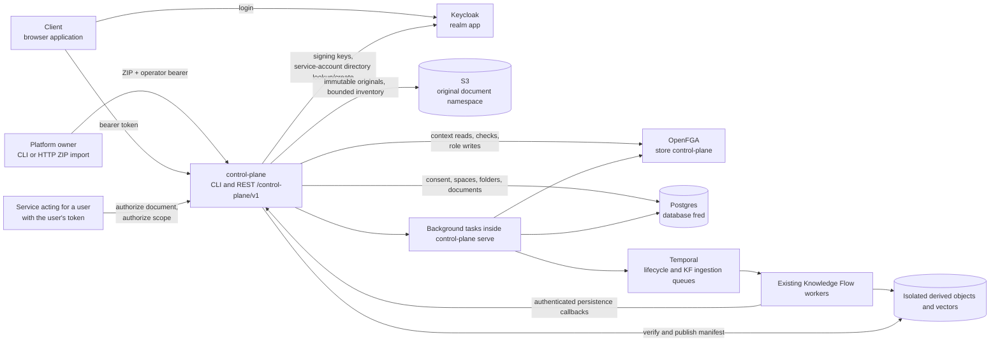

| Partner | What control-plane uses | Contract |
| --- | --- | --- |
| Keycloak | Access tokens, signing keys (JWKS), user lookup/creation with its own service account | [security](03-security.md), Authentication |
| OpenFGA | `check`, `write`, `read` on its own store | [model and contracts](A2-manager-contracts.md), OpenFGA model |
| Postgres | Its tables in the `fred` database | [model and contracts](A2-manager-contracts.md), Schema |
| S3 | Conditional Put, verified Get, Delete and paginated List | [original storage](#original-storage) |
| Temporal | Manager-owned lifecycle and delivery of existing KF ProcessPush | [lifecycle](#space-deletion-lifecycle) |
| Clients | Public configuration and health; authenticated onboarding and business routes | [HTTP surface](A2-manager-contracts.md#control-plane-http-surface) and [authentication](A6-security.md#authentication) |
| Services acting for a user | `/authorize/document`, `/authorize/scope` | [runtime reference](A1-manager-runtime.md), Search scope |

## control-plane

A library crate (`src/lib.rs`) with a thin binary (`src/main.rs`): integration tests
drive the library against real Postgres and OpenFGA.

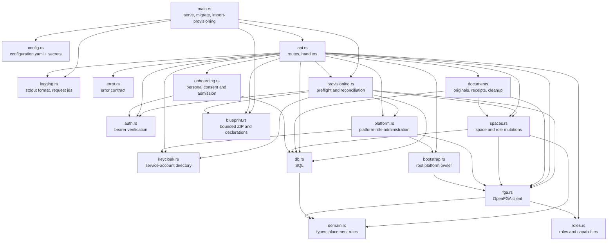

| Module | Owns | Rule it enforces |
| --- | --- | --- |
| `api` | HTTP surface, context validation and OpenFGA permission checks | handlers stay thin; mutations live in `spaces` and `platform` |
| `auth` | `CurrentUser` extractor, JWKS cache | [security](03-security.md) |
| `spaces` | immutable SQL placement, space/role mutations, memberships, search scope, folder creation and local write authorization | platform/organization locks and atomic guards (I4, I5, I23) |
| `onboarding` | versioned consent, admitted/own-human extractors | acceptance is independent of roles and memberships (I19) |
| `bootstrap` | the one-time root grant | two steps under the bootstrap lock (I9) |
| `domain` | `Space`, `Folder`, `Document`, roles, parent rules | pure functions, unit-tested (I1, I7) |
| `db` | content and space SQL | placement columns written by inserts only (I2) |
| `processing` | durable acceptance, dispatch, stage fences, manifests, previews and cleanup | current actor authority and isolated publication (I26) |
| `documents` | bounded transfers, upload journal, quotas, reads and autonomous object cleanup | verified publication and preserved originals (I25) |
| `fga` | pinned store/model, check, role and link reads, guarded write; empty-store publication | roles and permission evaluation stay in OpenFGA; SQL stores placement and the store/model binding |
| `logging` | output format, request span, completion event | [logging](A3-manager-operations.md#logging) (I11, I13) |
| `error` | status codes, `{"code": ..., "detail": ...}` bodies | [errors](A3-manager-operations.md#errors) |

`roles` defines typed platform roles and scoped capabilities. `platform` serializes
role mutations with bootstrap. `keycloak` owns one shared HTTP client and a synchronized
service-token cache. `api::routes` serves every HTTP route with the shared `AppState`,
without prefix or outer layers; `api::router` adds the base URL, CORS and request
logging. The HTTP API has no Temporal client.

The same `utoipa-axum` registrations build the runtime routers and OpenAPI paths.
`utoipa::ToSchema` derives request/response schemas from the Rust DTOs. The binary's
`generate-openapi` command runs before configuration and logging initialization;
it emits the canonical `/control-plane/v1` contract without constructing service state.
The frontend generates `controlPlaneOpenApi.ts` through its standard RTK codegen
tool and registers the slice in the shared Redux store. A handwritten enhancement
encodes provisioning and original-upload binary arguments as FormData; paths, methods and
response types remain generated.
The bootstrap, personal-space and import
endpoints disable automatic retry on 401 because expiry can follow committed
effects; the shared base query still refreshes before each explicit attempt.

`blueprint::Bundle` validates the bounded ZIP and normalizes declarations without exposing credentials
through Debug or serialization. HTTP and CLI parse on a blocking worker without
filesystem extraction. `Importer` performs read-only preflight, per-identity
mutations, then additive space/role reconciliation. The binary connects without SQL
migration or FGA model synchronization, and does not initialize Temporal for import.

## Frontend provisioning

`ProvisioningPage` consumes the generated import mutation through its FormData
adapter. `useManagerPlatformAdmin` shares the manager `/me` RTK query between
the existing navigation and page guard. It does not infer manager authority from
control-plane roles. The page uses the shared `PageHeader`, `FileDropzone` and
`Button` components and the mutation's pending, error and completed-report state.
`App`, the existing router, `MainLayout` and `Sidebar` compose this journey.
`GcuGuard` reads manager onboarding and gates `BootstrapGuard` and admitted routes;
the same layout keeps the account menu available before admission without protected
queries. For ordinary users, the existing Home widgets, routes, sidebar modes and
styles remain mounted.
Home navigation consumes manager `/me/spaces` for team names/roles and personal
opening, preserving the existing search/sort presentation. Organization data appears
only in the profile. Selection opens the usual `/team/<UUID>/agents` destination.
There is no synthetic Python team or permission mapping. Non-migrated service
consumers keep their original calls, including task polling and announcements;
service failure does not remove routes. Theme presentation uses startup configuration.

## Frontend organization administration

`ManagerArea`, after consent and bootstrap, resolves current `/me` authority.
Platform owners enter `/admin/organizations`; business URLs redirect there even
when the person also has organization/team roles. Organizations and Provisioning
share the existing administration navigation. The boundary permits the same
standalone profile/legal/release routes, skips business announcements/task/charter
consumers, and disables Python avatar/patch-history enrichment in the account menu.
Ordinary users retain the original business subtree. Normal background authority
refresh preserves mounted forms; a failed request remains blocked during retry,
until a successful response replaces it. Focus revalidates authority.

`OrganizationsPage` reuses `AdminTeamsPage` layout styles and the shared table,
header, input and button components. Its generated registry query distinguishes
loading, empty and failed responses without displaying stale rows. Cursor history
provides Previous/Next without a fabricated total. Creation accepts a name and exact
existing owner/admin usernames, prevents concurrent submissions, reports errors
without replay, ignores completion after unmount and refreshes the first page on success.

## Frontend account pages

The admitted sidebar enables Profile in the existing `UserProfile` menu. The
router mounts `UserSettingsPage`, accepted `GcuPageContent`, `GdprPage` and
`ReleaseNotesPage` under `GcuGuard` and `BootstrapGuard`. These are the shared
pages and controls, outside the sidebar and with no second manager renderer. The profile reads identity
from the browser session and effective platform roles from the generated `/me`
query shared with navigation, and its organization from `/me/spaces`. It hides cached roles during refresh, on error or
when the response belongs to another authenticated subject. With authentication
disabled, it matches manager's fixed mock subject `admin`.

Display preferences use the application context and i18n after startup loads
`GET /users/me/preferences` through the generated Rust client.
`user_preferences.rs` serves GET/PATCH with `OwnUser` before consent, deriving
the subject from verified identity and refusing service accounts and asserted
query subjects. Table `users_preferences` stores one row per subject;
the optional UUID identity snapshot cannot own it. An atomic SQL upsert changes
only supplied columns; explicit null restores defaults. Theme IDs stay opaque
and syntax-validated. Missing rows/read failures use defaults; old personal
browser values never initialize or populate the database. Pane widths and trace
expansion remain browser-local. The focused integration cases live in
`tests/support/user_preferences.rs`.
Legal content and static release notes use their existing markdown loaders.
The consultation route mounts the accepted content without the acceptance
mutation wrapper. The profile renders initials and mounts no Python bootstrap
or avatar subscription.

## Frontend resource browsing

The existing Resources components consume bounded manager directory pages and
current write decisions through the generated client. Their presentation remains
shared with the separate knowledge-base consumer, whose service contract is
unchanged. Manager folder identities never cross into knowledge-flow tag requests.
The actor-scoped import controller retains active files across navigation and
resolves durable receipts before retry. Account changes clear held files and
partition generated-client caches; same-account token refresh preserves identity.
The individual download helper handles the binary response with one bounded Blob.
The [content chapter](05-documents.md) defines this boundary and lifecycle.

## Content access

Manager resolves the caller's unique organization, verifies the target space belongs
to it, then asks OpenFGA for permission on that space. The same rule covers a
document, its metadata and a folder page. Ambiguous attachment fails with 409.
Organization resolution exhausts direct-role pages, then selects distinct SQL
organization IDs for their spaces in one query, including retired rows. Unknown
SQL IDs confer no attachment. The same resolver validates memberships before
filtering retired spaces from display. Target placement is read from SQL; no FGA
placement Read is issued for context or target loading.

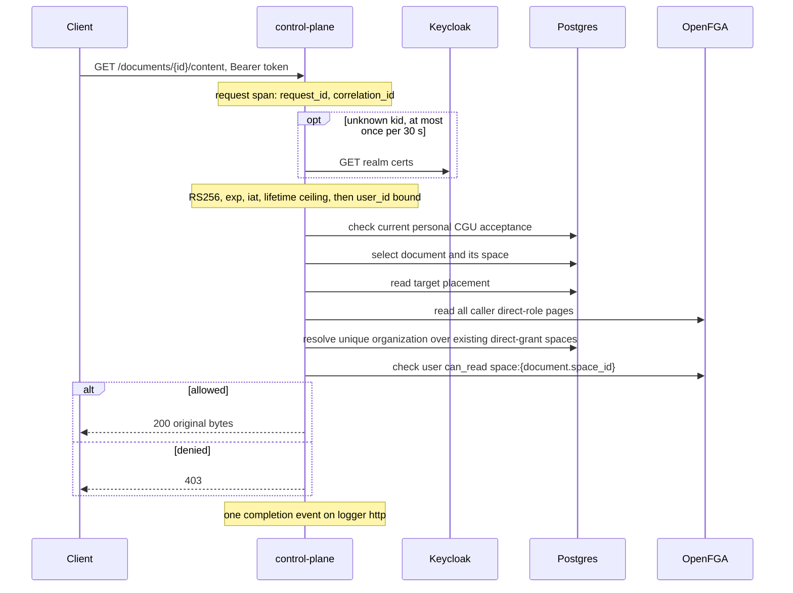

## Search scope

A service acting for a user calls with that user's own token. The scope is the space
and its ancestors, organization first, never its descendants (I7): from a team, a
project's content is out of scope. A personal space's scope is itself. An optional
`levels` list keeps only the organization, team or project levels it names; it never
adds a space. The caller filters indexed content with `space_id` in the returned ids,
and narrows to a folder with a `folder_path` prefix.

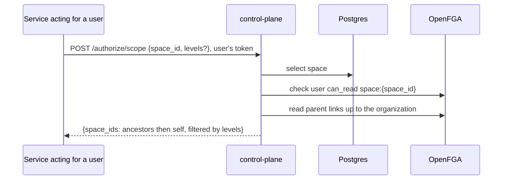

## Memberships

`GET /me/spaces` lists every space where the caller holds a direct role or one
descending from an ancestor, with its path and managing `organization_id`. `roles` holds the effective roles and
`inherited_roles` those held only through an ancestor. Manager reads the caller's
direct roles, each directly granted space's `parent` (or a personal space's
`organization`) link, then the children of each organization and team where the
caller holds a descending role. It does not use `ListObjects`, whose server-side
result limit truncates silently. The computed roles serve display only; every
decision remains a Check (I20).

## Role and space mutations

`grant` and `revoke` take the platform lock, then the organization lock, and capture
both guard revisions before context and permission checks (I4, I5, I23).
`create_space` and `create_personal_space` retain the organization lock and guard:
the required existing parent membership already binds their nominated person. The organization comes from the space's immutable SQL placement,
read before locking. SQL locks order live callers; OpenFGA guard consumption
rejects stale remote writes that outlive their caller or transaction.

Creation writes the new space's `parent` link (or a personal space's `organization`
link) in the same Write as its initial grants, after checking that no committed
sibling has the same name, or that the owner has no personal space in that
organization. Children whose SQL row never committed are ignored.

`POST /me/personal-space` captures the organization guard before context and
permission reads under its SQL lock. It requires unique context and organization
read, exhausts organization-link pages and joins committed personal rows. An
existing caller-owned row requires current personal read and returns 200 without
SQL/FGA writes. An absent row additionally requires `can_create_personal_space`,
then guarded creation returns 201. Lost read never causes role repair or replacement.
The UI waits for membership refresh before selection, ignores late completion after
account changes and requires explicit retry on error.

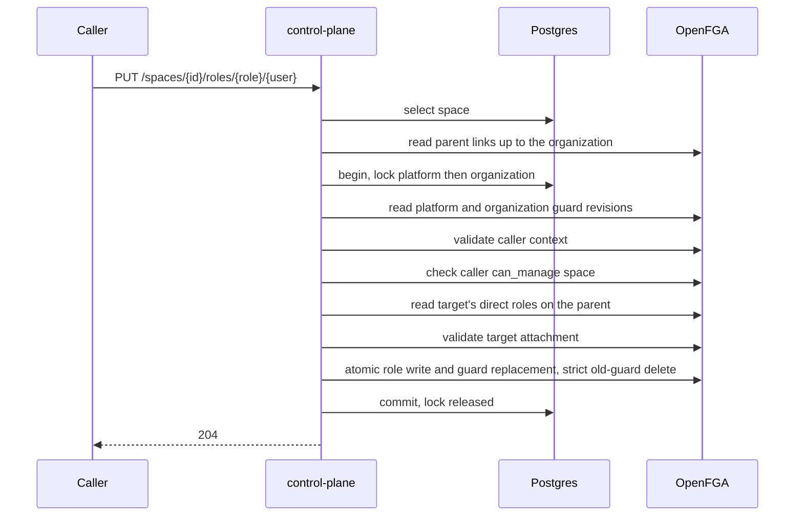

Revocation also reads the target's roles and the space's children under the lock
(and, for an organization, the personal spaces it manages), and refuses with 409
when the target would keep a role there without direct content here, or retain
personal creation eligibility without organization content membership. Removing the last admin of a non-personal space is refused with 409 (I14).
Removing a role never grants a replacement content role. A personal space is managed from its organization: an organization admin may
revoke its owner's roles, nobody may grant any (I6).

## Platform owner bootstrap

Two proofs: the caller's verified bearer and the deploy-time secret
(`app.bootstrap_token_env_var`, compared in constant time). Two transactions under one
advisory lock (I9).

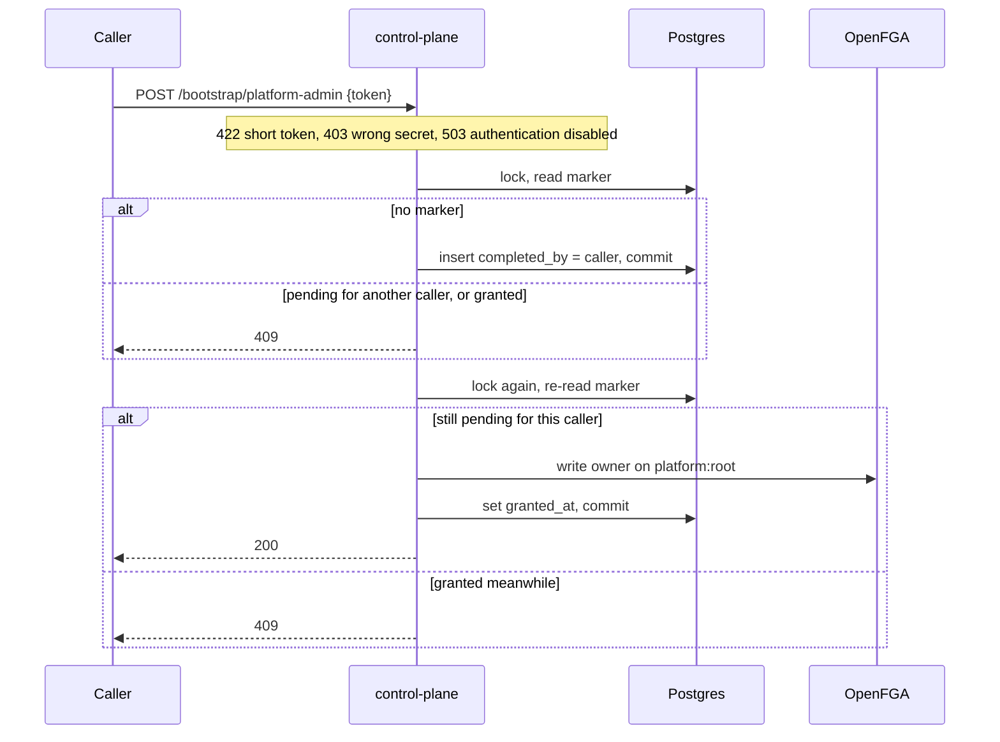

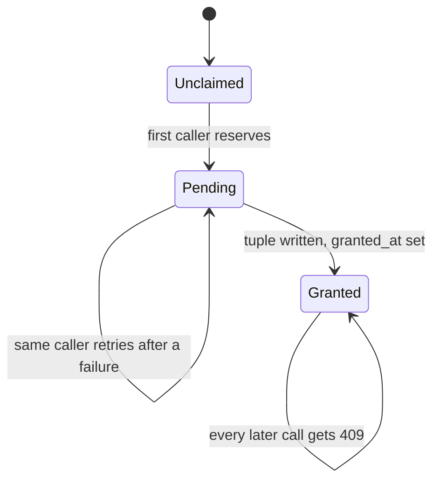

## Document metadata and folder mutations

The API reads published metadata, answers authorization probes and creates originals
through the folder upload route below. Metadata and binary reads check the owning
space's current authority. Document IDs are not Knowledge Flow identifiers.

Resources reads one mixed `/spaces/{id}/entries` directory. Upload conflict recovery
uses that same paginated endpoint and matches folder names exactly. Folder mutations,
uploads and processing starts invalidate its client cache; window focus refreshes it.
Only pages with pending/running processing refresh on a three-second cadence while
visible. The server bounds literal substring search to 255 characters and uses
separate root/child predicates for both count and page within one SQL snapshot.

Folder rename/delete locate the immutable owning space, acquire its organization
lock and authorize, then reread the folder through the held transaction (I22).
A deletion that commits while a caller waits causes 404 without a fabricated success.
The lock remains held through SQL commit; the extra read adds no OpenFGA call.

## Original storage

`documents::Storage` shares one configured S3 client and bounded transfer permits.
The SQL `document_upload` journal records attempts; `document` contains published
originals only. `document_storage` records one namespace binding, inventory cursor
and maintenance lease, independently of individual request retention.

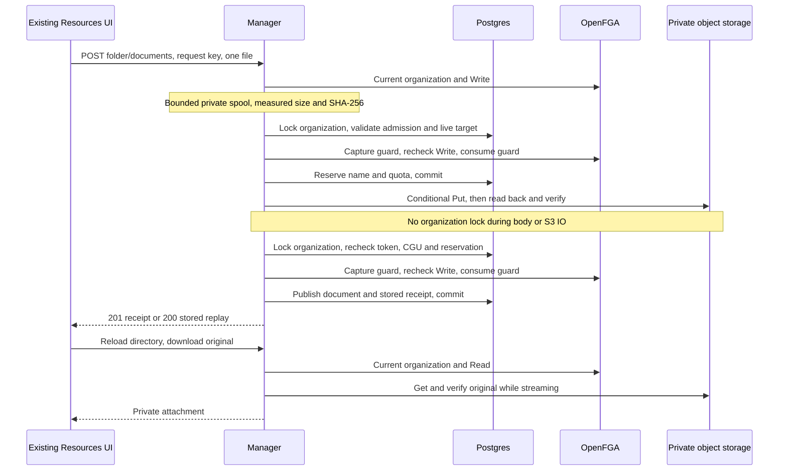

Publication failure leaves cleanup work in SQL. API reconciliation claims a bounded
batch, expires abandoned reservations under their organization locks and deletes
failed objects outside locks. A persisted prefix scan filters input keys, rechecks
SQL and requires the matching `fred-installation` metadata before deleting
unreferenced originals, including late writes after a previous cleanup. Outputs
and foreign objects are preserved; an inaccessible original defers its own cleanup.
Competing
replicas share the lease; a contended organization is deferred without starving
other candidates. The loop neither publishes documents nor calls processing services.

## Platform administration and self checks

`GET /me` returns effective platform roles, including the roles implied by platform
owner. `GET /users/platform-roles` returns direct grants only, to platform owners.
`PUT` and `DELETE /users/{user}/platform-roles/{role}` acquire the bootstrap/platform
lock and recheck the caller's platform-owner permission. Any platform owner grants or
revokes platform owners; revoking the last one is refused with 409. Granting requires
a Keycloak subject that exists in the configured directory; revoking a stale direct
grant does not require the identity to still exist (I15).

Platform roles use canonical names `platform_owner`, `platform_observer`,
`feature_manager` and `prompt_editor`; no other name is accepted.
Deleting an absent direct grant returns 404, even when the role is effective through owner.

An organization's `organization_owner` is granted and revoked by platform owners, under the
platform lock and guard as well as the organization's; owner on a team or project is
refused with 409, as is revoking an organization's last owner (I14). Before granting,
manager verifies the subject with its Keycloak service account in the same realm
and requires raw subject mapping. Missing or unavailable identity verification
prevents the write; revocation does not depend on the directory. The
organization's admins are granted by its owners or admins; every other space role by
the space's admins (I21).

`POST /authorize/platform` accepts `{ "permission": "list_all_teams" }`;
`POST /authorize/space` accepts `{ "space_id": "<uuid>", "permission": "run_evaluations" }`.
Both return `{ "allowed": true|false }` for the authenticated caller only. The typed
capabilities are defined in `roles.rs` and the model in [model and contracts](A2-manager-contracts.md). Space checks first
resolve the space, returning 404 for an unknown id.

`GET /admin/teams` requires `can_list_all_teams` and returns at most 100 non-personal
team metadata records ordered by UUID, with placement from the same SQL query.
`?after=<uuid>` continues after the last id; it confers no content access.

`GET /admin/organizations` requires platform ownership and selects active organization
rows with a UUID keyset and 101-row SQL lookahead. It returns at most 100 `items` and
an optional `next_cursor`, without FGA placement reads or directory enumeration.
`POST /admin/organizations` requires the same authority and personal admission. It
resolves exact existing owner/admin usernames in the configured matching Keycloak
realm before locking SQL. Under the platform lock it checks name availability,
initializes the new organization guard, captures platform/organization guards,
rechecks caller ownership and validates each distinct nominee's attachment. The
existing persistence path inserts the row, publishes only Owner/Admin direct roles
with both guards, audits and commits. Failed publication leaves no committed row;
orphan tuples on an uncommitted UUID confer no effective attachment or access.
`GET /admin/organizations/{id}` and `PATCH /admin/organizations/{id}` require the same
authority and answer the organization with its direct owners and admins as user
summaries, read with two holder Reads on that organization only; the registry stays
free of roster reads. `PATCH` takes any of `name`, `owner_username` and
`admin_username`, validated and resolved as for creation. Under the platform and
organization locks it rechecks caller ownership and retirement, keeps names unique
and makes each named account the sole direct holder of its role, checking the new
holder's attachment. The rename, grants and revocations commit together after one
guarded Write; a lost acknowledgment can leave the roles applied without the rename,
and a retry converges. A missing or non-organization id answers 404.

Team creation requires management of the parent organization, project creation
management of the parent team. The nominated admin must hold a direct content
role on the parent, and no sibling may have the same name. The caller receives no
implicit role.

## Authenticated provisioning import

`control-plane import-provisioning <bundle.zip> --token-file <path>` verifies the
operator bearer, connects to SQL without migrating and verifies migration
versions/checksums. It loads the published FGA store/model and checks platform owner.
Multipart `POST /import-export/import` checks the authenticated caller's platform
owner authority before reading exactly one `file` field. Both parse the same ZIP
on a blocking worker and invoke `Importer` with the authenticated operator. A new
organization requires a declared owner and admin. The bearer is verified once, at
admission; every later boundary rechecks `platform_owner` in OpenFGA. Revoking that
role stops the import at its next boundary; bearer expiry after admission does not.

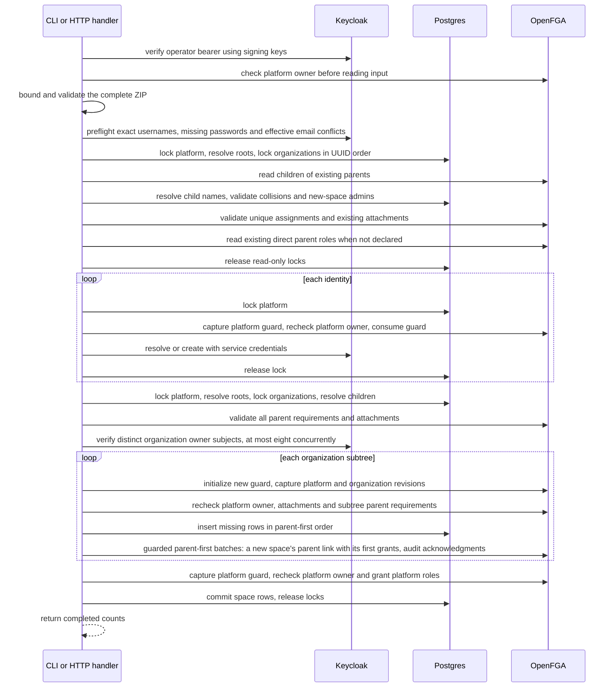

Predictable bundle, passwordless-identity, email-conflict, missing new-space-admin and parent-access
and conflicting-attachment errors fail whole-bundle preflight before provisioning writes (I18). Directory
traversal holds no mutation lock. Child names are read only after acquiring all
organization locks. Reconciliation retains those locks and the platform lock through
SQL commit. Meanwhile, role and platform mutations anywhere on the platform, and
folder, team or project writes in the declared organizations, wait at most five
seconds for their lock and then answer 503. It captures revisions before rechecking
platform ownership and parent access,
then carries acknowledged revisions through batches of at most 96 link and space-role
tuples plus four guard operations (I4, I5). A subtree with no role writes consumes its guard
explicitly. Organization owners are checked once per distinct subject before subtree
publication, in batches of at most eight concurrent directory lookups. Platform
grants use the platform guard and recheck identity existence.

Organizations resolve by root name, teams by organization/name, projects by team/name,
among the committed children linked to the parent in OpenFGA. Personal spaces are not
children and take no part in name resolution. Existing committed IDs are reused;
incompatible-kind collisions are refused. Bundle references only identify declarations within that input.
Exact username lookup is paginated and rejects ambiguous/inexact replies; a creation
conflict triggers a fresh lookup. Existing profiles and credentials are preserved.

Reconciliation is additive (I17): undeclared roles remain and requested grants are
repaired. Renaming a declaration identifies a different space. Identities and
acknowledged FGA grants can survive a failed SQL transaction; there is no distributed
rollback. New rows commit after their initial grants, and rolled-back UUIDs are never
reused. Tuples already written for a rolled-back space remain in OpenFGA and nothing
collects them: they grant nothing, because context and child resolution ignore IDs
absent from SQL, but they add entries to the subjects' role Reads and the parent's
child Reads. The CLI exits nonzero on failure; HTTP returns safe phase/count information.
HTTP 200 means reconciliation completes, not merely that an upload is accepted.

Local folder mutations capture the organization guard, authorize, consume
the guard and commit SQL under the same organization lock. Placement reads use the
held SQL connection. No workflow is dispatched by the API.

## Design rationale

| Id | Decision | Because | Consequence |
| --- | --- | --- | --- |
| D1 | SQL records immutable placement at creation; matching OpenFGA links remain the model's authority for inherited permissions. Editor, admin and analyst descend, member does not. | OpenFGA decides permissions; SQL placement avoids per-role-space link Reads without storing grants. | One Check per permission decision, evaluated through at most two parents; context uses direct-role pages and one SQL query; structural enumeration still reads FGA links (I20). Chapter 09 records complete request budgets. |
| D2 | Organization > team > project; a personal space is a one-member team without parent. | One model for every container; a personal space stays private to its owner. | Personal spaces inherit nothing and have their own management rule (I6). |
| D3 | Folders carry no rights. | Rights per folder bring back traversal and per-item lists. | Access granularity is the space. |
| D4 | Space and content placement are immutable. | SQL constraints and OpenFGA links preserve ownership. | Folder renames preserve placement; the API exposes no move operation. |
| D5 | A space's search scope is its ancestors and itself; levels only narrow it. | Content of a project stays out of its team's scope. | A project reads its team's and organization's content unless the caller removes those levels. |
| D6 | Admin roles grant no content access. | Governing is not reading. | An admin who reads also holds a content role. |
| D7 | Organization mutations hold a Postgres advisory lock and consume an OpenFGA guard captured before checks. | SQL locks alone cannot stop a remote write after cancellation. | Live callers serialize; stale remote writes fail atomically. |
| D8 | Root bootstrap in two steps under one lock: reservation committed, then grant and completion. | No double promotion, no reopening. | A failed grant can only be finished by its claimant. |
| D9 | Configuration, secrets and log output follow Fred's service conventions. | One way to operate every Fred service. | `sourceLocation.function` holds the module path. |
| D10 | Shared infrastructure, own OpenFGA store. | No dedicated infrastructure to run. | Table names are unique in `fred`; `control-plane` is the logical store name; SQL pins its active store/model IDs. |
| D11 | Deployed with fred's chart as a separate release. | One chart for every Fred service. | The release references the chart without its `values.schema.json` ([operations reference](A3-manager-operations.md)). |
| D12 | Owner names a limited institutional responsibility; admin, editor, analyst and member are business roles at organization, team and project scope. Admin and content roles remain orthogonal. | Institutional operations and business management need distinct vocabulary. | Current owner permissions, cumulative-role behavior and mandate gaps are recorded in the [permission comparison](A11-roles.md#responsibility-boundaries-and-current-enforcement); this wording does not change the model. |
| D13 | Platform mutations, all direct space-role changes, organization creation and import share the platform lock/guard, before organization locks. | Different organization locks cannot prevent competing person assignments; stale remote writes also need a shared fence. | Attachments remain unique, at the cost of serializing role mutations across unrelated organizations. |
| D14 | Directory operations use a dedicated service client and raw Keycloak subjects in the same realm as callers. | Caller tokens do not carry directory administration privileges. | Grants validate identity existence; revocation tolerates deleted identities. |
| D15 | Import uses authenticated, read-only initialization and a distinct Keycloak service identity. | Service-client credentials must not substitute for Fred operator authority. | Bootstrap and compatible schema/model initialization precede import; Temporal is not involved. |
| D16 | Provisioning is additive and replayable, with identity phases separate from the space transaction. | Keycloak, SQL and OpenFGA do not share a transaction. | Partial effects remain; replay preserves committed IDs and repairs grants. Rolled-back space IDs are not reused. |
| D17 | Strict guard deletion and role changes share one OpenFGA Write. | A consumed revision rejects stale decisions without copying the role set. | One guard Read and two additional tuple operations per guarded scope; conflicting attempts reauthorize on replay. |
| D18 | SQL pins store/model; a different published model is refused. | The binary owns exactly one schema and one model. | Startup never upgrades a model; ordinary loads stay read-only. |
| D19 | One version-2 ZIP with explicit organizations, teams, projects and direct roles serves CLI and HTTP. | Reconciliation needs unambiguous parent scope and complete preflight. | Legacy formats are explicitly unsupported; bundle-local references do not add persistent identity or imply content grants. |
| D20 | The unique organization is derived from canonical direct roles and immutable SQL placement, including retired spaces. Workspace discovery uses that server-validated context. | Avoid a second SQL membership authority or a tenant choice controlled by URL/claims. | Zero attachments grant no business access; ambiguous attachments fail closed; platform governance remains independent. |
| D21 | Personal creation requires explicit organization eligibility; opening reuses current authority. | Some people have no personal workspace; opening must not undo revocations. | First explicit open creates, repeats write nothing, and organization content remains a prerequisite. |
| D22 | Processing admission writes the delivery intent in its transaction and notifies the dispatcher on commit; a periodic poll remains the safety net. The API holds no Temporal client. | SQL and Temporal share no transaction; the commit, not a timer, should start work; API replicas need no Temporal connection or credentials. | Delivery starts on commit; a missed notification costs at most `poll_seconds`; notifying commits serialize briefly; the listener holds one pool connection; the mechanism is unchanged whether the dispatcher runs inside `serve` or in a separate process. |

## Folder mutations from Resources

Creation, rename and deletion use the same organization write boundary. Placement
lookup precedes the transaction; organization lock, guard capture, current context,
write Check and guard fence precede the local mutation. `authorized_write` uses
`pg_try_advisory_xact_lock` in a fresh transaction per attempt. A busy attempt rolls
back before a 50 ms sleep without a connection; a five-second deadline bounds
acquisition, including connection checkout after placement lookup. Expiry returns
503 with `dependency_unavailable`, as SQL lock timeouts do. The successful
transaction retains its lock through commit. The same acquisition boundary applies
to upload reservation/publication, processing admission and final indexing
publication. Role and lifecycle lock acquisition remains blocking. Existing folders
are reread under that lock. Recursive deletion is one atomic operation and fails if a document
or pending upload references any included folder. No per-folder authorization or Temporal dispatch
occurs. The original dialogs prevent duplicate submission and discard completion
after navigation; pending deletions of the same UUID share one request.

## Space deletion lifecycle

`lifecycle::policy` validates configuration and resolves retention without effects.
`lifecycle::store` accepts authenticated requests and owns durable receipts.
`lifecycle::cleanup` executes one bounded SQL/OpenFGA batch; `lifecycle::worker`
registers the deterministic `SpaceDeletionSweep` workflow and its activities.
Lifecycle tasks share the initialized application state of `control-plane serve`;
they do not apply SQL migrations.

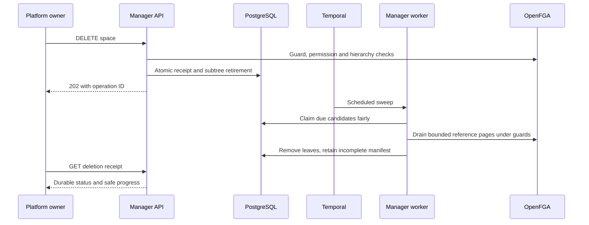

Acceptance streams hierarchy pages into one SQL transaction under platform then
organization locks. Cleanup uses separate bounded transactions, with up to 1000
folder leaves or 96 payload tuple deletes plus four guard operations per batch.
Each candidate receives at most one batch per activity attempt, with three attempts
and 60-second start-to-close / 240-second schedule-to-close limits. A separate
activity records exhausted attempts; failure does not abort other candidates.
Each activity also observes cancellation and has a 50-second local deadline.
Worker PostgreSQL statements are bounded at 45 seconds and lock waits at 5 seconds;
cleanup sets those limits before taking its transaction locks. SIGTERM/SIGINT starts
a two-second graceful period, then cancels remaining activity futures. Server-side
SQL limits bound outstanding statements even when their Rust future is dropped.
Candidate selection advances its visit time so a failing candidate cannot monopolize
a limited sweep.

FGA deletion rereads the first page after every mutation. SQL identifiers survive
ambiguous acknowledgments. An organization guard is removed last, fenced by the
platform guard; a failed final SQL commit is recoverable without recreating that
guard. Workflow history carries operation IDs, not credentials or canonical grants.

## Document processing

`processing::Processing` shares manager SQL/FGA and original storage, with its own
strict workload authenticator and derived S3 client. `document_processing` is both
the attempt journal and delivery outbox; it has a different lifetime from upload
receipts and retains generations, policy, result counts and dispatch leases.
`document_storage` binds the derived namespace to the installation.

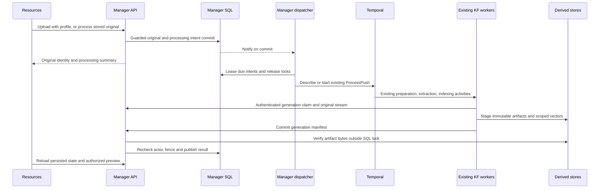

The Python export supplies the existing workflow JSON schema and profile policy.
Rust validates and serializes that contract; workflow/activity names, argument
shapes and registrations remain unchanged. Activity adapters select separate
persistence only for manager sources. Queue routing and extraction supervision
remain in the existing worker. The supervised background tasks establish their Temporal connections independently of HTTP serving.
